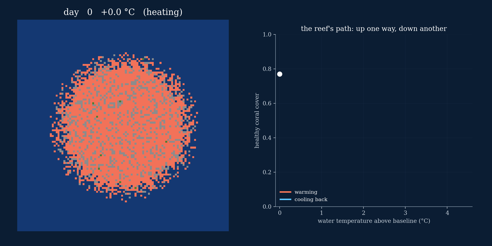
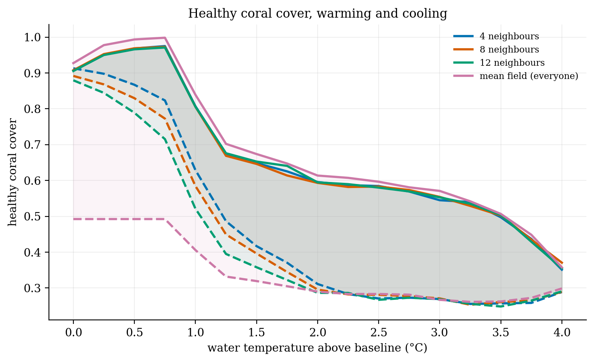
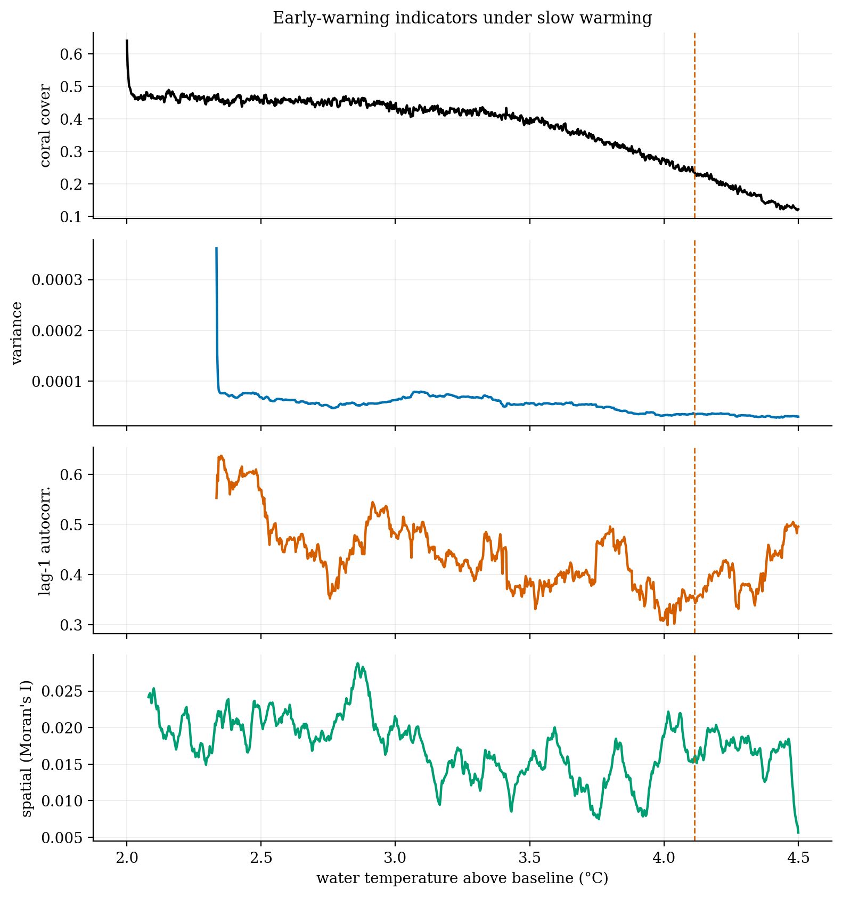
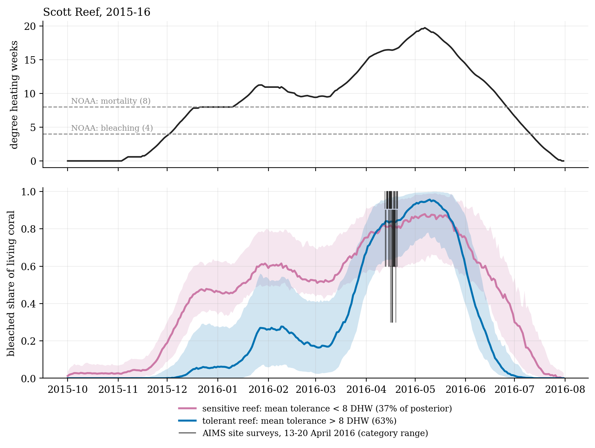
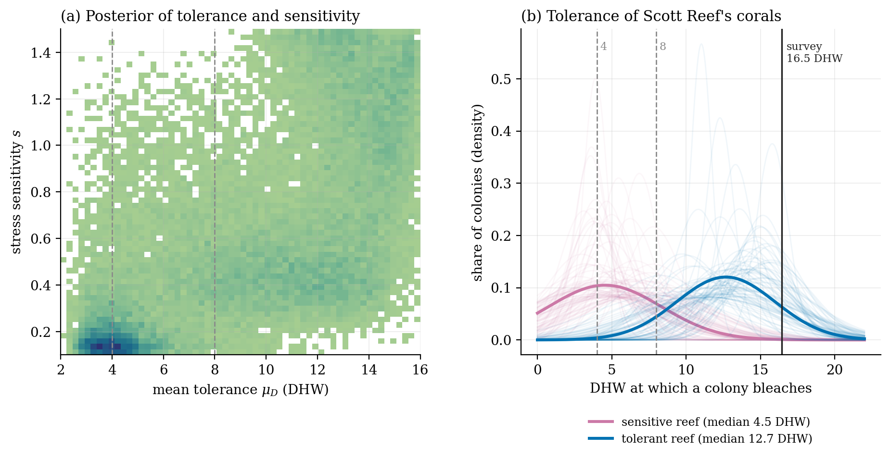
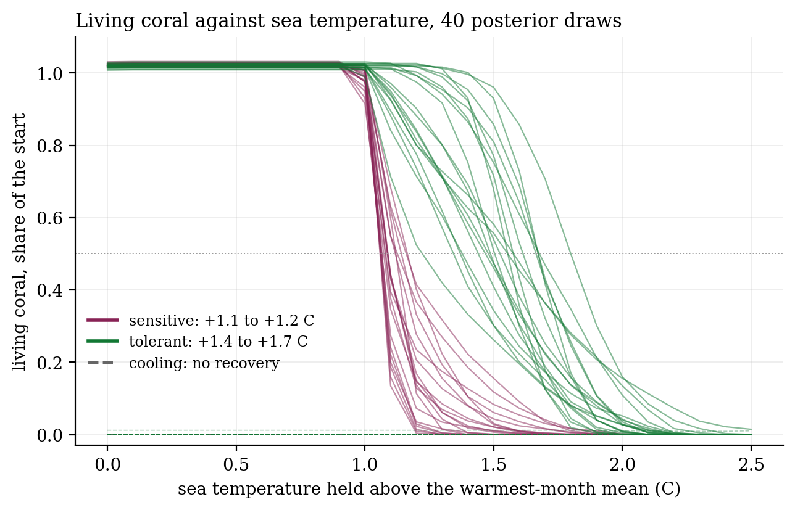

# Coral reef tipping points



## Why I asked this

Numerical simulation was one of my favourite modules at Trinity, and one of the models we built there was the Potts model: a grid of cells, each in one of a few states, each pulled towards the state of its neighbours. I have always been interested in ecology, and in how ecosystems collapse, and the parallel between a lattice of spins and a reef of coral patches seemed too obvious to leave alone. A patch of coral is healthy, bleached, dead or overgrown, and what happens to it depends on the water temperature and on what is growing next to it.

The best-known reef models (Mumby, Hastings & Edwards 2007) are mean-field: every patch feels the average of the whole reef. From physics we know that mean-field models exaggerate how sudden and how permanent a change of state is, because they ignore the local survivors that can reseed their surroundings. The aims of this project were:

1. rebuild my undergraduate Potts model of a reef, fast enough to run thousands of times,
2. change how far the interactions reach, from four neighbours to the whole reef, and see whether the reef tips and stays tipped,
3. fit it to a real bleaching event, Scott Reef in Western Australia in 2016, and say how much heat its corals could take.

## The model

Our reef is a 60 × 60 lattice. Each cell *x* is in one of four states: healthy coral, bleached coral, bare rock or macroalgae (seaweed). Each day every cell may propose a change of state, and the change is accepted with the Metropolis rule:

```
P(accept)  =  min(1, exp(−β ΔE))
```

where ΔE is the change in the cell's energy and β sets how noisy the reef is. Strictly, this is a Potts-inspired stochastic cellular automaton with Metropolis-type acceptance rather than a Potts model in the Gibbs sense: all cells update at once, the proposals depend on each cell's stress, a little noise is added to ΔE, and death and colonisation are one-way steps, so detailed balance fails and there is no equilibrium distribution. The interaction-range runs below use the original energy in `coral_model.py` (degree heating days capped at 8, with recovery terms), and the Scott Reef fit uses the energy written out here (`coral_crw.py`). A lower energy is a more likely state. For a healthy patch the energy can be written as such:

```
E_H(x)  =  −J f_H(x)  −  ε_H  +  s · max(DHW(x) − D₅₀(x), 0)
```

Here f_H(x) is the share of the cell's neighbours that are healthy, J is the neighbour coupling, ε_H is the baseline preference for healthy coral, and the last term is heat stress. In our case the coupling is divided by the number of neighbours. This means a longer range changes the *reach* of the interaction and not its total strength. Otherwise "more neighbours" and "stronger coupling" could not be told apart.

Heat stress is measured the way NOAA Coral Reef Watch measures it (Skirving et al. 2020), in degree heating weeks (DHW): the heat above the warmest-month mean (MMM), accumulated over the last 12 weeks.

```
HS(t)   =  SST(t) − MMM
DHW(t)  =  (1/7) Σ_{last 84 days} HS,   counting only HS ≥ 1 °C
```

NOAA expects significant bleaching from about 4 DHW and mortality from about 8. This is the measure every bleaching survey is compared against, so we use it too. My first version used a home-made heat accumulator instead, which I replaced once I read how the field actually measures it.

We needed two more pieces before our reef could tip at all. In my original code coral could never die: its death rule needed heat stress above a cap that the stress could never reach. This meant bleached coral always recovered, and nothing could get stuck. I added mortality, and macroalgae that colonise dead coral and are cleared by grazing fish. Grazing is diluted as coral dies, since the same fish are spread over more seaweed. This is the same feedback Mumby et al. use to make real reefs bistable.

## How far the interactions reach

To look for a tipping point we warm the water slowly, hold it, then cool it back down, and track the coral cover. If our reef comes back along the same path, there is no tipping point. If it comes back along a different, lower path, the reef has hysteresis, ie. it got stuck.



We see the reef get stuck at every interaction range. Once heat kills enough coral, seaweed takes the space, and cooling the water does not bring the coral back. Our loop is about 60% wider when every cell feels the whole reef than when it feels its four nearest neighbours. This means the mean-field model does exaggerate collapse, as the physics suggested, and for the reason it suggested: with short-range coupling, surviving patches reseed the cells next to them.

I expected cleaner dynamics than this. We also found two negative results. How *fast* the water warms barely matters, but how hot it gets does. And none of the classic early-warning signals (rising variance and autocorrelation before a transition, Scheffer et al. 2009) fire before the collapse, because in our case the slide is gradual rather than sudden.



## Fitting it to a real reef

The first version was checked against a bleaching curve in `Coral temps.xlsx`. When I went back to it, I found the curve had been drawn by hand, and its temperatures do not match Scott Reef in 2016 (a correlation of 0.12 with NOAA's record). Those fits have been removed. This was a lesson in checking the data before the model. Reef data are hard to find, as most surveys are sparse, a few sites at a few dates, and say nothing about where on the reef each patch is.

Our target is now 65 site surveys by the Australian Institute of Marine Science (AIMS) at Scott Reef on 13–20 April 2016, from the Global Coral Bleaching Database (van Woesik & Kratochwill 2022). Each site reports bleaching as a category: 6 sites at 30–60%, 24 at 60–90% and 35 above 90%. The heat forcing is NOAA's daily DHW for the Scott–Ashmore station.

The other change came from the literature. Corals in one reef differ: the most and least heat-tolerant tenth of colonies differ by 4–5 DHW (Humanes et al. 2022). This is why we give each cell its own tolerance D₅₀(x) ~ N(μ_D, σ_D²), drawn once and smoothed so neighbouring colonies are alike. In physics terms the uniform field of the Potts model becomes a random field.

Fitting a lattice model is not easy, because there is no likelihood to write down, and we can only simulate it. I first tried tuning it with Optuna, and it was hard to get anything that behaved like an actual reef rather than collapsing completely. Instead I used simulation-based inference (Cranmer, Brehmer & Louppe 2020):

1. We simulate 8,000 reefs through the 2015–16 heat record, drawing four parameters from wide priors: mean tolerance μ_D (2–16 DHW), its spread σ_D, the stress sensitivity s and the noise β.
2. We "survey" each simulated reef exactly as AIMS did: 65 random sites on 16 April, binned into the same four categories.
3. We train a mixture density network (Bishop 1994, Papamakarios & Murray 2016) to map a survey to a distribution over the parameters, q(θ | survey) = Σ_k π_k 𝒩(θ; μ_k, diag σ_k²). I wrote it in NumPy with the gradients derived by hand, so as to not treat it as a black box.

## How I checked it

Before using the real survey, we check the inference on 800 simulated reefs it has never seen. For every parameter, the 90% credible interval contains the true value 90% of the time (89.5–90.4%). This means the uncertainty it reports can be trusted. The fitted model then predicts 0.5, 6.7, 20 and 37 sites in the four categories, against 0, 6, 24 and 35 observed.

## What the survey says, and what it can't

We see a bimodal posterior: two reefs fit the survey, a sensitive reef with mean tolerance 4.5 DHW (37% of the posterior), and a tolerant reef at 12.7 DHW with a sharper response to stress (63%). By mid-April both have bleached about 85% of their living coral. This is an identifiability problem. One snapshot, taken at 16.5 DHW, far beyond both thresholds, cannot separate how tolerant the corals are from how steeply they respond once past it.



The two reefs disagree earlier in the summer. By 1 February the sensitive reef has 59% of its coral bleached and the tolerant reef 26%. A single survey in February would decide between them, but the database has none for Scott Reef in 2016. They also disagree about dead coral. By 5 April the sensitive reef has lost about half of its living coral (16–66% across draws), while the tolerant one has lost none. AIMS's own update from Scott Reef on 5 April 2016 reported that "wide-spread mortality is already evident". That is a field report, not a survey statistic, so I have not refitted to it, but it leans towards the sensitive reef (`inference/check_mortality.py`).



## Where Scott Reef tips

With our fitted parameters we can now ask the tipping question again, with error bars. For 40 parameter sets from the posterior, 20 from each mode, we hold the water at a fixed temperature above the warmest-month mean for 120 days, step it up 0.1 °C at a time, then step it back down.



We see the sensitive reef tip at +1.1 to +1.2 °C (about 30.6–30.7 °C) and the tolerant reef at +1.4 to +1.7 °C. Neither comes back on cooling, in any draw. This is because our model has no coral larvae arriving from outside the lattice, so a reef that has died has nothing to regrow from. Real reefs do recover, slowly, from larvae carried in from other reefs, so the hysteresis here is an upper bound.

## What went wrong, and what I learned

The data were the hardest part of this project. Most of the time went on the reef collapsing totally and refusing to behave like a real one, and on finding out that the curve I had calibrated to was not data at all. The nearest-neighbour analogy also turned out to be weaker than I hoped. Corals do help their neighbours (shade, shelter, larvae settling nearby), but it is only loosely true, and the energies in the model are chosen rather than derived. The hysteresis results should be read as qualitative.

## What I'd do next

Our model needs far more data than one survey: repeated, spatial surveys of a reef through a whole season, so that a cellular automaton or Potts model could be tuned with machine learning rather than by hand. Adding larval supply from neighbouring reefs is the obvious missing biology. I would also like to work on the pure mathematics of these systems (when a lattice model has a sharp transition, and what sets its order) as well as the applied side.

## Code

`coral_model.py` (the fast Potts reef, about 9× faster than `Coral_Potts_Model_original.py`) · `coral_crw.py` (DHW forcing and random tolerances) · `run_tipping_crw.py` · `inference/` (`simulate_bank_crw.py`, `mdn.py`, `infer_crw.py`, `check_mortality.py`) · `coral_potts.ipynb` · `data/` · Python, NumPy, SciPy

## Credits

Reef model and grazing feedback: Mumby, Hastings & Edwards (2007), Nature 450:98. Heat stress: NOAA Coral Reef Watch daily 5 km product, Scott–Ashmore virtual station (Skirving et al. 2020, Remote Sensing 12(23):3856, [doi:10.3390/rs12233856](https://doi.org/10.3390/rs12233856)). Surveys: Global Coral Bleaching Database, NOAA NCEI accession 0228498 (van Woesik & Kratochwill 2022, Scientific Data 9:20, [doi:10.1038/s41597-022-01121-y](https://doi.org/10.1038/s41597-022-01121-y)), with Scott Reef surveys by the Australian Institute of Marine Science. Biology: Humanes et al. (2022), Proc. R. Soc. B 289:20220872; Ainsworth et al. (2016), Science 352:338. Early-warning signals: Scheffer et al. (2009), Nature 461:53. Inference: Cranmer, Brehmer & Louppe (2020), PNAS 117:30055; Papamakarios & Murray (2016), NeurIPS; Bishop (1994), mixture density networks.
