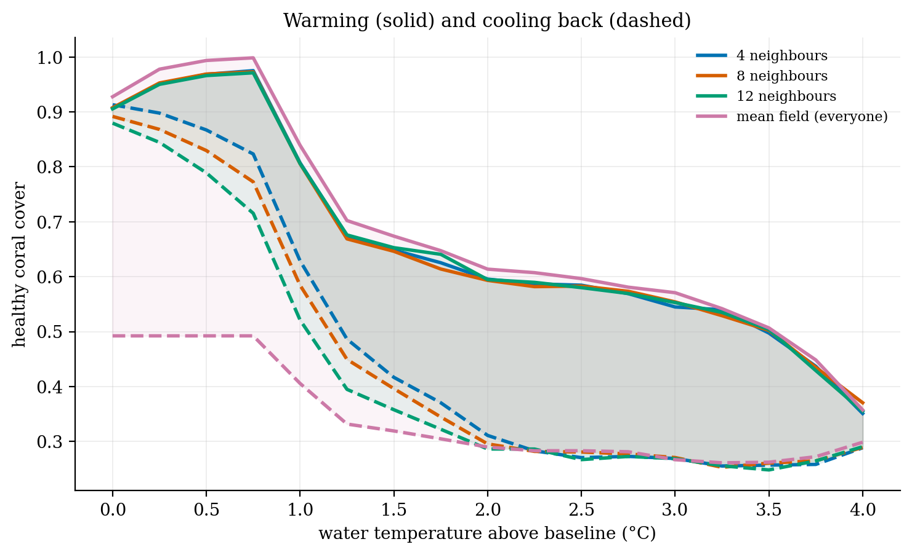
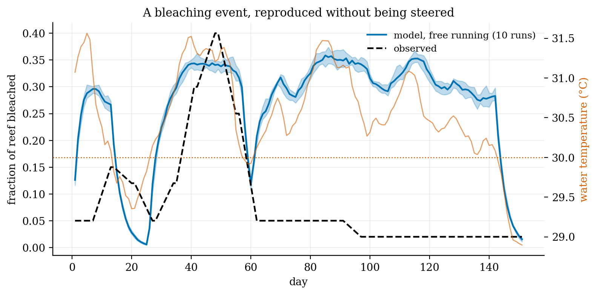
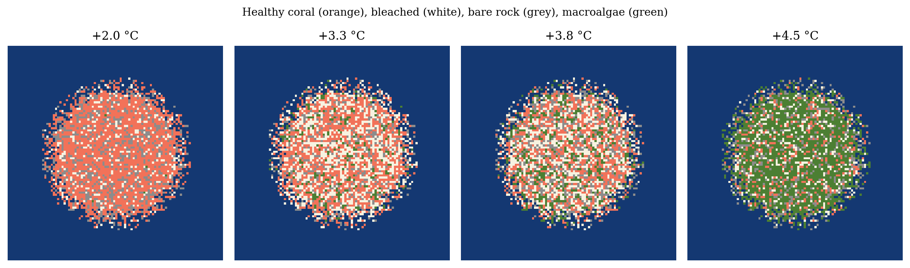
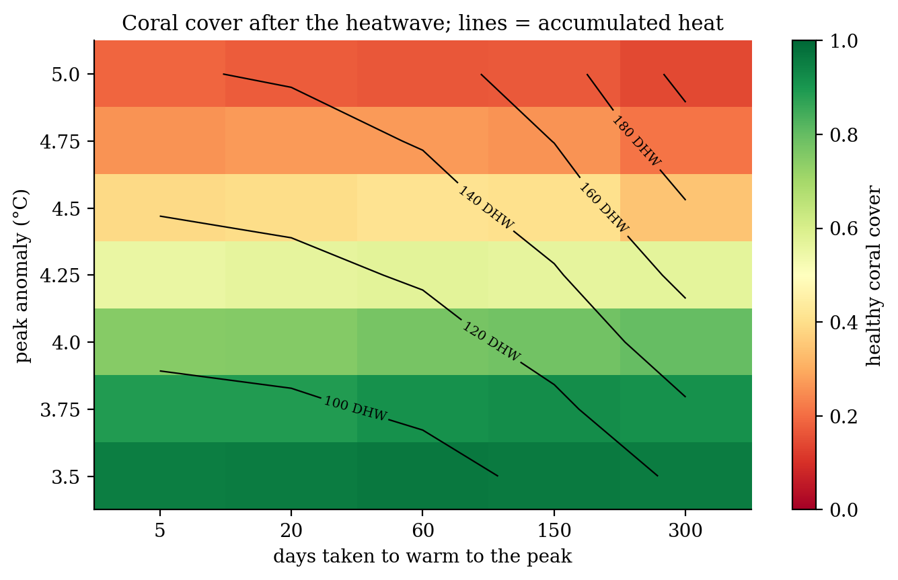
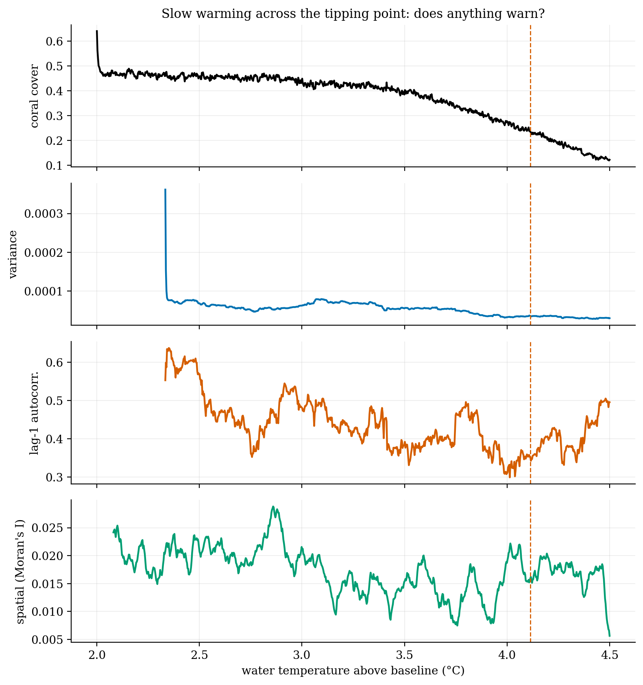
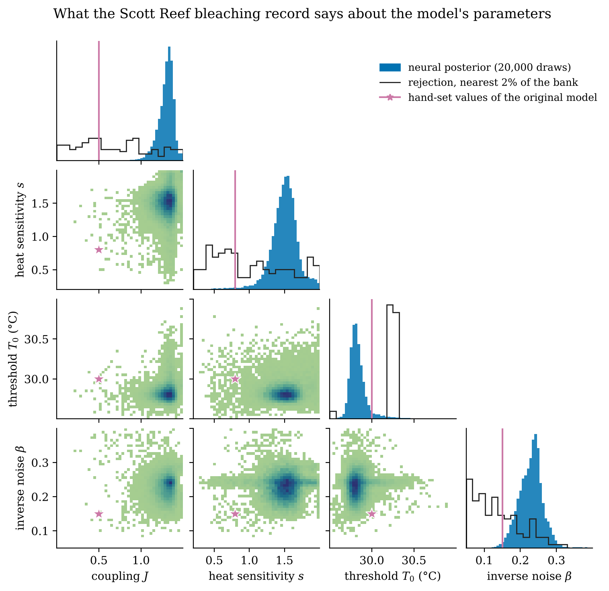
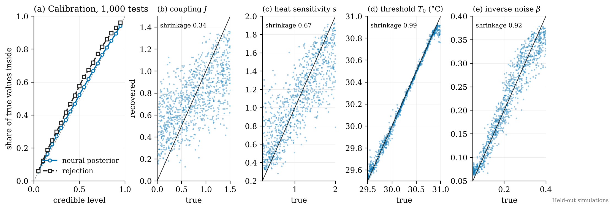
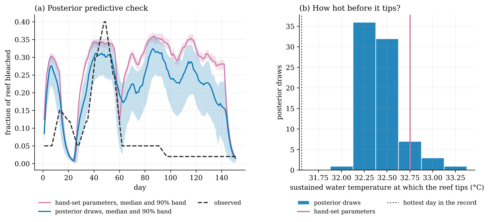

# When a reef can't come back

**A coral reef modelled like a magnet shows why the classic reef models make collapse look more sudden and more permanent than it is.**

A reef is a patchwork. Each patch is healthy coral, bleached coral, bare rock or seaweed, and each is pushed around by the water temperature and by its neighbours, the way spins in a magnet are. Physicists have a firm rule about systems like this: models in which every patch feels every other ("mean field") exaggerate how abrupt and how irreversible a change is. The best-known reef models are mean-field.

So I built the reef on a lattice, switched the reach of the interactions from four neighbours to the whole reef, and warmed and cooled the water.

- **It reproduces a real bleaching event** without being steered towards it: 37% of the reef bleached in the model, against 40% observed, and it recovered.
- **Reefs get stuck.** Once heat kills enough coral, seaweed takes the space, and cooling the water back doesn't bring the coral back.
- **Mean field gets stuck worst.** The loop is about 60% wider when every patch feels the whole reef than with four neighbours: local survivors reseed their surroundings.
- **Two honest negatives.** Warming *speed* barely matters; how hot it gets does. And none of the classic early-warning signals fire before collapse, because the slide is gradual.

| | |
|:-:|:-:|
|  |  |
|  |  |

## Tuning the parameters from data

The model above runs on parameters set by hand. This section asks what the bleaching record itself says about them, with error bars.

The Potts reef has no likelihood that can be written down: the probability of an observed bleaching curve given the parameters is not available in closed form. It can be simulated, and that is enough. **Simulation-based inference** (Cranmer, Brehmer & Louppe 2020) trains a network on simulations to return the posterior directly:

1. **Simulate.** 8,000 reefs, each with four parameters drawn from broad priors: coupling $J$, heat sensitivity $s$ (the external field), bleaching threshold $T_0$ and inverse noise $\beta$. Each is run free through the same 151-day Scott Reef record.
2. **Summarise.** The bleached fraction in fifteen 10-day blocks, measured from its own floor (the record never drops below a 2% background the model lacks).
3. **Train.** A mixture density network, written from scratch in NumPy with hand-derived gradients checked against finite differences, maps the summaries to a mixture of eight Gaussians over the parameters: $q(\theta \mid x) = \sum_k \pi_k(x)\, \mathcal N(\theta;\, \mu_k(x), \mathrm{diag}\,\sigma_k^2(x))$. Minimising $-\mathbb E \log q(\theta \mid x)$ over the bank makes $q$ the posterior (Papamakarios & Murray 2016).
4. **Check on known answers.** On 1,000 held-out simulations, the true parameters fall inside the 90% credible interval 89-90% of the time for every parameter. The rejection baseline (keep the nearest 2% of simulations) is too wide on the threshold, at 98%.

What the record says:

- **The threshold is pinned; the coupling is not.** $T_0 = 29.8$ °C (90% interval 29.7-30.0), close to the hand-set 30.0. Coupling, sensitivity and noise all move away from their hand-set values: $J = 1.31$ (1.12-1.41, against 0.5), $s = 1.51$ (1.17-1.79, against 0.8), $\beta = 0.23$ (0.17-0.28, against 0.15). The coupling sits near the top of its prior, so the prior bound is informative there.
- **The fit improves, but not everywhere.** Posterior draws reproduce the record with a median error of 0.167, against 0.221 for the hand-set values and 0.215 for rejection. Neither fixes the model's second bleaching episode after day 60, which the real reef did not have. No parameter setting removes it, which points to a missing mechanism (acclimatisation after a first bleaching is one candidate), not a mistuned one.
- **How hot before it tips?** Each posterior draw is warmed and cooled as in the hysteresis experiment. The reef loses half its healthy coral at a sustained 32.4 °C (90% interval 32.2-32.7), 0.8 °C above the hottest day in the record. The hand-set model put it at 32.75 °C, at the edge of that interval. None of the posterior reefs recovers on cooling.

| | |
|:-:|:-:|
|  |  |

`inference/simulate_bank.py` · `inference/mdn.py` · `inference/infer.py`

**Built:** a vectorised rewrite of my original Potts model, about 9× faster. Along the way I found that coral in the original could never die: its death rule needed heat stress above a cap. Adding mortality and grazed macroalgae (the Mumby feedback) fixed that.

`coral_model.py` · `coral_potts.ipynb` · `inference/` · Python, NumPy, SciPy

*A side project, built for fun. The model is a toy reef calibrated to one bleaching record, so the results are qualitative. The Scott Reef temperature record it is calibrated on (`Coral temps.xlsx`) comes from NOAA Coral Reef Watch and the Australian Institute of Marine Science (AIMS), and isn't redistributed here. Inference: Cranmer, Brehmer & Louppe (2020), PNAS 117, 30055; Papamakarios & Murray (2016), NeurIPS; mixture density networks from Bishop (1994).*
