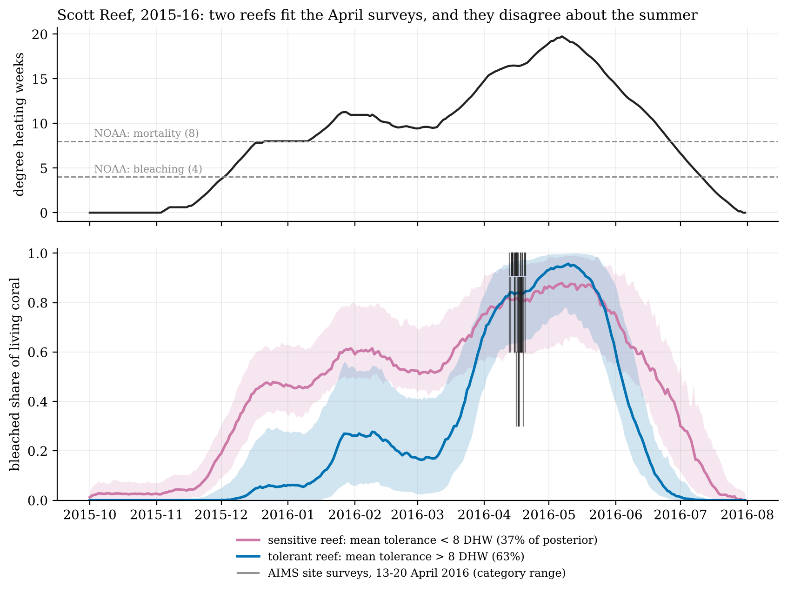
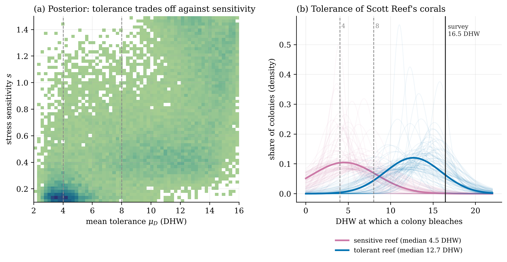
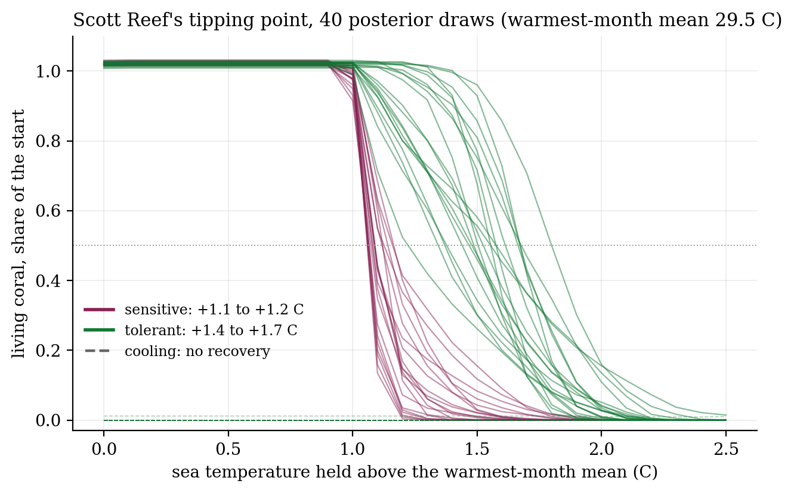

# When a reef can't come back

**A coral reef modelled like a magnet shows why the classic reef models make collapse look more sudden and more permanent than it is.**


A reef is a patchwork. Each patch is healthy coral, bleached coral, bare rock or seaweed, and each is pushed around by the water temperature and by its neighbours, the way spins in a magnet are. Physicists have a firm rule about systems like this: models in which every patch feels every other ("mean field") exaggerate how abrupt and how irreversible a change is. The best-known reef models are mean-field.

So I built the reef on a lattice, switched the reach of the interactions from four neighbours to the whole reef, and warmed and cooled the water.

- **It reproduces the shape of a bleaching event**: bleaching, then recovery. The curve it was first checked against turned out to be hand-drawn, so it is now fitted to real surveys instead (below).
- **Reefs get stuck.** Once heat kills enough coral, seaweed takes the space, and cooling the water back doesn't bring the coral back.
- **Mean field gets stuck worst.** The loop is about 60% wider when every patch feels the whole reef than with four neighbours: local survivors reseed their surroundings.
- **Two honest negatives.** Warming *speed* barely matters; how hot it gets does. And none of the classic early-warning signals fire before collapse, because the slide is gradual.

| | |
|:-:|:-:|
|  |  |
|  |  |

## What one survey says about coral tolerance

The model above runs on parameters set by hand and a temperature curve. This section asks a sharper question of real data. **How much heat can Scott Reef's corals take before they bleach?** The answer comes with error bars.

**What changed, and why.** A literature check exposed two problems with the first version.

- **Wrong heat measure.** Bleaching does not follow the day's temperature. It follows accumulated heat. The field's standard measure is NOAA Coral Reef Watch's **degree heating weeks** (Skirving et al. 2020):

  ```
  HotSpot   HS(t)  = SST(t) − MMM                      (MMM: mean of the warmest month)
  DHW(t)          = (1/7) Σ over the last 84 days of HS,  counting only HS ≥ 1 °C
  ```

  NOAA expects significant bleaching from about 4 DHW and mortality from about 8. One rolling 12-week window is the standard, so the model now runs on NOAA's own daily DHW for the Scott-Ashmore station, October 2015 to July 2016.
- **Corals differ.** Within one reef population, the most and least heat-tolerant tenth of colonies differ by 4-5 DHW (Humanes et al. 2022). The Potts model had a single threshold for every patch. Each patch now has its own tolerance D₅₀ ~ N(μ_D, σ_D²), drawn once and spatially smoothed so neighbouring colonies are alike. In physics terms, the uniform external field becomes a **random field**: quenched disorder.
- **And the old target was not data.** The bleaching curve used before (`Coral temps.xlsx`, "Smooth") was hand-drawn, and its temperatures do not match 2016 at Scott Reef (correlation 0.12 with NOAA's record). Those earlier fits have been removed.

**The data.** The target is now 65 real site surveys by AIMS at Scott Reef on 13-20 April 2016, from the Global Coral Bleaching Database (van Woesik & Kratochwill 2022). Each site reports bleaching as a category: 6 sites at 30-60%, 24 at 60-90% and 35 above 90%. On those days DHW stood at 16.5, twice NOAA's mortality level.

**The inference.** The same simulation-based inference as before (Cranmer, Brehmer & Louppe 2020):

1. Simulate 8,000 reefs through the NOAA record, with priors on four parameters: mean tolerance μ_D (2-16 DHW), spread σ_D, stress sensitivity s and noise β.
2. "Survey" each one exactly as AIMS did: 65 random sites on 16 April, binned into the same four categories.
3. Train a mixture density network, written in NumPy with hand-derived gradients, to return q(θ | survey) = Σ_k π_k 𝒩(θ; μ_k, diag σ_k²).

On 800 held-out simulations, the 90% credible interval contains the truth 90% of the time for every parameter (89.5-90.4%).

**What the survey says:**

- **The surveys fit well.** The posterior predicts 0.5, 6.7, 20 and 37 sites in the four categories, against 0, 6, 24 and 35 observed.
- **But two different reefs fit them, and the survey cannot choose between them.** The posterior is bimodal:
  - a **sensitive reef** (37% of the posterior): mean tolerance 4.5 DHW, right on NOAA's threshold, with a weak response to stress;
  - a **tolerant reef** (63%): mean tolerance 12.7 DHW, with a sharp response.

  By mid-April both have bleached about 85% of living coral. This is a classic identifiability failure: one snapshot, taken at a heat level far beyond both thresholds, cannot separate how tolerant the corals are from how steeply they respond once past it.
- **They disagree about the summer.** By 1 February, the sensitive reef has 59% of its coral bleached and the tolerant reef 26%. A single survey in February or early March would decide between them. The Global Coral Bleaching Database has none for Scott Reef in 2016. AIMS's May 2016 update says warm water had affected the region "over the past 2 months" and that severity was still rising during the April voyage. That slightly favours the tolerant reef, but it is not a measurement.
- **So what?** NOAA's 4 DHW alert is a regional average. If Scott Reef is the tolerant reef, the alert sounded about three months before its corals bleached in earnest. That is a real gap for anyone using the alert to time a response, and it is the question an earlier survey would answer.

| | |
|:-:|:-:|
|  |  |

`coral_crw.py` · `inference/simulate_bank_crw.py` · `inference/mdn.py` · `inference/infer_crw.py` · `data/`

## Where does Scott Reef tip?

The first version quoted a single tipping temperature from the hand-drawn curve. With the reef now fitted to real surveys, the question can be asked with error bars. For 40 parameter sets drawn from the posterior (20 from each mode), the water is held at a fixed temperature above the warmest-month mean for 120 days, stepped up 0.1 °C at a time, then stepped back down.
- **The sensitive reef tips at +1.1 to +1.2 °C** (80% of draws), about 30.6–30.7 °C. Once the water holds 1 °C above the warmest-month mean, heat stress builds at 12 DHW, past this reef's mortality threshold.
- **The tolerant reef tips at +1.4 to +1.7 °C,** about 31.0–31.3 °C.
- **Neither comes back on cooling, in any draw.** This model has no coral larvae arriving from outside the lattice, so a reef that has died has nothing to regrow from. Real reefs recover, slowly, from larvae carried in from other reefs. The model's hysteresis is therefore an upper bound, and adding larval supply is the natural next step.



`run_tipping_crw.py`

**Built:** a vectorised rewrite of my original Potts model, about 9× faster. Along the way I found that coral in the original could never die: its death rule needed heat stress above a cap. Adding mortality and grazed macroalgae (the Mumby feedback) fixed that.

`coral_model.py` · `coral_crw.py` · `coral_potts.ipynb` · `inference/` · Python, NumPy, SciPy

*A side project, built for fun. The lattice model is a toy, so the hysteresis results are qualitative. Data: NOAA Coral Reef Watch daily 5 km heat stress, Scott-Ashmore Reefs virtual station (Skirving et al. 2020, Remote Sensing 12(23):3856, [doi:10.3390/rs12233856](https://doi.org/10.3390/rs12233856)); Global Coral Bleaching Database, NOAA NCEI accession 0228498 (van Woesik & Kratochwill 2022, Scientific Data 9:20, [doi:10.1038/s41597-022-01121-y](https://doi.org/10.1038/s41597-022-01121-y)), with Scott Reef surveys by the Australian Institute of Marine Science. Biology: Humanes et al. (2022), Proc. R. Soc. B 289:20220872 (variation in heat tolerance within a reef); Ainsworth et al. (2016), Science 352:338 (pre-bleaching thermal history). Inference: Cranmer, Brehmer & Louppe (2020), PNAS 117, 30055; Papamakarios & Murray (2016), NeurIPS; mixture density networks from Bishop (1994).*
