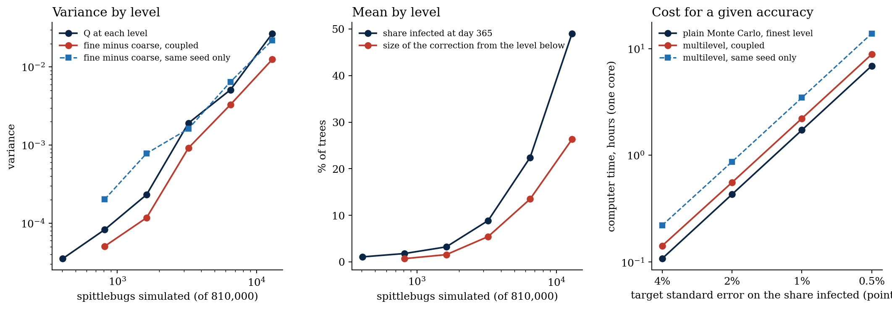
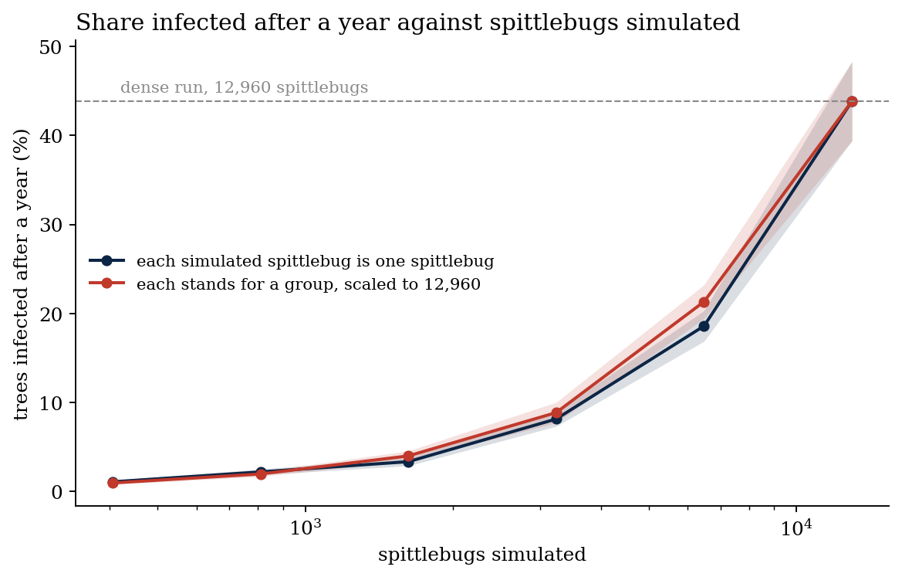
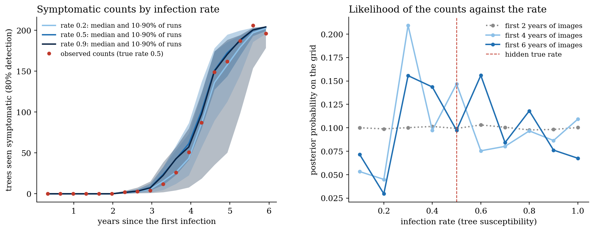

# Olive grove Xylella, stochastic SIR

**A stochastic agent-based model of *Xylella fastidiosa* spreading through an olive grove by spittlebugs: the infection threshold, felling and planting spacing.**

## Why I did this

*Xylella* has killed millions of olive trees in southern Italy. It is carried by meadow spittlebugs, and symptoms take about two years to show. I rebuilt a published lattice model of the grove (Fierro et al., 2019), where every spittlebug walks, feeds and passes the bacterium on. I implemented a lighter version of the original model, checked against it, so that it can be run and tuned many more times (about 95× faster). The aim was to bring in percolation theory and look for planting spacings and felling patterns that break up the spread.

## What we found

We see that outbreaks are all or nothing: 39 of 40 take the whole grove, with half the trees infected in about 2.3 years, and one never starts. A bug in the original code put the grove in the wrong season on day 0. This gave every outbreak a head start: 38% more of the grove infected by day 600 (0.274 against 0.199).

A spittlebug stays on a tree for about 18 days per visit. Below about 16–29% chance of infection per visit outbreaks die out, and above it they take the grove. This is a sharp threshold, and it decides most of what follows.

No felling radius or detection speed left more trees standing. This is because above the threshold felling comes too late, and below it it is not needed. Reducing spittlebug contact is what did the work.

Planting further apart only works if the ground cover is managed, because spittlebugs live in the grass between trees. With their number per tree held fixed, spreading a 16 x 16 grove from 4 to 10 cells cuts the share of trees infected in three years from 97% to 14%. The outbreak stops taking the grove between 6 and 8 cells apart: the share of groves more than half infected falls from 65% at 6 cells to 20% at 7 and none at 8. With their density per hectare fixed instead, wider spacing adds as many spittlebugs as distance takes away, and 69–85% of trees are infected at every spacing (`spacing_threshold.py`).

| | |
|:-:|:-:|
|  |  |
|  |  |
|  | |

## Multilevel Monte Carlo, and what it showed about the model

The paper's grove has a million spittlebugs a hectare, 810,000 on our 90 × 90 m grove. That can't be run many times, so our model simulates a fraction of them: 0.1%, 810 spittlebugs, in every result above. Multilevel Monte Carlo (Giles 2008) is the standard way to get the answer at a finer level cheaply: most runs at a coarse level, plus corrections from pairs of runs, each pair one level finer and one coarser,

$$E[Q_L] = E[Q_0] + \sum_{l=1}^{L} E[Q_l - Q_{l-1}].$$

Here level $l$ simulates $405 \times 2^l$ spittlebugs, from 405 to 12,960, and $Q$ is the share of trees infected after a year. The corrections are cheap only if each fine run and its coarse partner move together (the coupling). So each fine run contains its coarse partner: its first half of spittlebugs draw the same random numbers as the coarse run's (each run's randomness is split into a stream for the shared spittlebugs and one for the extra ones), the seed carrier is the same, and each tree's symptom delay is drawn once. We run 30 pairs per level. `mlmc.py`

We see the coupling work. Paired runs correlate at 0.62-0.78, against about zero when the two runs only share a seed, and the corrections vary half as much as the quantity itself.

Multilevel does not pay yet, though. To pin the share infected to within one point, multilevel needs about 2.2 hours of computer time against 1.7 for plain Monte Carlo at the finest level. It pays when the corrections shrink as the levels get finer and fine runs are far dearer than coarse ones. Neither holds here: each doubling of spittlebugs roughly doubles the share infected, and a run costs only about 1.6 times more per level.

This means our model has not converged in the number of spittlebugs. The share infected after a year goes from 1% with 405 spittlebugs to 3% with 1,620, 22% with 6,480 and 49% with 12,960. After a year and a half every run with 6,480 or more has taken the whole grove. The 810 spittlebugs used throughout give a much slower outbreak than the paper's density would, so the timings above (half the grove in about 2.3 years) are slow. The threshold and felling comparisons, made at one fixed density, still compare like with like.

We then tried letting each simulated spittlebug stand for a group. A run with k times fewer spittlebugs than a reference of 12,960 treated each one as a group of k, so its chance of infecting a tree on a visit, and of picking the bacterium up, became the chance that at least one of the k would: $p \to 1-(1-p)^k$, with $p$ = 0.5 at the reference. If chance per contact were the bottleneck, the scaled sparse runs would reach the dense run's 44% after a year. They don't: 1% with 405 scaled spittlebugs, 4% with 1,620, 21% with 6,480, hardly different from the unscaled runs (40 seeds per level). This is because the bottleneck is coverage: a sparse swarm visits fewer trees, and a group that moves as one still visits only one tree. This means the number of spittlebugs sets how fast the epidemic runs. Like the infection rate, it is a parameter to fit to real groves, which is what the Gallipoli images are for. `sampling_scaling.py`

## What I'd do next

Our model is only as good as its rates, and every rate here comes from the original paper. The next step is to fit it to a real grove. This one, near Gallipoli in the zone where *Xylella* spread from 2013, is a regular planting of roughly 15 × 20 trees, close to our simulated 16 × 16 grove. In February 2014 every tree has a full canopy. By September 2026 the crowns are small and grey: the trees have died and been cut back, or been replaced with young ones, which a single image cannot tell apart.

A sequence of images like these, one tree at a time, is what data assimilation is designed for. We could update the model's hidden state (which trees are infected but not yet showing it) each time a new image arrives, and learn the infection rate and the spittlebug season from how the dieback spreads, rather than taking them from the paper.

*Imagery: Esri World Imagery Wayback (source: Esri, Maxar, Earthstar Geographics), releases of 20 February 2014 and 24 September 2026; `real_grove.py` downloads and draws them.*

Before fitting real images, the method needs a twin experiment, a first test of data assimilation. We hide a known infection rate (0.5) in a simulated grove, observe its symptomatic trees every 120 days with each one seen only 80% of the time, and ask a particle filter of 32 groves, each with its own guess of the rate, to recover it. Nothing is learned for the first two years, because symptoms show about two years after infection. After six years the filter's 90% range for the rate is still about 0.1 to 0.9, close to the 0.1 to 1.0 it started from. `assimilate.py`

With only 32 groves the filter itself could be at fault, so we checked the counts directly, without a filter. For each rate from 0.1 to 1.0 we ran 24 groves forward and took the likelihood of the observed counts as the average, over those groves, of the probability of the whole sequence of counts (the filter's own observation model). The likelihood is flat. With six years of images the best and worst rates on the grid differ by 1.7 in log-likelihood, a factor of about 5, with no trend across the grid, and the 90% range covers the whole grid. This is because above the threshold every outbreak takes the whole grove: after six years the median run has 253 to 255 of the 256 trees symptomatic at every rate, and the counts for rates 0.5 and 0.9 rise almost together, with 0.2 only slightly slower. This means the counts alone can't identify the rate. To learn it, the images have to show which trees die and in what order, the spatial pattern of the spread rather than the count. A per-tree image sequence like the Gallipoli pair would give that. `ensemble_likelihood.py`

**Built:** a vectorised rewrite (`olive_model.py`), checked against my original model across 12 + 200 runs; four bug fixes; a transmission log; felling and detection policies; a planting-spacing sweep; and parallel ensembles.

`olive_grove_01_model.ipynb` · `olive_grove_02_felling.ipynb` · `real_grove.py` · Python, NumPy, multiprocessing

*A side project, built for fun. These are model results, not policy advice.*
