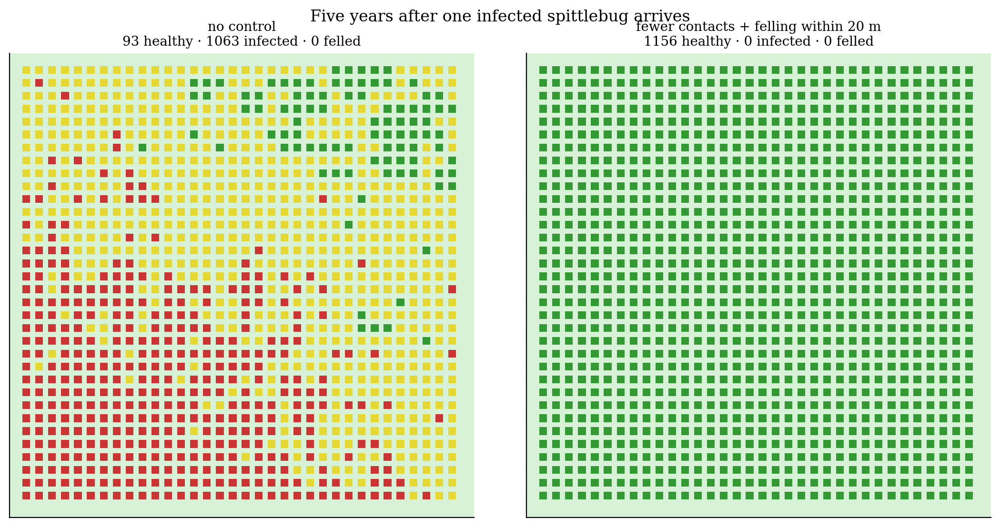
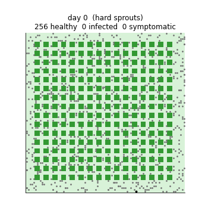
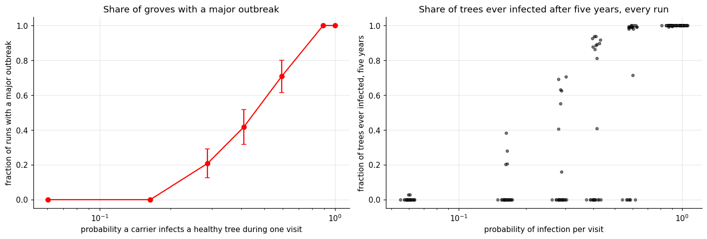
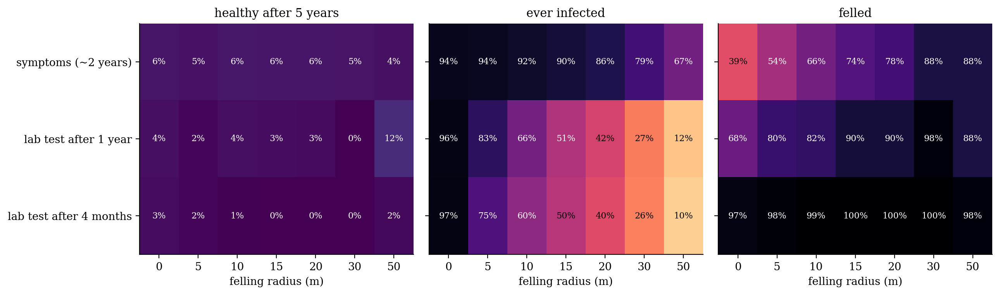
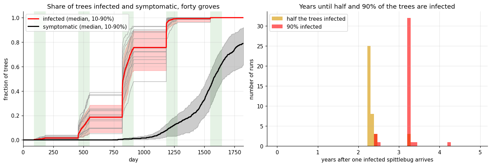
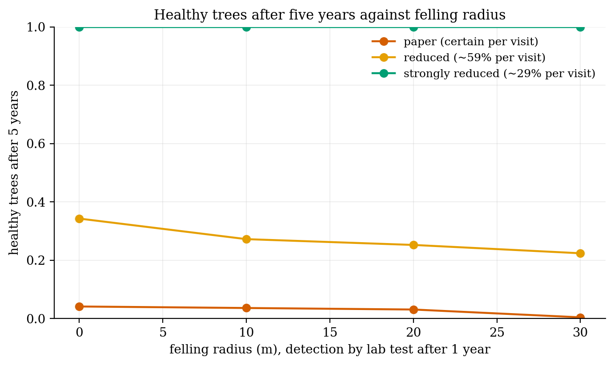
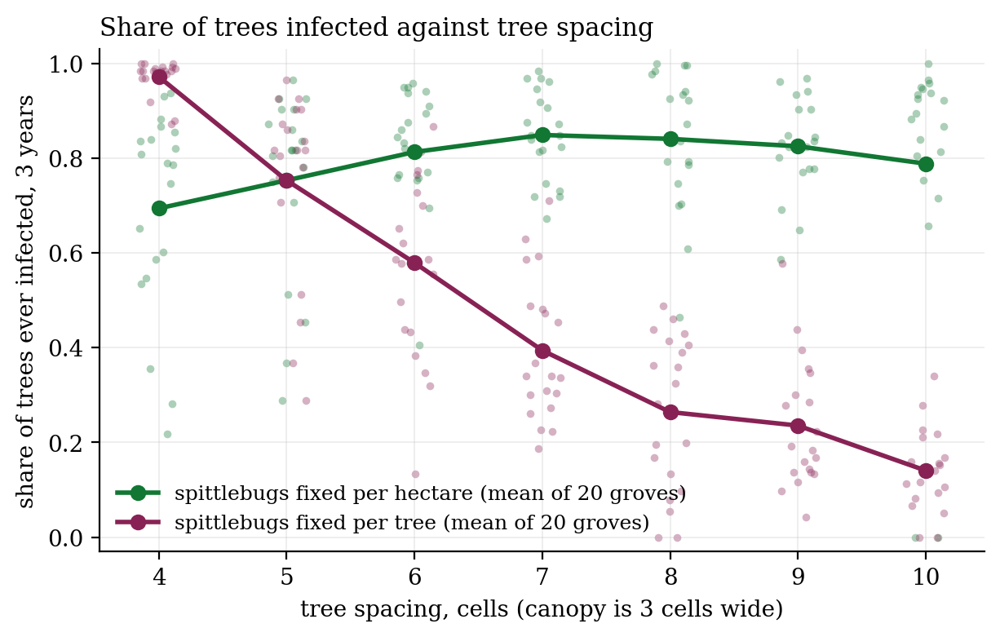
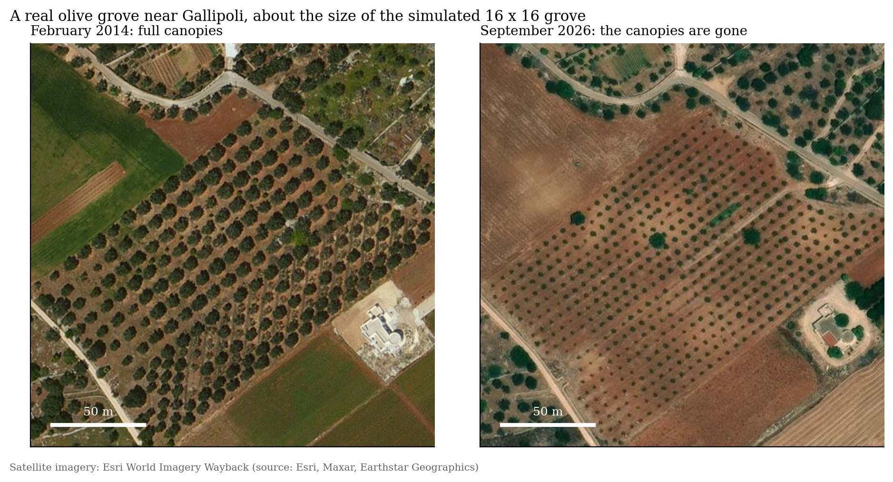
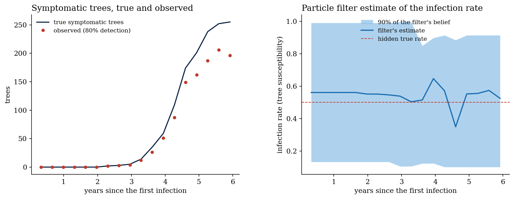

# Olive grove Xylella, stochastic SIR

**A stochastic agent-based model of *Xylella fastidiosa* spreading through an olive grove by spittlebugs: the infection threshold, felling and planting spacing.**

*Xylella* has killed millions of olive trees in southern Italy. It's carried by meadow spittlebugs, and symptoms take about two years to show. I rebuilt a published lattice model of the grove (Fierro et al., 2019), where every spittlebug walks, feeds and passes the bacterium on, then made it about 95× faster and asked what actually stops it.

- **Outbreaks are all-or-nothing.** 39 of 40 take the whole grove, with half the trees infected in about 2.3 years. One never starts.
- **A one-day slip moved a two-year answer by 38%.** The original code put the grove in the wrong season on day 0, which gave every outbreak a head start.
- **There's a sharp threshold.** A spittlebug stays on a tree for about 18 days per visit. Below about 16–29% chance of infection per visit, outbreaks die out; above it, they take the grove.
- **Felling never paid.** No felling radius or detection speed left more trees standing: too late above the threshold, unnecessary below it. Reducing spittlebug contact did the work.
- **Planting further apart works only with the ground cover managed.** Spittlebugs live in the grass between trees. With their number per tree held fixed, spreading a 16 x 16 grove from 4 to 10 cells cuts the share of trees infected in three years from 97% to 14%. The outbreak stops taking the grove between 6 and 8 cells apart: the share of groves more than half infected falls from 65% at 6 cells to 20% at 7 and none at 8. But with their density per hectare fixed, wider spacing adds as many spittlebugs as distance takes away, and 69–85% of trees are infected at every spacing (`spacing_threshold.py`).

| | |
|:-:|:-:|
|  |  |
|  |  |
|  | |

## What I'd do next

The model is only as good as its rates, and every rate here comes from the original paper. The next step is to fit it to a real grove. This one, near Gallipoli in the zone where *Xylella* spread from 2013, is a regular planting of roughly 15 × 20 trees, close to our simulated 16 × 16 grove. In February 2014 every tree has a full canopy. By September 2026 the crowns are small and grey: the trees have died and been cut back, or been replaced with young ones, which a single image cannot tell apart.

A sequence of images like these, one tree at a time, is exactly what data-assimilation methods are built for. We could update the model's hidden state (which trees are infected but not yet showing it) each time a new image arrives, and learn the infection rate and the spittlebug season from how the dieback actually spreads, rather than taking them from the paper.

*Imagery: Esri World Imagery Wayback (source: Esri, Maxar, Earthstar Geographics), releases of 20 February 2014 and 24 September 2026; `real_grove.py` downloads and draws them.*

**A first test of data assimilation.** Before fitting real images, the method needs a twin experiment: hide a known infection rate (0.5) in a simulated grove, observe its symptomatic trees every 120 days with each one seen only 80% of the time, and ask a particle filter of 32 groves, each with its own guess of the rate, to recover it. Two things come out. Nothing is learned for the first two years, because symptoms show about two years after infection. And even after six years the filter's 90% range for the rate stays at about 0.1 to 0.9: above the threshold every outbreak takes the whole grove, so the number of dead trees barely depends on the rate. To learn it, the images have to show which trees die and in what order, the spatial pattern of the spread, not just how many; that is what a per-tree image sequence like the Gallipoli pair would give. `assimilate.py`

**Built:** a vectorised rewrite (`olive_model.py`), checked against my original model across 12 + 200 runs; four bug fixes; a transmission log; felling and detection policies; a planting-spacing sweep; and parallel ensembles.

`olive_grove_01_model.ipynb` · `olive_grove_02_felling.ipynb` · `real_grove.py` · Python, NumPy, multiprocessing

*A side project, built for fun. These are model results, not policy advice.*
