# Po Valley mesoclimate, physics-informed machine learning

**A region-specific model of daily maximum temperature for the Po Valley: a heat-budget equation anchored to every station reading, compared with regression-kriging, a U-Net and a physics-informed network.**

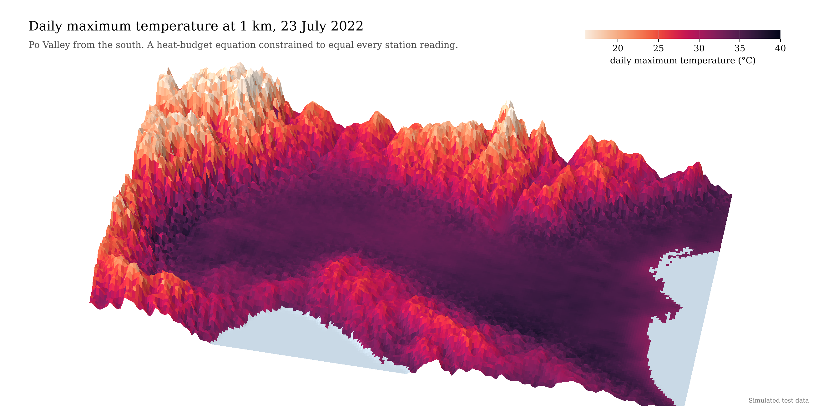

## Why I did this

In my work in quantitative climate risk at Wieldmore I became interested in regional climate models: smaller, region-specific models of a mesoclimate, especially for Europe's industrial belts. A region like the Po Valley is small enough to put a PDE mesh and machine learning on directly, and it has two rich sources of data: ERA5 and Copernicus gridded data, and a dense network of weather stations. The interesting question is what you give up when you leave a physically continuous system like ERA5. Once you cut out a region and enforce boundaries, you are at the mercy of the boundary conditions.

ERA5-Land describes the Po Valley in boxes about 9 km across. Gridded station products such as E-OBS fill the map by interpolating stations, and stop returning the stations in the process. In our case we build daily maximum temperature on a 1 km grid for June to August 2021-2023 under two constraints. Between stations the surface obeys a reduced heat-budget equation, in which each land-cover class couples the air to the ground at its own rate. At stations it equals the observation exactly. XGBoost learns the heating the equation leaves out and returns it to the equation as a prior. A U-Net trained on the thermometers with the heat budget in its loss (a physics-informed network) is the best model on the hottest days.

**Data.** The method was built and tested first on simulated daily fields in the shape of the real products, with a known truth behind them (from "The model" onwards below). It has since been run on the real data: ERA5-Land, MODIS land surface temperature, terrain and land cover from Earth Engine, and the readings of 38 stations, scored at stations held out in 50 km blocks in 2023 (`results_real/`).

## On the real data

| Model | RMSE (K) | Hottest 5% of days (K) |
|---|:-:|:-:|
| ERA5-Land, bilinear and lapse rate | 1.89 | 2.05 |
| Regression with kriged residuals | 1.61 | 1.87 |
| Physics only | 1.62 | 1.67 |
| Physics, anchored to stations | 1.61 | 1.75 |
| Physics, anchored, XGBoost prior | 1.75 | 1.72 |
| U-Net emulator | 1.65 | 1.85 |
| Network on stations only | 1.71 | 1.88 |
| Physics-informed network | 1.60 | 1.78 |
| Physics-informed network, heavier physics, anchored | 1.64 | 1.60 |

We see every regional model beat ERA5-Land by about 0.3 K, a sixth of its error. Kriging, our physics model and the physics-informed network sit within 0.05 K of each other over all days, and with 38 stations we cannot separate them. Putting the heat budget in the loss takes the network from 1.71 K to 1.60 K, and on the hottest days the anchored version is the best model (1.60 K). The XGBoost prior does not carry over from the simulation (1.75 K).

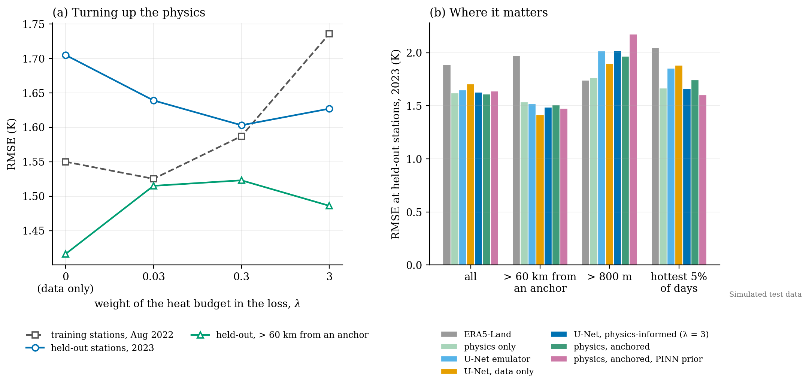

The constraint holds: on all 276 days the surface returns every station to within 10⁻¹² K. The fitted relaxation times are short, so a station's footprint is a plume only a few kilometres long. This means the physics reaches only a few kilometres from each station, and the statistical prior has to carry it further. The wind term is worth 0.045 K. The fitted mixing coefficient is forty times smaller than the scheme's own numerical diffusion, so it cannot be interpreted.

| | |
|:-:|:-:|
| 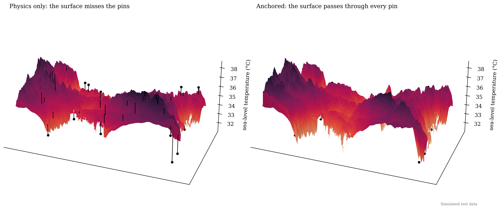 | 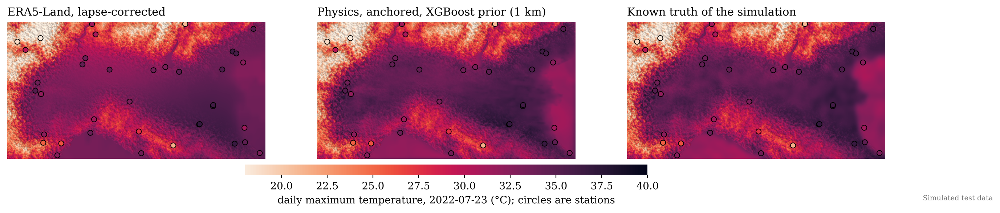 |
| 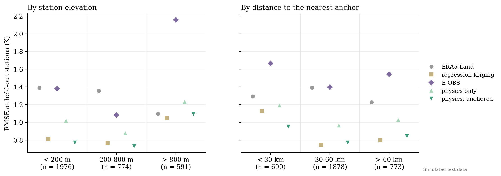 | 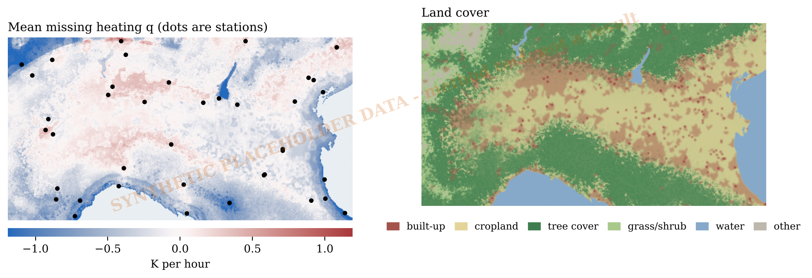 |
| 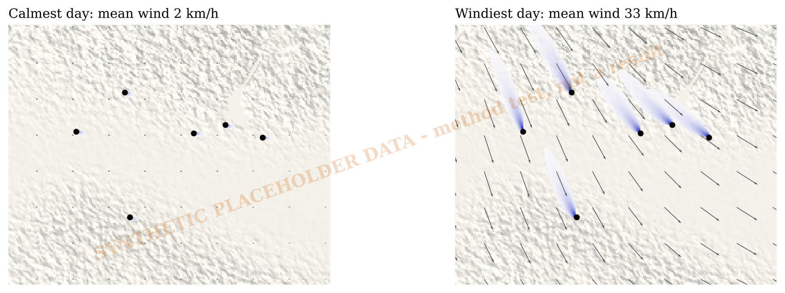 | 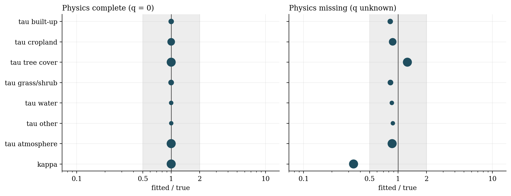 |

## The model

Temperature is reduced to sea level, θ = T + Γz with Γ = 6.5 K/km, and each day solves

```
u · ∇θ  −  κ ∇²θ  +  (θ − θ_s) / τ_s(x)  +  (θ − θ_E) / τ_a  =  q(x),      θ = θ_E on the boundary
1 / τ_s(x) = Σ_c f_c(x) / τ_c
```

θ_s is MODIS land surface temperature, θ_E is ERA5-Land Tmax, f_c are land-cover fractions and q is the heating the equation lacks. Discretised (first-order upwind, five-point Laplacian) this is a sparse system A θ = b + q. With H selecting station cells and y the readings, the anchored solution minimises (q − q̂)ᵀ W (q − q̂) subject to both A θ = b + q and H θ = y, where W = I + ℓ_q² L penalises size and roughness:

```
θ₀ = A⁻¹(b + q̂)        d = y − Hθ₀        G = HA⁻¹   (one adjoint solve per station)
q  = q̂ + W⁻¹Gᵀ (G W⁻¹ Gᵀ)⁻¹ d             θ = A⁻¹(b + q)             T = θ − Γz
```

Parameters are fitted with adjoint gradients: one extra solve per day gives the derivative with respect to all eight.

## Method check on simulated data: skill at held-out stations, 2023

Everything from here to the end of the neural-network sections is on the simulated daily fields, where the true temperature at every cell is known (`results/`). Before any data, the solver recovered planted parameters exactly when its physics was complete, and to within 25% (relaxation times) when it was not. We see anchored physics match regression-kriging without clearly beating it. RMSE falls from 1.34 K (ERA5-Land) to 1.03 K (physics only), 0.83 K (anchored) and 0.79 K (with the XGBoost prior), and regression with kriged residuals scores 0.85 K. The 0.06 K gap has a 95% interval of -0.14 to +0.00 K.

| | Model | RMSE (K) | Bias (K) | < 200 m | 200-800 m | > 800 m |
|---|---|:-:|:-:|:-:|:-:|:-:|
| B0 | ERA5-Land, bilinear + lapse rate | 1.34 | -0.58 | 1.39 | 1.36 | 1.10 |
| B1 | Regression + kriged residuals | 0.85 | +0.05 | 0.81 | 0.77 | 1.05 |
| B2 | E-OBS (simulated, see note) | 1.49 | +0.55 | 1.38 | 1.08 | 2.16 |
| B3 | XGBoost on station residuals | 1.07 | +0.21 | 1.03 | 0.98 | 1.27 |
| M1 | Physics only (q = 0) | 1.03 | +0.32 | 1.02 | 0.88 | 1.23 |
| M2 | Physics, anchored | 0.83 | +0.04 | 0.77 | 0.73 | 1.09 |
| M3 | Physics, anchored, XGBoost prior | 0.79 | +0.03 | 0.69 | 0.72 | 1.10 |

3,341 station-days at 39 stations, five folds of 50 km blocks, parameters fitted on 2021-2022. The simulated E-OBS is interpolated from its own 30-station network, so B2's score reflects that choice. Against the simulation's hidden truth at every land cell the ranking is the same (1.22 K, 0.85 K, 0.63 K for B0, M1, M2) and the XGBoost prior adds nothing at map level.

## Two neural networks: an emulator, then a physics-informed one (simulated data)

The usual way to put a neural network into downscaling is to train it on a dense target. Here there are two ways to do that, and they ask different questions.

### 1. An emulator of the physics

We use a small U-Net (Ronneberger, Fischer & Brox 2015), the standard image-to-image network in statistical downscaling (Baño-Medina, Manzanas & Gutiérrez 2020). It takes 14 coarse and static maps (ERA5-Land, the surface-temperature excess, wind, terrain and six land-cover fractions) and returns a 1 km field, plus a 5% and a 95% quantile. It has 120,000 parameters and is written in JAX.

Its target is the anchored physics surface (M2), built for each fold without that fold's stations. This means it is an emulator: it learns to reproduce the physics model from coarse inputs alone, without running the solver or seeing stations. This is not a fair contest with the physics. It shows how much of the anchored surface can be predicted from the coarse fields. Stations remain the ground truth for scoring.

| | Model | RMSE (K) | Bias (K) | Hottest 5% of days | < 200 m | 200-800 m | > 800 m |
|---|---|:-:|:-:|:-:|:-:|:-:|:-:|
| B0 | ERA5-Land, bilinear + lapse rate | 1.34 | -0.58 | 1.49 | 1.39 | 1.36 | 1.10 |
| M1 | Physics only | 1.03 | +0.32 | 0.86 | 1.02 | 0.88 | 1.23 |
| U | **Emulator alone** | **1.03** | +0.27 | 1.04 | 1.03 | 0.88 | 1.18 |
| M2 | Physics, anchored | 0.83 | +0.04 | 0.80 | 0.77 | 0.73 | 1.09 |
| M4 | **Physics, anchored, emulator prior** | **0.87** | +0.08 | 0.83 | 0.84 | 0.73 | 1.11 |

We see the emulator's RMSE match the physics-only model (1.03 K), but it does worse on the hottest days (1.04 K against 0.86 K). This is because an emulator smooths its target, and the extremes are what get smoothed away. As a prior it adds nothing, since a prior learned from the anchored surface carries no information that the anchoring does not already supply.

Its 90% interval held only 66% of 2023 readings. This is because it was trained to match a smooth surface and never saw the thermometers. Conformalised quantile regression (Romano, Patterson & Candès 2019) widens the interval by the 90th percentile of the 2022 misses, measured at each fold's own held-out stations. In 2023 the interval then holds 86%, with a mean width of 3.0 K.

### 2. A physics-informed network, trained on thermometers

A fair comparison trains on the stations themselves. The same U-Net is trained with this loss:

```
loss  =  (1/|S|) Σ_{s∈S} (θ̂_s − y_s)²   +   pinball(5%, 95%)   +   λ · (1/|Ω|) Σ_{x∈Ω} r(x)²
r     =  A θ̂ − b
```

S is the fold's training stations and Ω every land cell in the tile. In our case A θ = b is the same discretised heat budget as in the physics model: same upwind and five-point stencil, same fitted κ, τ_a and τ_s(x). So r is the heating that the network's map needs and the equation does not supply. This is the soft-constraint form of physics-informed learning (Raissi, Perdikaris & Karniadakis 2019; Karniadakis et al. 2021). The physics term needs no labels. It reaches every cell between the stations, which is where a data-only network has nothing to learn from.

We report λ at four settings instead of tuning it, each trained per fold for 1,200 steps.

| λ | RMSE (K) | Hottest 5% of days | > 800 m | 90% interval holds | Truth RMSE, every land cell | Anchored RMSE | Anchored, hottest 5% |
|---|:-:|:-:|:-:|:-:|:-:|:-:|:-:|
| 0 (data only) | 1.08 | 1.12 | 1.25 | 78% | 0.89 | 0.91 | 0.84 |
| 0.03 | 1.05 | 1.05 | 1.23 | 80% | 0.85 | 0.88 | 0.79 |
| 0.3 | 1.05 | 0.94 | 1.23 | 81% | 0.84 | 0.87 | 0.77 |
| 3 | 1.05 | **0.85** | **1.20** | **82%** | **0.84** | 0.86 | **0.75** |

The physics term costs a little accuracy at the training stations and gains it at unseen ones. On a validation month at the training stations, λ = 3 scores 0.83 K against 0.81 K for λ = 0, because the constraint stops the network fitting those thermometers as closely. At held-out stations every λ > 0 beats λ = 0, and at every land cell the error falls from 0.89 K to 0.84 K. This is the behaviour expected of a regulariser that carries real information.

The gain is largest on the hottest days, where RMSE falls by a quarter, from 1.12 K to 0.85 K. This is because heatwave days are rare in the training data, so a data-only network has too few examples to learn them from. The heat budget holds on every day, including the rare hot ones, so the physics term still has something to teach there. Using the λ = 3 network as the prior of the station anchoring gives 0.75 K on the hottest 5%, ahead of the XGBoost prior (0.78 K) and the plain physics (0.80 K). Over all days, M3 remains best (0.79 K against 0.86 K).

The data-only network is the worst of all the networks. Trained on 39 thermometers, it overfits them. The emulator avoided this only by borrowing the physics model's dense surface, while the physics-informed network gets that information from the equation itself rather than from the solver's output.

| | |
|:-:|:-:|
| 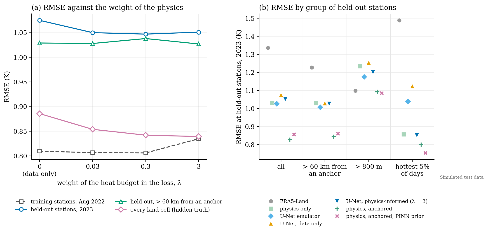 | 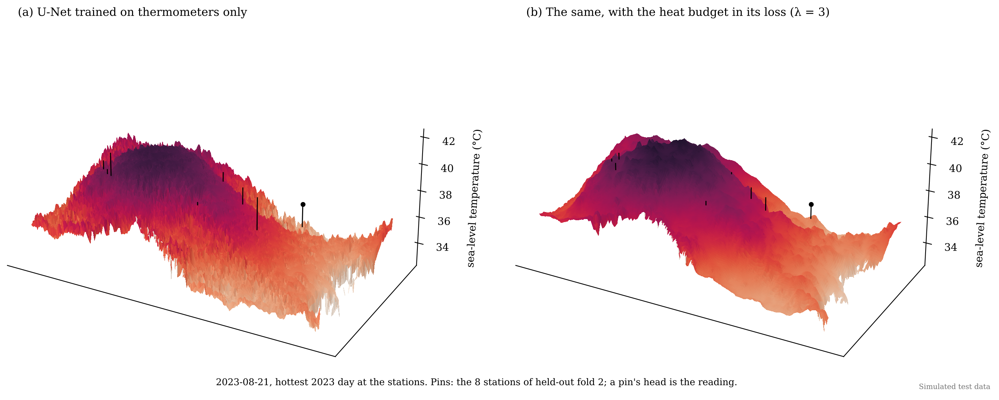 |
| 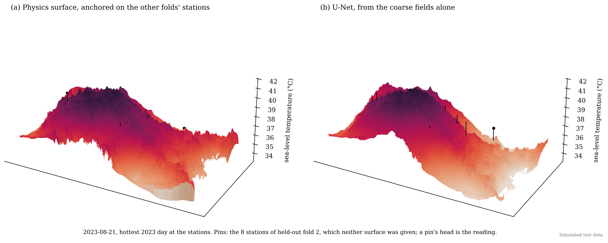 | 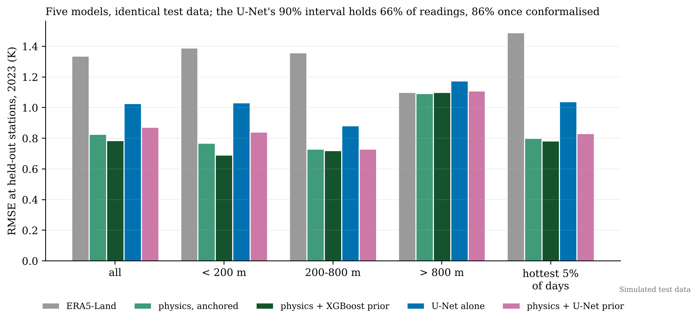 |

**Interactive:** [error at every held-out station, physics against the emulator](https://kevingrainger.github.io/maps/003-unet-errors.html)

`tmax1km/unet.py` · `tmax1km/pinn.py` · `run_unet.py` · `run_pinn.py`

## Provenance

The real run uses ERA5-Land (Copernicus CDS), MODIS land surface temperature, terrain and land cover (Earth Engine) and Meteostat station readings, fetched by `python download_data.py --ee-project YOUR_PROJECT` (with a GHCN-Daily fallback for stations). The simulated method check uses these tiers:

| Dataset | Tier | Source |
|---|---|---|
| Station locations and elevations | real | Meteostat station list (CC BY 4.0), 39 stations with an observed 2021-2023 record |
| Elevation (1 km) | estimated | 5 arc-minute Mapzen/SRTM grid (via pvlib), interpolated, plus generated sub-grid roughness |
| Land-cover fractions | estimated | Natural Earth coastline, lakes and urban outlines; vegetation zoned by elevation |
| Station daily Tmax | simulated | `tmax1km/simulation.py` |
| ERA5-Land Tmax, skin temperature, wind | simulated | `tmax1km/simulation.py` |
| MODIS land surface temperature | simulated | `tmax1km/simulation.py` |
| E-OBS daily tx | simulated | `tmax1km/simulation.py` |

## Limits

Steady state: one balance per day, no heat storage, no memory. Single layer: no boundary-layer depth, inversion or sea breeze, which can only appear through q. Clear-sky LST: under cloud the surface temperature is ERA5-Land's plus a monthly offset. Fixed lapse rate: above 800 m no model here improves on lapse-corrected ERA5-Land. First-order upwind differencing adds about 1,000 m²/s of numerical diffusion, more than the fitted κ. 39 stations rank the models but cannot separate the best two.

**Built:** sparse upwind/five-point PDE solver with one LU factorisation per day; exact station anchoring in closed form; adjoint gradients checked against finite differences; spatially blocked cross-validation with fold-safe training of the XGBoost prior; regression-kriging and XGBoost baselines; a station-level bootstrap for model differences; a U-Net emulator and a physics-informed U-Net whose loss is the solver's own residual stencil, in JAX; conformal calibration; a resumable pipeline; four solver tests in CI.

`tmax1km/` (`grid` · `data` · `simulation` · `pde` · `anchor` · `ml` · `unet` · `validation` · `step0` · `plots`) · `po_valley_downscaling.ipynb` · `run_pipeline.py` · `run_unet.py` · `run_pinn.py` · `download_data.py` · `make_maps.py` · `make_cover.py` · `tests/` · Python, SciPy sparse, XGBoost, JAX, folium

**Interactive maps:** [the heatwave day](https://kevingrainger.github.io/maps/003-heatwave.html) · [missing heating, land cover and station footprints](https://kevingrainger.github.io/maps/003-missing-physics.html)

**Next:** the regional ARPA station networks, which multiply the anchors tenfold; a lapse rate fitted per day; and a second-order advection scheme so that κ means something.

*A side project, built for fun. Credits: ERA5-Land (Muñoz-Sabater et al. 2021, [doi:10.5194/essd-13-4349-2021](https://doi.org/10.5194/essd-13-4349-2021)); E-OBS (Cornes et al. 2018, [doi:10.1029/2017JD028200](https://doi.org/10.1029/2017JD028200)); variational analysis (Sasaki 1970, Mon. Wea. Rev. 98, 875-883; Lorenc 1986, [doi:10.1002/qj.49711247414](https://doi.org/10.1002/qj.49711247414)); the closest published relative, First Street Foundation's geostatistical air temperature model (Wilson et al. 2022, Climate 10(3):47, [doi:10.3390/cli10030047](https://doi.org/10.3390/cli10030047)); physics-informed machine learning (Karniadakis et al. 2021; Harder et al. 2023); ESA WorldCover 2021 (Zanaga et al. 2022, [doi:10.5281/zenodo.7254221](https://doi.org/10.5281/zenodo.7254221)); XGBoost (Chen & Guestrin 2016, [doi:10.1145/2939672.2939785](https://doi.org/10.1145/2939672.2939785)); U-Net (Ronneberger, Fischer & Brox 2015, MICCAI); deep-learning downscaling (Baño-Medina, Manzanas & Gutiérrez 2020, [doi:10.5194/gmd-13-2109-2020](https://doi.org/10.5194/gmd-13-2109-2020)); conformalised quantile regression (Romano, Patterson & Candès 2019, NeurIPS); physics-informed neural networks (Raissi, Perdikaris & Karniadakis 2019, [doi:10.1016/j.jcp.2018.10.045](https://doi.org/10.1016/j.jcp.2018.10.045)). Station list from Meteostat; outlines from Natural Earth.*
