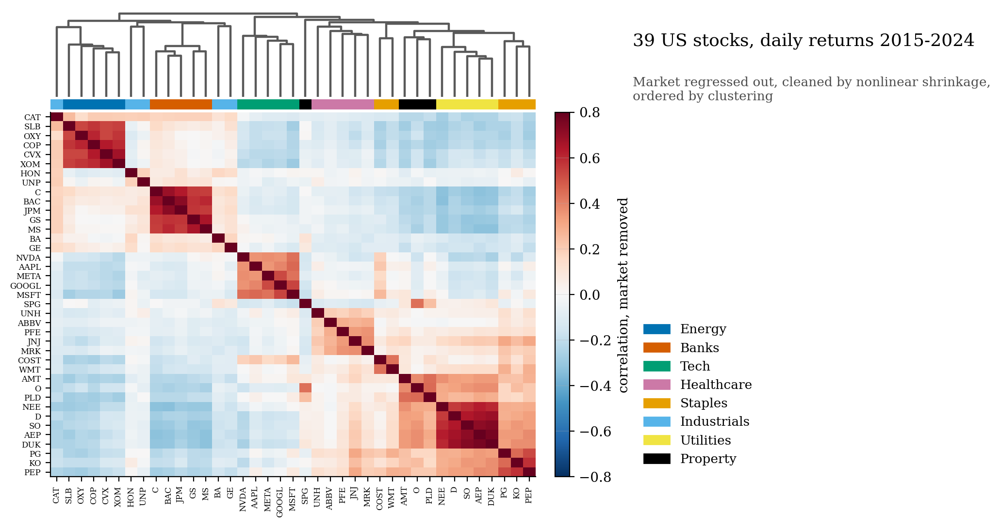
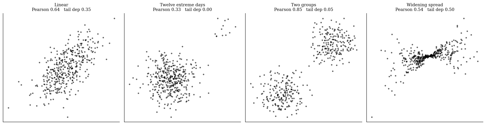
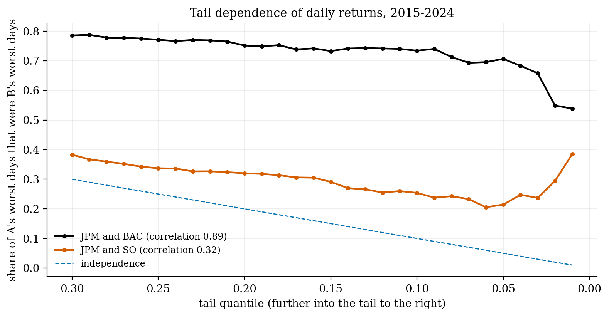
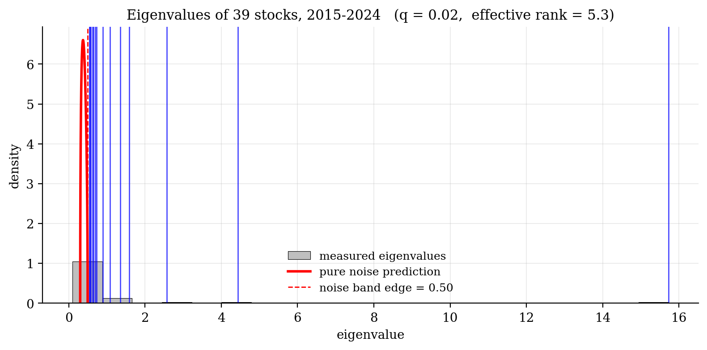
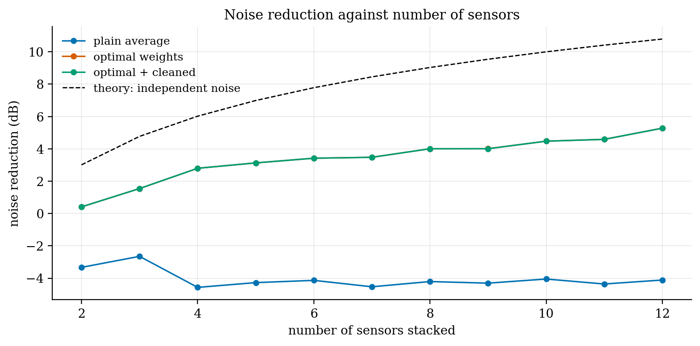
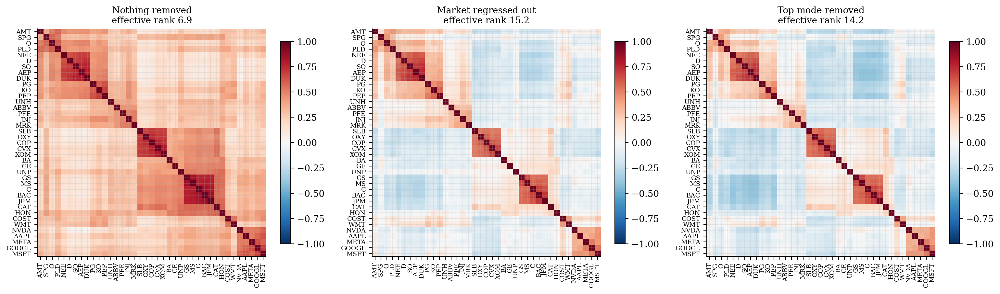
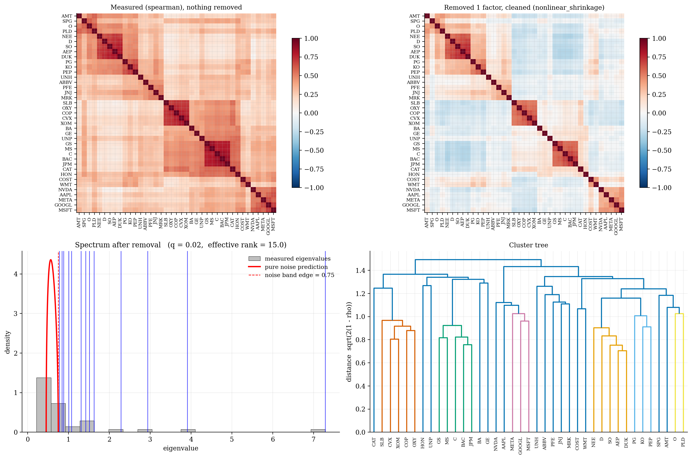

# corrlib, a correlation library

**A small Python library for measuring, cleaning and stripping down correlation matrices, used by the seismic and solar projects.**



## Why I did this

I built this small Python library to support these projects, since most of them involve some kind of correlation, signal processing, filtering or data assimilation. I wanted one set of tools I knew worked, so that when I code with AI agents, the tools they call are always consistent and correct. Building it also made me learn the exact mathematics behind each method.

With 39 stocks there are 741 correlations to estimate, and most of what a year of data says about them is noise. Random-matrix theory gives the eigenvalue spectrum of pure noise (the Marchenko–Pastur law), so we can clean against it. Once we remove the market (the one thing every stock shares), we see the sectors appear.

```python
from corrlib import Correlator
c = Correlator(measure="gaussian_rank", remove=[market], clean="nonlinear_shrinkage", effective_n="bartlett")
C = c.fit(returns)
c.plot()
```

Taking out the market raises the effective number of independent bets from about 7 to 15. The cleaners are tested against known answers (59 tests): Ledoit–Wolf matches scikit-learn exactly, and nonlinear shrinkage, using Ledoit & Wolf's 2020 estimator, is the best cleaner on structured data. The first version I wrote was worse than no cleaning at all near q = 1, and the tests caught it. In a portfolio test, cleaning closes only part of the gap between the risk a portfolio claims and the risk it delivers. An earlier "perfect" result turned out to be a units bug.

| | |
|:-:|:-:|
|  |  |
|  |  |
|  |  |

**Built:** correlation measures (Pearson, rank, Gaussian rank, partial, distance, tail dependence, lead–lag); estimators for irregular data; factor and mode removal; random-matrix cleaning; array stacking (minimum-variance = Capon beamformer); clustered heatmaps; effective sample size.

`corrlib/` · `corrlib_showcase.ipynb` · `make_figures.py` · `tests/` · Python, NumPy, SciPy

*A side project, built for fun, and the shared engine of projects 011 and 006. Prices come from Yahoo Finance via yfinance; the notebook downloads them, and they aren't stored in the repository.*
