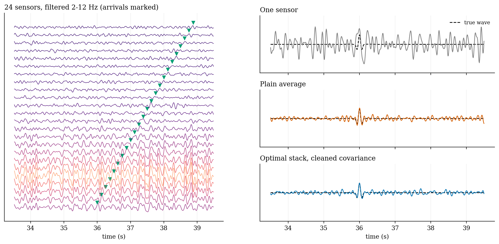
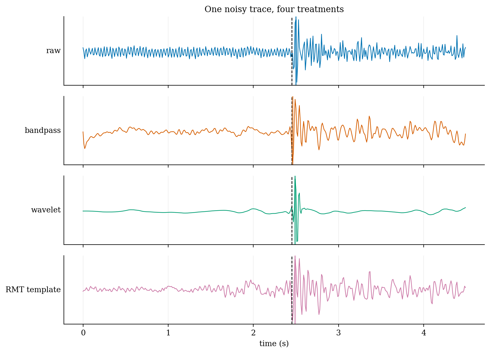
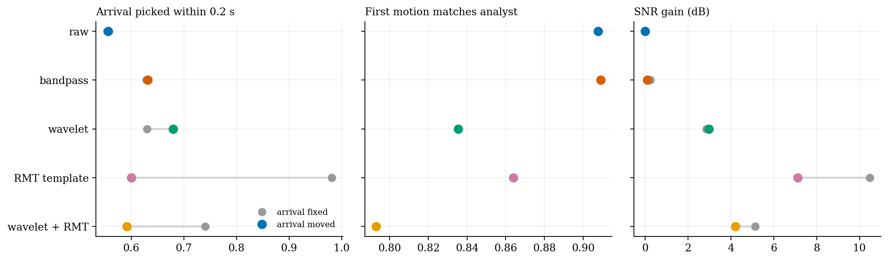
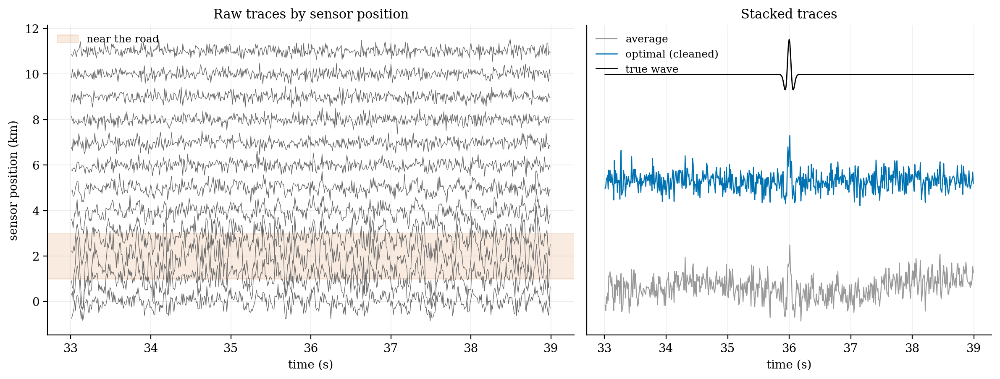
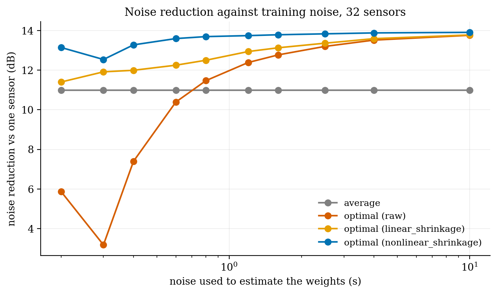
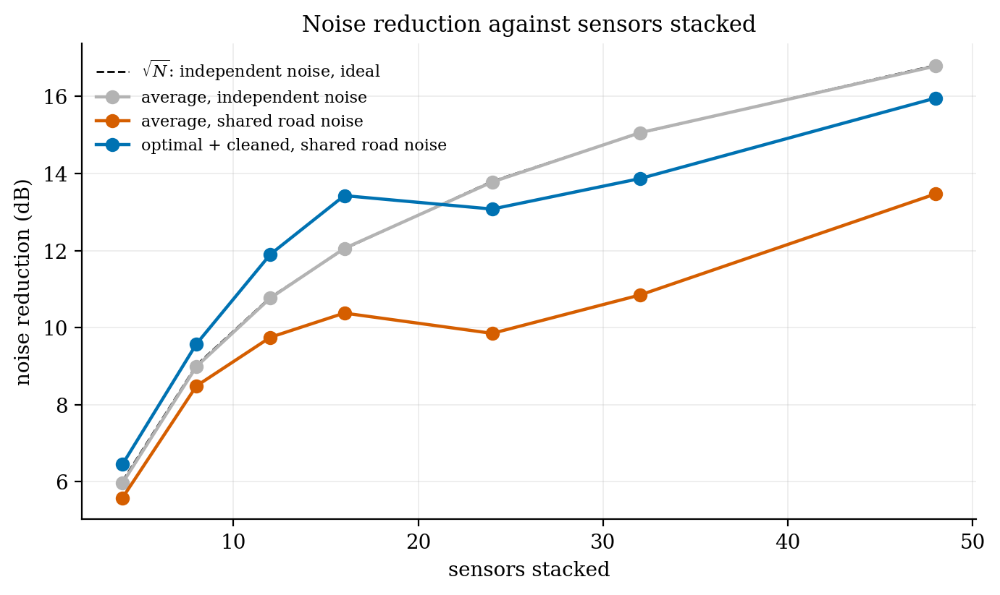

# Seismic denoiser

**Denoising methods from seismology and random matrix theory, scored on 3,000 noisy recordings from the Southern California Seismic Network by the arrival time and the first motion they preserve.**

## Why I did this

Seismology is built on signal processing, which ties it to my other projects, and earth systems are where my passion in applied mathematics lies. Small earthquakes under Los Angeles are buried in traffic noise. I wanted to see which denoising methods keep what a seismologist needs from a recording: the arrival time, and which way the ground moved first. We score filters, wavelets and stacking from seismology against two methods from random matrix theory, on 3,000 noisy recordings from the Southern California Seismic Network. The first is a PCA template with a Marchenko–Pastur cut-off (the random-matrix cleaning below). That cut-off assumes white, independent noise, and seismic noise is neither. The second is minimum-variance weighting of an array.

At first the random-matrix method picked 98% of arrivals. This was because every recording in the dataset has its arrival at the same point in the window. When we move the arrival at random, it drops to 60%, barely above doing nothing (56%).

Wavelets add 3 dB of signal-to-noise but flip the first motion on about one trace in fourteen. This means a cleaner-looking waveform can be worse for picking. A plain bandpass filter is the only method that helps without doing harm.

For an array of sensors, the best weights are the minimum-variance ones: the weights that give the least noise, given how the noise is correlated between sensors. With a road's noise shared between our sensors, this beats a plain average, but only once that noise covariance is cleaned with random matrix theory (`corrlib`).

| | |
|:-:|:-:|
|  |  |
|  |  |
|  | |

**Built:** an STA/LTA picker and a first-motion estimator, both calibrated on quiet traces (99% and 97%); a test with randomly moved arrival times; a synthetic array with shared noise; held-out scoring.

`seismic.py` · `seismic_denoiser.ipynb` · Python, NumPy, SciPy, h5py, PyWavelets · uses [`corrlib`](../004-corrlib-correlation-toolbox)

*A side project, built for fun. Labelled waveforms from Ross, Meier & Hauksson (2018), [doi:10.1029/2017JB015251](https://doi.org/10.1029/2017JB015251); Southern California Seismic Network data via the SCEDC, [doi:10.7909/C3WD3xH1](https://doi.org/10.7909/C3WD3xH1). The data isn't included in the repository (6 GB).*
