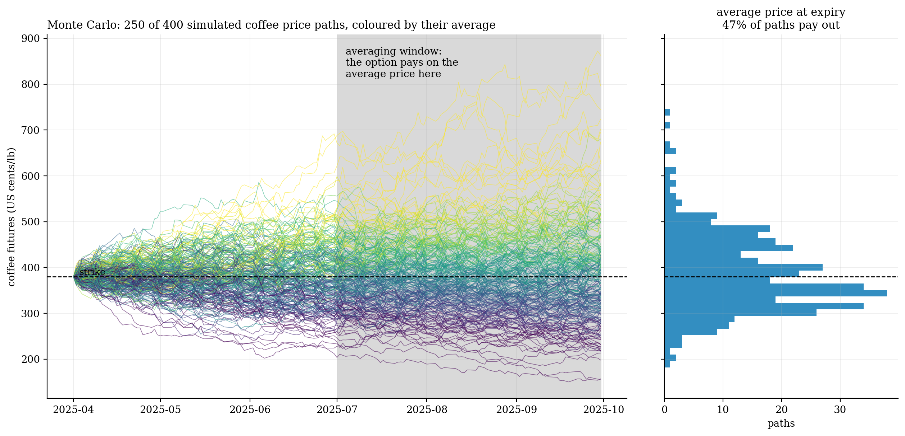
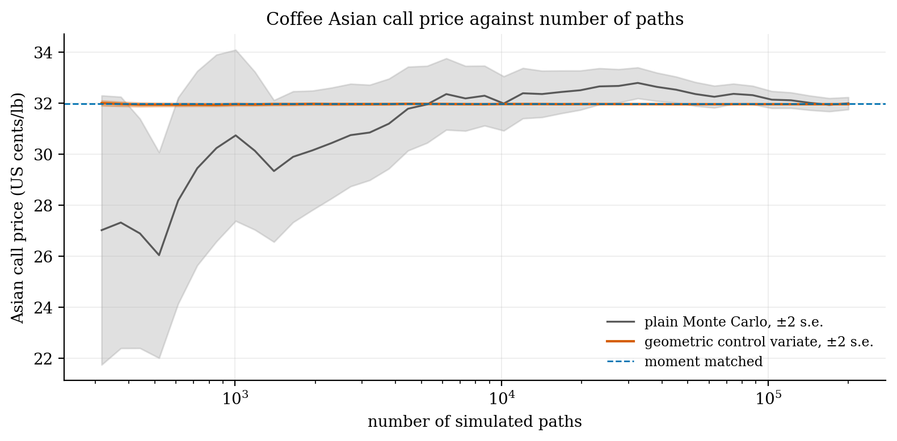
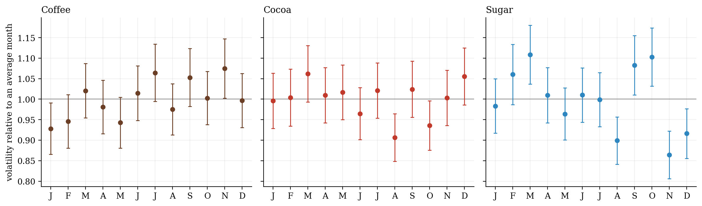
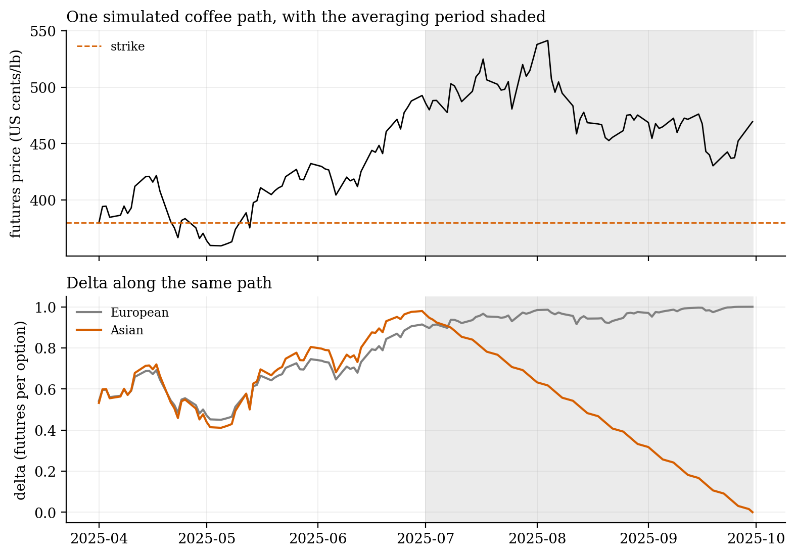
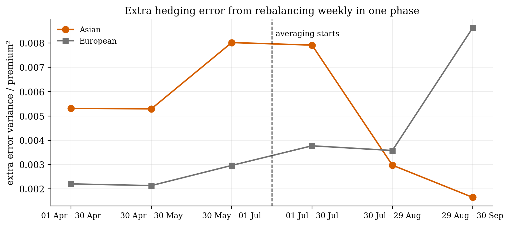

# Asian option pricer

## Why I did this

A learning project. I learned option pricing from Mark Joshi's *The Concepts and Practice of Mathematical Finance*, before and during my time as a quantitative analyst at Wieldmore, where I dealt with many kinds of options beyond European ones, Asian options among them. It tied in well with the PDEs and numerical methods from my physics degree (see the [PDE project, 015](../earlier-work/pde-solvers-cpp)). My main interest is commodities, so this is the pricing groundwork for them: an Asian option pays on the average price over a period, which is how commodity buyers usually hedge, because they buy steadily rather than on one day.

## The methods

Every price is built three independent ways and checked against the others. First we price by Monte Carlo with a control variate. The geometric-average Asian option has an exact price, and it moves almost one for one with the arithmetic one, so simulating both and correcting by the known error cuts the Monte Carlo noise by 1,100 to 7,200 times. Next we need a finite-difference solver, tested first on European options, where its error falls as the square of the grid spacing (measured order 2.09). Finally, Večeř's PDE (2001) turns an Asian option into a problem in one space variable however many fixings it has. With volatility that changes through time it matches the control-variate Monte Carlo to within one standard error (about 0.0003 on a price near 8) for in-, at- and out-of-the-money strikes.

## Softs, with seasonal volatility

Volatility in coffee, cocoa and sugar follows the calendar, rising through the growing season. In our case it is estimated month by month from the futures prices, and the pricer lets it change through time.

## What the well-known results look like here

We see the well-known results. An Asian option's delta fades as the average locks in, since each fixing removes part of the price risk. This means most of the hedging risk comes just before averaging starts, when the whole average is still open and the delta is largest. Ignoring seasonal volatility changes the price but makes little difference to how well the hedge works.

| | |
|:-:|:-:|
|  |  |

The same Black (1976) pricing and delta hedging carry into the wheat hedging project (013).

## Code

`vecer.py` (the one-dimensional Asian PDE) · `options_03_asian_softs.ipynb` (Monte Carlo, control variate, seasonal volatility, hedge simulator) · Python, NumPy, SciPy

The earlier notebooks that built and tested the finite-difference solver on an S&P 500 option chain, and compared the SET50 with the S&P 500, are kept in `archive/`.

*A side project, built for fun. Credits: Joshi (2008), The Concepts and Practice of Mathematical Finance; Kemna & Vorst (1990), J. Bank. Finance 14, 113, for the control variate; Večeř (2001), J. Comput. Finance 4, 105. Prices from Yahoo Finance via yfinance; they aren't stored in the repository.*
