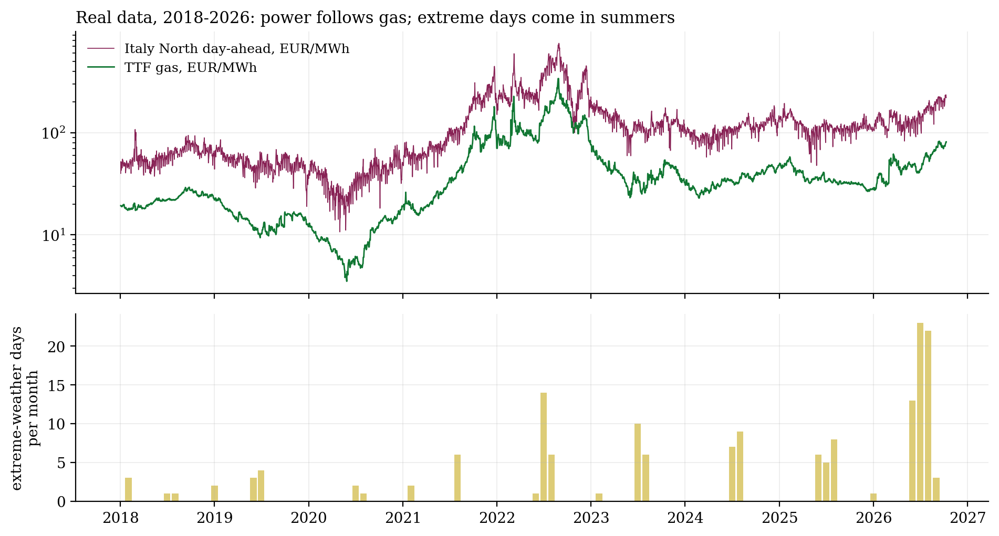
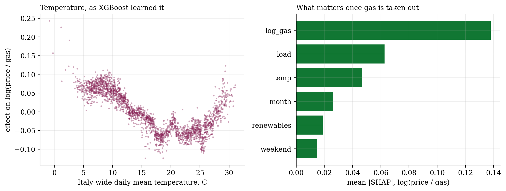
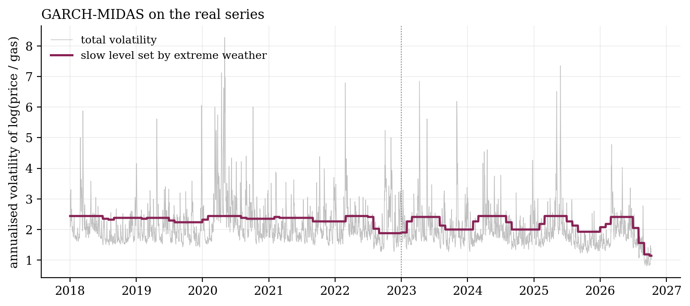
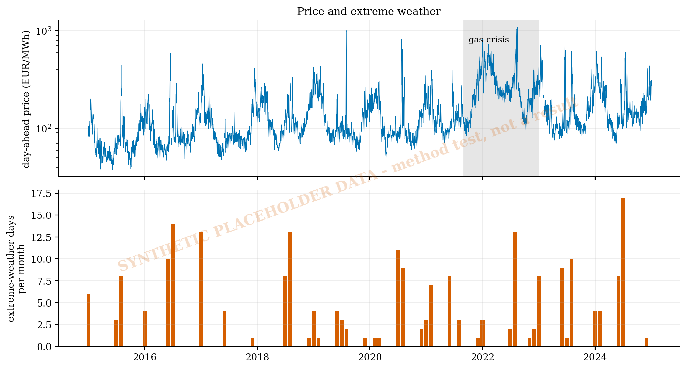
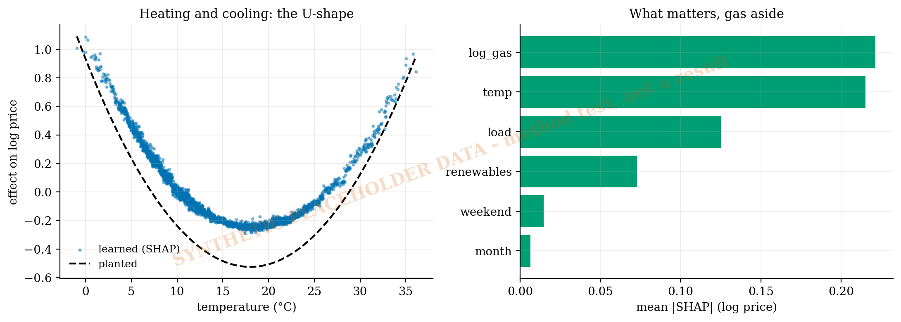
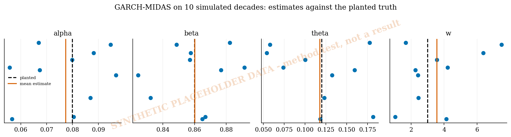
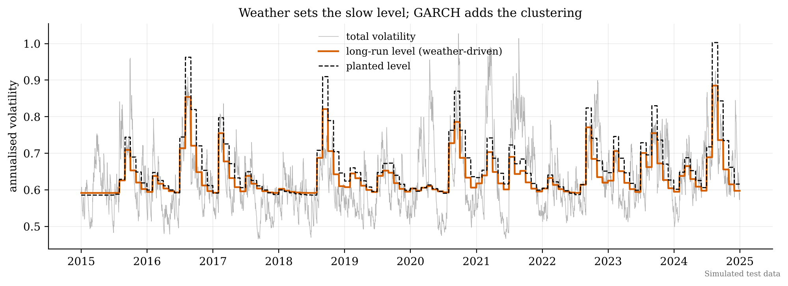
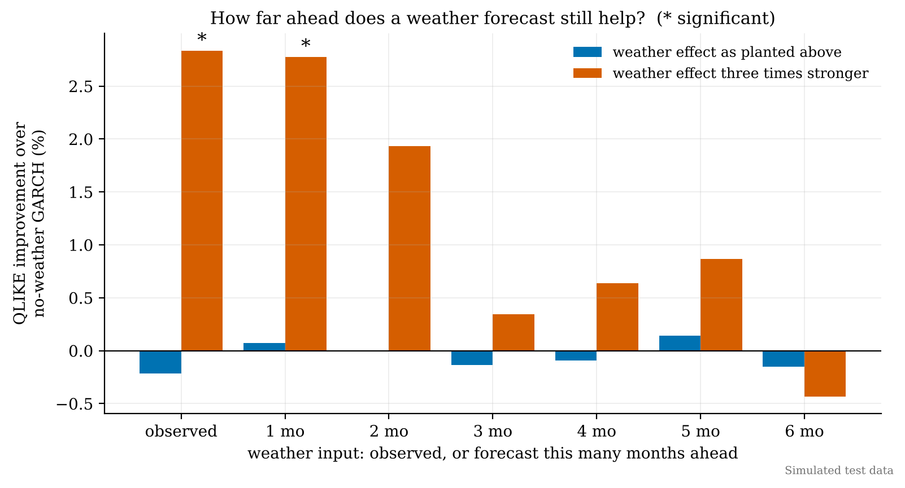

# Can a weather forecast see a power-price storm coming?

**A 2026 study found extreme weather to be the main driver of Italian power-price volatility. On the real Italy North prices of 2018–2026, the weather matters, but in the opposite direction: extreme months are calmer. Even a perfect forecast of them barely helps.**

Observed weather explains volatility after it has happened, but a hedger needs to know before. This project builds a three-stage version: what drives the price, what drives the volatility, and how much a weather forecast could add. It was first built and checked on simulated data with planted relationships (below), then run on the real series:
- day-ahead prices for the Italy North zone (Energy-Charts, CC BY 4.0);
- Italian load, wind and solar;
- an eight-city ERA5 temperature;
- Dutch TTF gas.

**On the real data, 2018–2026:**
- **Gas first, then a U-shaped temperature effect.** Modelled as price relative to gas, XGBoost clearly beats a straight line on years it hasn't seen (RMSE 0.174 against 0.255), which it did not on the simulated data. SHAP finds the expected U: power is dearer relative to gas in cold weather and above about 27 °C, and cheapest around 18–25 °C. After gas, load matters most, then temperature.
- **Extreme weather calms the volatility.** GARCH-MIDAS finds the monthly count of extreme days (Italy-wide mean above 28 °C or below 3 °C) significant (likelihood ratio 27.6, p ≈ 10⁻⁶) but with a **negative** sign (θ = −0.15). The same holds for the raw price (θ = −0.07). In heatwaves gas plants set the price every hour and power simply tracks gas; mild, sunny months are when solar makes prices swing. Cold months are too few (5) to judge.
- **A forecast could add almost nothing.** Fitted on 2018–2022 and scored on 2023 onwards, knowing each month's extreme-day count *exactly* lowers the volatility forecast loss by **0.7%** against plain GARCH. Last month's count does as well (0.9%), and the calendar average 0.2%. No seasonal forecast can beat perfect knowledge, so 0.7% is the ceiling on what one is worth here.

| | |
|:-:|:-:|
|  |  |

**The method check on simulated data.** The simulated data has the same shape as the real series but with the relationships planted. On it, GARCH-MIDAS recovers the weather effect without bias (θ̂ = 0.118 against 0.12 planted), though single estimates range from 0.05 to 0.18. A power calculation showed that a modest effect needs a long test period to detect.

| | |
|:-:|:-:|
|  |  |
|  |  |
|  | |

**Built:** time-ordered cross-validation; XGBoost + SHAP; GARCH-MIDAS by maximum likelihood with beta-lag weights; GARCH(1,1); QLIKE scoring; Diebold–Mariano tests.

`power.py` · `fetch_real.py` · `run_real.py` · `italian_power.ipynb` · `check_midas.py` · Python, XGBoost, SHAP, SciPy

**Limits:** one bidding zone (Italy North) rather than the national PUN. A temperature-only definition of extreme weather. No archive of real seasonal forecasts, so stage 3 gives the upper bound only. TTF gas from Yahoo Finance is not redistributed; `fetch_real.py` downloads it again.

*A side project, built for fun. Builds on Guerzoni, Riso & Zoia (2026); GARCH-MIDAS from Engle, Ghysels & Sohn (2013), Rev. Econ. Stat. 95, 776; QLIKE from Patton (2011); Diebold & Mariano (1995). Data: day-ahead prices and Italian generation from Energy-Charts (Fraunhofer ISE), CC BY 4.0, originally ENTSO-E; ERA5 via Open-Meteo (CC BY 4.0); TTF via Yahoo Finance.*
