# Weather and the Italian power price

**A 2026 study found extreme weather to be the main driver of Italian power-price volatility. On the real Italy North prices of 2018–2026, the weather matters, but in the opposite direction: extreme months are calmer. Even a perfect forecast of them barely helps.**

Observed weather explains volatility after it has happened, but a hedger needs to know before. This project builds a three-stage version: what drives the price, what drives the volatility, and how much a weather forecast could add. It was first built and checked on simulated data with planted relationships (below), then run on the real series:
- day-ahead prices for the Italy North zone (Energy-Charts, CC BY 4.0);
- Italian load, wind and solar;
- an eight-city ERA5 temperature;
- Dutch TTF gas.

**Taking gas out first.** Gas plants set the Italian price in most hours, so the price mostly follows TTF gas. Everything below works on power relative to gas, log(power / gas), so what is left can be tied to the weather.

**Day by day.** The relationship shows best at daily resolution, one summer at a time. Through June-September 2026, each hot spell lifted power above gas: the daily correlation of power relative to gas with temperature was 0.41, and on days above 28 °C power ran about 11% higher relative to gas than on other days. In summer 2022 the figures were 0.52 and about 19%.

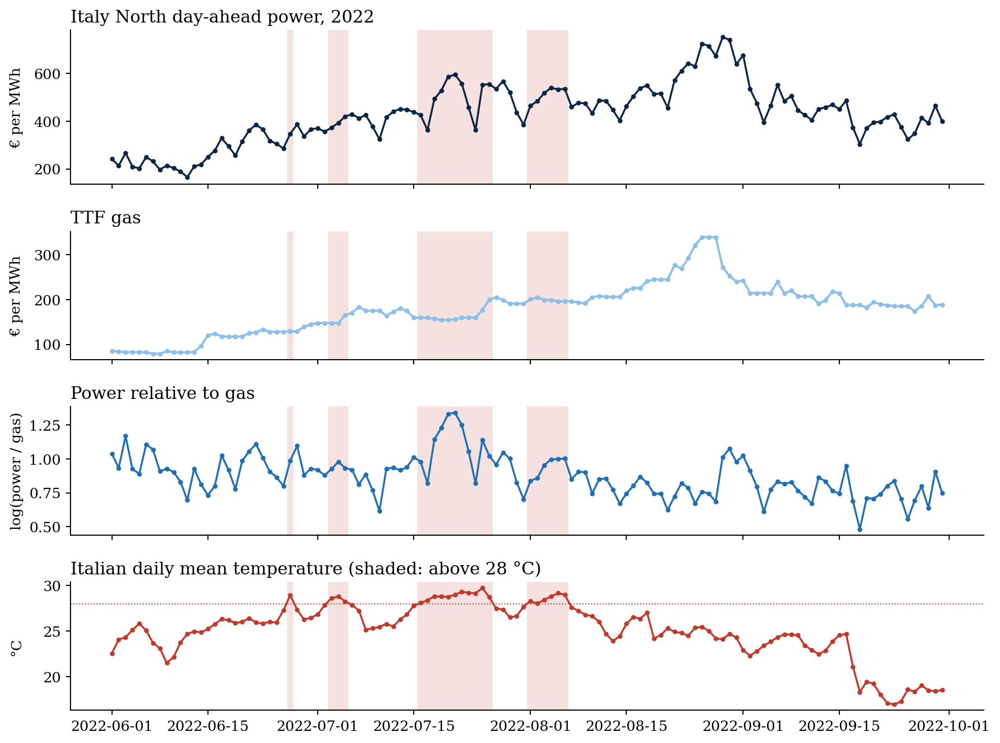

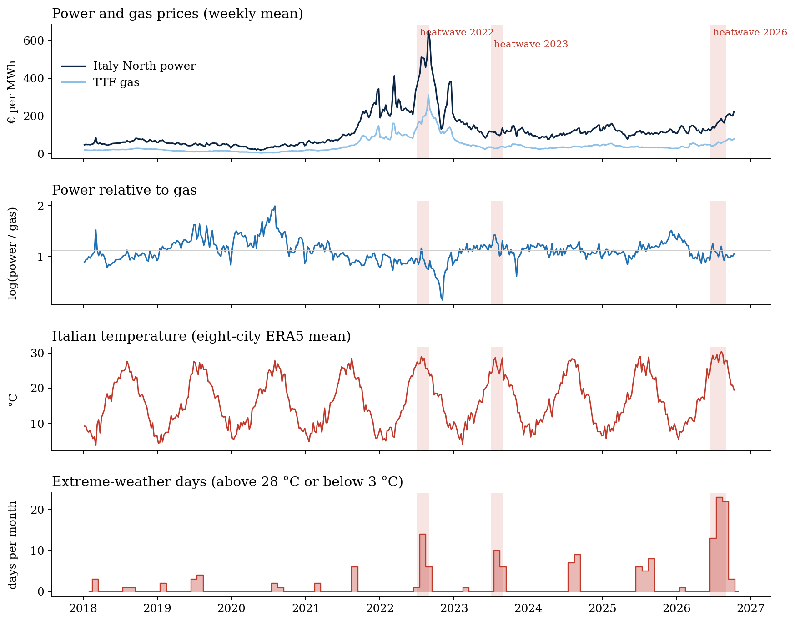

**The gas link and the weather link through time.** Weekly power and gas moved almost one for one through the 2022 gas crisis (a rolling correlation near 0.9), less closely afterwards, and hardly at all during the 2026 heatwave. The link between power relative to gas and the distance from a comfortable 21 °C averages 0.23 and rises to 0.33 in the three worst heatwave summers (2022, 2023, 2026).

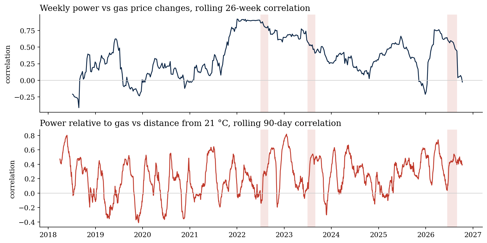

**On the real data, 2018–2026:**
- **Gas first, then a U-shaped temperature effect.** Modelled as price relative to gas, XGBoost clearly beats a straight line on years it hasn't seen (RMSE 0.174 against 0.255), which it did not on the simulated data. SHAP finds the expected U: power is dearer relative to gas in cold weather and above about 27 °C, and cheapest around 18–25 °C. After gas, load matters most, then temperature.
- **Extreme weather calms the volatility.** GARCH-MIDAS finds the monthly count of extreme days (Italy-wide mean above 28 °C or below 3 °C) significant (likelihood ratio 27.6, p ≈ 10⁻⁶) but with a **negative** sign (θ = −0.15). The same holds for the raw price (θ = −0.07). In heatwaves gas plants set the price every hour and power simply tracks gas; mild, sunny months are when solar makes prices swing. Cold months are too few (5) to judge.
- **A forecast could add almost nothing.** Fitted on 2018–2022 and scored on 2023 onwards, knowing each month's extreme-day count *exactly* lowers the volatility forecast loss by **0.7%** against plain GARCH. Last month's count does as well (0.9%), and the calendar average 0.2%. No seasonal forecast can beat perfect knowledge, so 0.7% is the ceiling on what one is worth here.

| | |
|:-:|:-:|
| 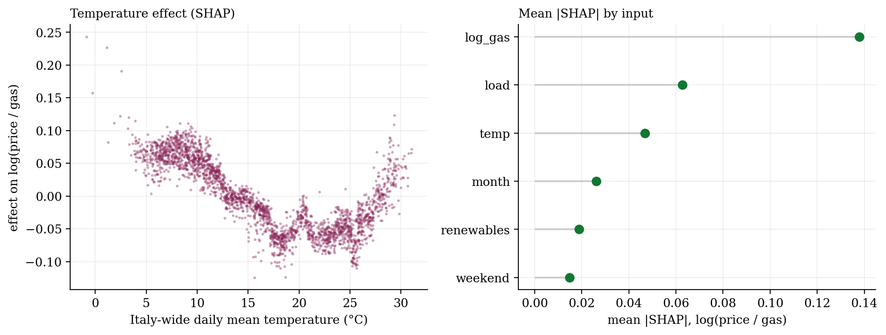 | 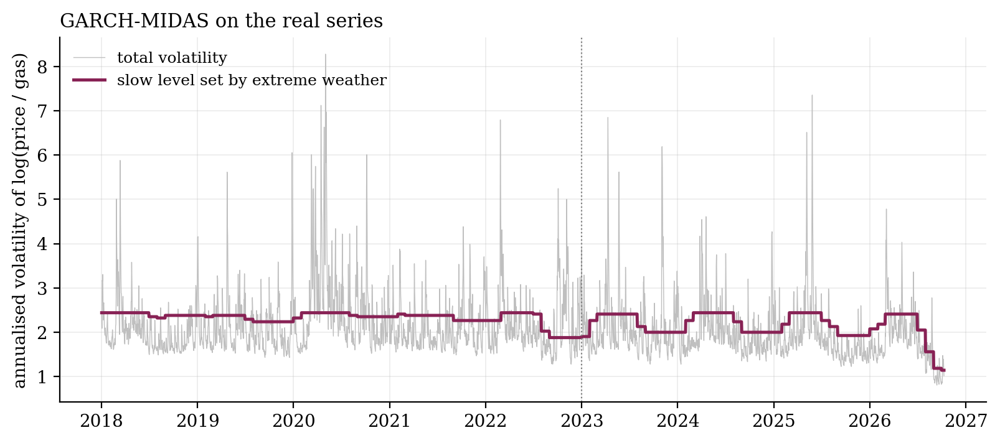 |

**The method check on simulated data.** The simulated data has the same shape as the real series but with the relationships planted. On it, GARCH-MIDAS recovers the weather effect without bias (θ̂ = 0.118 against 0.12 planted), though single estimates range from 0.05 to 0.18. A power calculation showed that a modest effect needs a long test period to detect.

| | |
|:-:|:-:|
| 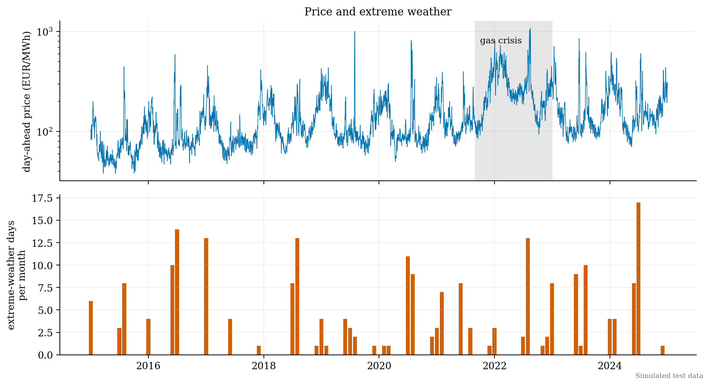 | 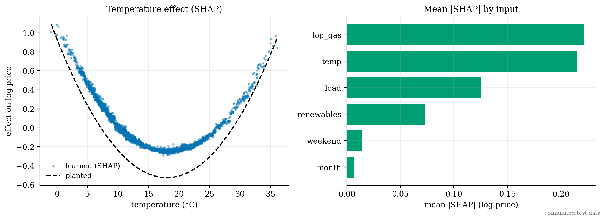 |
| 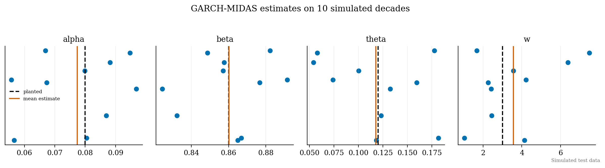 | 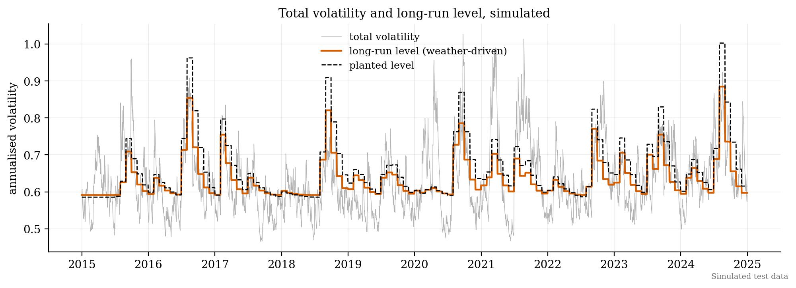 |
| 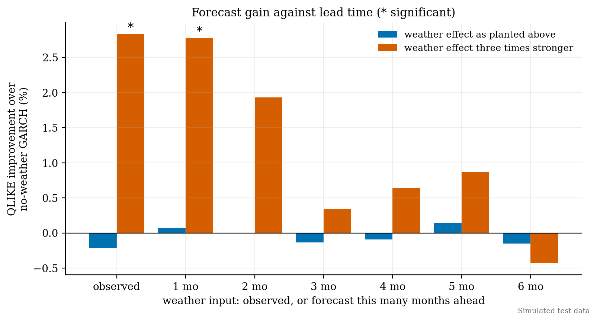 | |

**A real seasonal forecast, tested.** Each month from 2023, ECMWF's SEAS5 forecast of the next three months' temperature over northern Italy is fed through the temperature-price relationship learned on 2018-2022, and scored against climatology (a normal season) on the level of power relative to gas and on its volatility. The forecast itself is weak here (a correlation of 0.28 with the observed three-month temperature), and it adds nothing: no skill on volatility (-0.02) and clearly worse than climatology on the level (-3.9), because the relationship learned through the 2022 gas crisis doesn't carry into calmer years. That fits the ceiling found above, 0.7% even with perfect knowledge of the extremes; for Italian power, the weather's signal is day to day, not season to season. `seasonal_test.py`

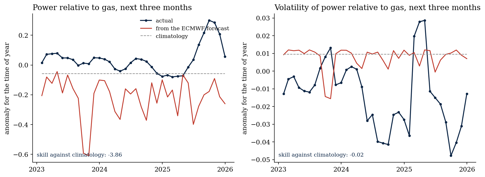

**Built:** time-ordered cross-validation; XGBoost + SHAP; GARCH-MIDAS by maximum likelihood with beta-lag weights; GARCH(1,1); QLIKE scoring; Diebold–Mariano tests.

`power.py` · `fetch_real.py` · `run_real.py` · `make_power_figures.py` · `italian_power.ipynb` · `check_midas.py` · Python, XGBoost, SHAP, SciPy

**Limits:** one bidding zone (Italy North) rather than the national PUN. A temperature-only definition of extreme weather. No archive of real seasonal forecasts, so stage 3 gives the upper bound only. TTF gas from Yahoo Finance is not redistributed; `fetch_real.py` downloads it again.

*A side project, built for fun. Builds on Guerzoni, Riso & Zoia (2026); GARCH-MIDAS from Engle, Ghysels & Sohn (2013), Rev. Econ. Stat. 95, 776; QLIKE from Patton (2011); Diebold & Mariano (1995). Data: day-ahead prices and Italian generation from Energy-Charts (Fraunhofer ISE), CC BY 4.0, originally ENTSO-E; ERA5 via Open-Meteo (CC BY 4.0); TTF via Yahoo Finance.*
