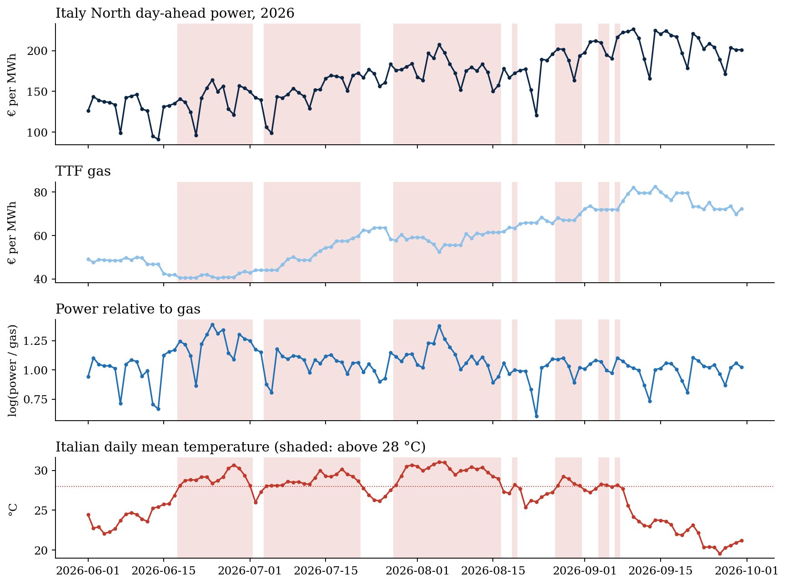
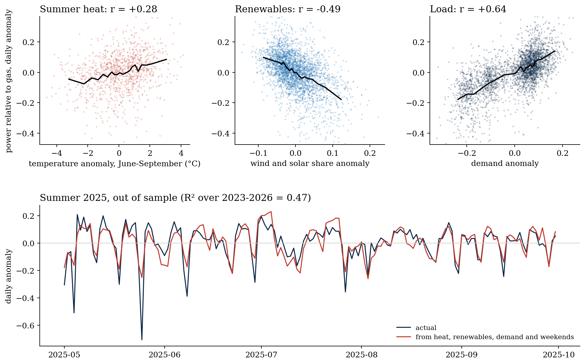

# Correlation study between weather and the Italian power price

## Overview

This project came out of my training at work, where I recreated some of the standard papers in the field, and I have taken it further in my own time. As is well known, gas plants set the Italian power price in most hours, so the price mostly follows Dutch TTF gas. This project aims to strip the gas signal out of the Italian power price, first by modelling power relative to gas. It is a recreation of the GARCH-MIDAS analysis (a volatility model in which a monthly variable, here extreme weather, shifts the daily volatility) of Guerzoni, Riso & Zoia (2026), who found extreme weather to be a significant driver of Italian power-price volatility, here on real Italy North prices for 2018-2026.

The aim was to measure what drives the price relative to gas, what drives its volatility, and how much ECMWF's seasonal weather forecast can add.

Via GARCH-MIDAS, it was found that the monthly count of extreme-weather days is significant (p ≈ 1.5 × 10⁻⁷), but with the opposite sign to the 2026 study, so months with more extreme days have calmer prices relative to gas. This is because in heatwaves gas plants set the price in every hour, so power simply follows gas, while in mild, sunny months solar sets the price for part of the day and the price swings most. Growing solar in the Italian grid may be starting to offset the effect of cooling demand on hot days. Even knowing each month's count of extreme days in advance improves the volatility forecast by only 0.7%, measured by its forecast error.

In a covariate analysis of daily prices, it was found that demand, renewable production, heat and the day of the week are the main predictors of the power price relative to gas, as is commonly understood. Together they explain 47% of the daily swings out of sample, and in summer 2026 power ran about 11% higher relative to gas on days above 28 °C.

ECMWF's seasonal forecast added nothing over a normal season when used to predict the next three months, as the weather's signal in Italian power is day to day and a three-month average washes it out. It would be very interesting to take this further with the AI ensemble forecasts and stochastic event sets now available. Using weather to inform energy trading is already common practice, and there has never been more potential for it.

### Taking gas out first

Gas plants set the Italian price in most hours, so the price mostly follows TTF gas. In our case everything below works on power relative to gas, log(power / gas), so what is left can be tied to the weather.

### Day by day

The relationship shows best at daily resolution, one summer at a time. We see each hot spell through June-September 2026 lift power above gas. The daily correlation of power relative to gas with temperature was 0.41, and on days above 28 °C power ran about 11% higher relative to gas than on other days. In summer 2022 the figures were 0.52 and about 19%.

### The gas link and the weather link through time

Weekly power and gas moved almost one for one through the 2022 gas crisis (a rolling correlation near 0.9), less closely afterwards, and hardly at all during the 2026 heatwave. The link between power relative to gas and the distance from a comfortable 21 °C averages 0.23 and rises to 0.33 in the three worst heatwave summers (2022, 2023, 2026).

### On the real data, 2018–2026

Modelled as price relative to gas, XGBoost clearly beats a straight line on years it hasn't seen (RMSE 0.174 against 0.255), which it did not on the simulated data. SHAP finds the expected U: power is dearer relative to gas in cold weather and above about 27 °C, and cheapest around 18–25 °C. After gas, SHAP ranks load first and temperature second.

GARCH-MIDAS finds the monthly count of extreme days (Italy-wide mean above 28 °C or below 3 °C) significant (likelihood ratio 27.6, p ≈ 1.5 × 10⁻⁷) but with a negative sign (θ = −0.15), so extreme weather calms the volatility. The same holds for the raw price (θ = −0.07). This is because in heatwaves gas plants set the price every hour, so power simply follows gas. It is the mild, sunny months, when solar sets the price for part of the day, that swing most. Cold months are too few (5) to judge.

With no weather effect (θ = 0) the shape of the lag weights drops out of the model, so the likelihood ratio with both θ and the shape free isn't χ² with 2 degrees of freedom (Davies 1987). The p-value above is from the test with the shape fixed at flat weights over six months, which leaves θ as the one extra parameter (χ² with 1 degree of freedom). Flat weights are also where the free fit lands, so that choice was made knowing the fit. The bootstrap doesn't depend on it. We simulated 499 series with no weather effect, from the fitted model and its own shocks, and refitted both models to each. The free-shape ratio's 95th percentile is 8.2 against 6.0 for χ², and none of the 499 reached 27.6 (p ≈ 0.002, the smallest 499 draws can show). `run_real.py` · `lr_bootstrap.py`

A forecast could add almost nothing. Fitted on 2018–2022 and scored on 2023 onwards, knowing each month's extreme-day count in advance lowers the volatility forecast loss by 0.7% against plain GARCH (Diebold–Mariano t = −2.37). Last month's count does slightly better (0.9%, t = −3.08), and the calendar average 0.2% (t = −1.94). This means the gain comes partly from plain GARCH being misspecified, so 0.7% is the gain from extreme days within this model rather than a ceiling on what a forecast could be worth.

| | |
|:-:|:-:|
|  |  |

### The method check on simulated data

The simulated data has the same shape as the real series but with the relationships planted. On it, GARCH-MIDAS recovers the weather effect without bias (θ̂ = 0.118 against 0.12 planted), though single estimates range from 0.05 to 0.18. A power calculation showed that a modest effect needs a long test period to detect.

| | |
|:-:|:-:|
|  |  |
|  |  |
|  | |

### Daily drivers

Taking each day's power-to-gas price as an anomaly against its own 30-day mean (so slow regimes like the gas crisis drop out), a simple model of demand, wind and solar share, heat, cold and weekends, learned on 2018-2022, explains 47% of the daily swings in 2023-2026, out of sample. This means the weather and renewables move the price clearly day to day. Demand is the strongest driver (r = +0.64), renewables push the price down (r = -0.49), and summer heat lifts it (r = +0.28 for June-September days), mostly through the demand it creates. Over the whole year raw temperature shows almost nothing (r = -0.05), because cold days raise the price in winter and hot days in summer.

### A real seasonal forecast, tested

Each month from 2023, ECMWF's SEAS5 forecast of the next three months' temperature over northern Italy is fed through the temperature-price relationship learned on 2018-2022, and scored against climatology (a normal season) on the level of power relative to gas and on its volatility. The forecast itself is weak here (a correlation of 0.28 with the observed three-month temperature), and it adds nothing: no skill on volatility (-0.02) and clearly worse than climatology on the level (-3.9). The three-month relationship learned in 2018-2022 is dominated by the gas crisis, when power fell relative to gas in warm months, so every warm forecast for 2023-2026 pulls the prediction down. This means the three-month relationship is an artefact of the gas crisis rather than a weather signal. This fits the small gains found above, where even perfect knowledge of the extremes was worth 0.7%. For Italian power the weather's signal is day to day, and a three-month average washes it out. `seasonal_test.py`

**Built:** time-ordered cross-validation; XGBoost + SHAP; GARCH-MIDAS by maximum likelihood with beta-lag weights; GARCH(1,1); QLIKE scoring; Diebold–Mariano tests.

`power.py` · `fetch_real.py` · `run_real.py` · `make_power_figures.py` · `italian_power.ipynb` · `check_midas.py` · Python, XGBoost, SHAP, SciPy

**Limits:** one bidding zone (Italy North) rather than the national PUN. A temperature-only definition of extreme weather. The SEAS5 test covers only 2023-2026. TTF gas from Yahoo Finance is not redistributed, so `fetch_real.py` downloads it again.

*A side project, built for fun. Builds on Guerzoni, Riso & Zoia (2026); GARCH-MIDAS from Engle, Ghysels & Sohn (2013), Rev. Econ. Stat. 95, 776; QLIKE from Patton (2011); Diebold & Mariano (1995). Data: day-ahead prices and Italian generation from Energy-Charts (Fraunhofer ISE), CC BY 4.0, originally ENTSO-E; ERA5 via Open-Meteo (CC BY 4.0); TTF via Yahoo Finance.*
