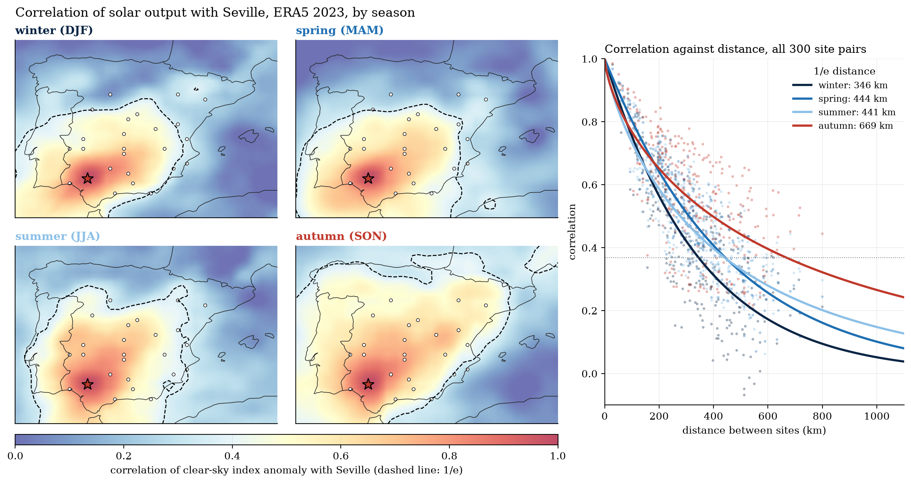
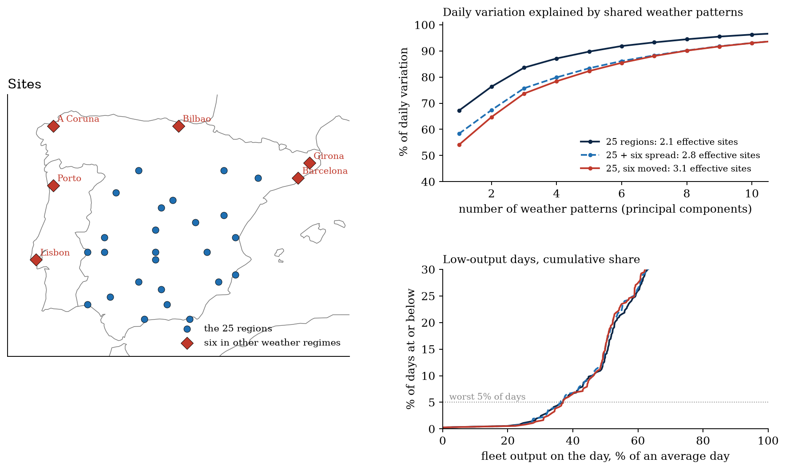
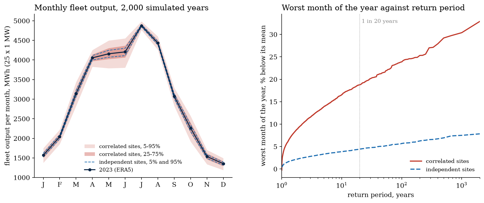
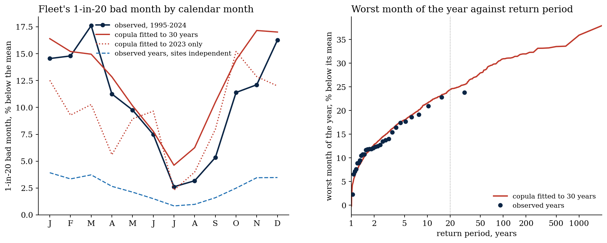
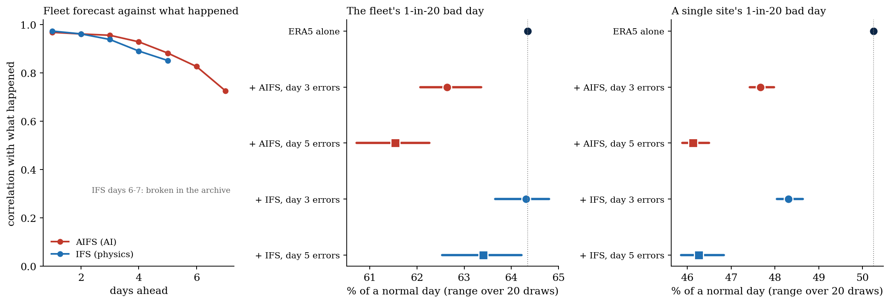

# Correlated risk structures in a Spanish solar portfolio

## Overview

A fleet of solar plants carries correlated risk. If each site's P95, its output in a bad year, is worked out on its own, the fleet's bad year is underpriced. This is because the sites are spatially correlated. The same cloud and weather events can cover many sites at once, and one site's climate is correlated with another site's climate. This project built a quick framework for measuring that correlated risk. This step has to come before simulated or stochastic weather can be used to price a portfolio's risk.

The aim was to measure the extent of correlation between 25 Spanish PV locations, and to assess its impact on the fleet's output and revenue at OMIE prices. ERA5 data define the correlated risk baseline (through correlations, copulas and similar tools), and ECMWF's physics (IFS) and AI (AIFS) forecasts are then tested as tools to monitor and project this correlated risk structure into the future.

It was found that the correlation between sites falls to 1/e (about 0.37, the usual measure of how far a decaying correlation reaches) over 350 to 670 km, depending on the season. So the 25-site portfolio behaves more like 3 to 4 independent sites, through a lack of climatic diversification. On the worst 5% of days in 2023, the fleet produced 16% less than an independent risk model would suggest. Over 30 years of ERA5, the fleet's 1-in-20 bad month is 10.5% below normal, four times deeper than the 2.5% that independent sites give, and a copula event set (simulated months that keep the correlation between sites) reproduces this. It was also found that forecast errors are far more local than the weather, and in general cancel out over a spatially spread portfolio.

The project reinforces the need to always model the correlated risk structure of a solar fleet, based on shared weather and also on a shared market. I would love to repeat the analysis on downscaled weather, including the impact of correlated market risk.

| | |
|:-:|:-:|
|  |  |
|  |  |
|  |  |

## Correlated risk in money

Each site is given 1 MW of solar, its hourly output proxied by ERA5 irradiance, and sold at the OMIE Spanish day-ahead price of that hour through 2023.

Solar output peaks in the middle of the day, when the price is lowest, so the sites captured on average 80% of the year's average price (€69 against €87 per MWh). On the worst 5% of days the 25-site fleet produced 37 MWh, against 44 MWh if each site's days were shuffled independently within the same month (keeping the season, breaking only the shared weather). This means shared weather made the bad days 16% lower in output.

Shared prices made them far worse in revenue. The worst 5% of days earned about €350 against a €7,000 average, and about €2,500 if the sites were independent. Most of that gap is the price, which is the same for every site: on 36 days in 2023 the midday price was below €10 per MWh, and on those days the whole fleet earned almost nothing at once. This means summing each site's P95 underprices a fleet twice: once for the weather the sites share, and again for the market they all sell into. `revenue_risk.py`, prices from OMIE.

## Spreading the sites

The 25 regions are mostly in the dry south and centre. Six sites in other weather regimes were added (A Coruna, Porto, Bilbao, Barcelona, Girona, Lisbon), with each site again 1 MW and output from ERA5 irradiance through 2023.

On daily output with the season removed, the 25 regions act like 2.1 independent sites. Adding the six raises that to 2.8, and moving six of the most clustered southern sites to the new regimes, keeping 25 MW, raises it to 3.1, about half as much again. The worst days do not improve, though: the fleet's worst 5% of days stay at about 37% of an average day in every version. This is because those days are winter fronts that cover the whole peninsula, and the northern sites are cloudier anyway, so spreading lowers everyday correlation without lifting the tail. `spread_sites.py`

## A first stochastic event set

A P95 needs many more bad months than one year of weather holds, so the next step is to simulate them. From the 2023 ERA5 output of the 25 regions, each site's day is split into its monthly mean and a daily anomaly. The anomalies are joined by a Gaussian copula: each site keeps its own anomaly distribution, the sites are tied together by their rank correlation (0.63 on average between pairs), and each day carries over part of the day before (a day-to-day correlation of 0.60 in the shared weather). 2,000 years are drawn twice, once with the fitted correlation and once with the sites independent, and the fleet's monthly output is read off each.

We see the shared weather make up most of the tail. The fleet's 1-in-20 bad month falls 9.2% below normal on average across the year with correlated sites, against 2.3% if the sites were independent, about four times deeper. In one year in twenty the fleet's worst month of the year is 19% below its mean, and with independent sites it would be 4%. By month, the bad month is deepest from October to January (12-15% below normal), when fronts cross the whole peninsula, and shallowest in July (2%). One year only gives the day-to-day weather inside that year, though, and not a whole month or year cloudier than usual. `event_set.py`

### Thirty years

The same fleet was followed through 1995-2024 with ERA5 daily radiation from the Open-Meteo archive. The 30 real years give the fleet's 1-in-20 bad month directly (the 5th percentile of 30 years, between the worst and second worst, so rough), and the copula was refitted to all 30 years of daily anomalies.

We see the real years agree with the copula. Over the 30 years the fleet's 1-in-20 bad month is 10.5% below normal on average across the calendar, against 2.5% if each site's year were drawn on its own: four times deeper, as the 2023 copula said. 2023 was a sunny year (22nd of 30 for output), so the one-year copula was a little light. It put the 1-in-20 month at 9.2% below normal, and refitted to 30 years it gives 12.3%, slightly deeper than observed and so a cautious estimate.

The refitted copula reproduces the real years' extremes. The worst month of each year, plotted against how often it comes round, falls on the simulated curve: about 24% below normal once in twenty years. The deepest months are in winter and March (15-18%), when fronts and cut-off lows sit over the peninsula for weeks. The worst month of all was March 2022, 24% below normal, a month of rain and Saharan dust. Whole years vary much less: the 1-in-20 year is about 3% below normal (2018, the worst, 4.9%).

A Gaussian copula has no tail dependence, so we checked whether the sites have their bad days together more often than it allows. For each pair of sites we take how often both are in their worst q of days, divided by q (χ in Coles, Heffernan and Tawn 1999), and average over the 300 pairs. Over the 30 years it falls from 0.41 at q = 10% to 0.23 at q = 1%, close to the Gaussian copula's 0.44 and 0.25, so the copula doesn't understate joint bad days. A t copula, which keeps joint extremes at any level, fits the daily data much better by likelihood (6 degrees of freedom), but the extra joint extremes in the data are at the sunny end (0.56 falling to 0.41, against the Gaussian's 0.44 to 0.25). At the bad end the t copula overstates them (0.49 to 0.37). Run through the event set it gives almost the same answers: the 1-in-20 bad month is 12.0% below normal on average (12.3% with the Gaussian), and the 1-in-20 worst month of the year 23.6% (24.4%).

`fetch_era5_daily.py` · `event_set_30y.py` · `copula_tails.py`

### The two forecast models in the event set

The first idea was to treat each model's 7-day forecast as a day that could have happened, the way extreme-weather studies stretch short records with forecast ensembles. At a week ahead the forecasts are still too good for that: AIFS's day-7 fleet forecast follows what happened with a correlation of 0.72, so its days aren't new weather. That needs forecasts weeks or months ahead. What the models can give now is their errors: a forecast error field is a realistic pattern of the weather turning out differently from what was expected, across all 25 sites at once. Each of the 30 years of ERA5 days was perturbed with an error field from a scored day within a month of the same date, from IFS or AIFS, 3 or 5 days ahead, 20 times over.

We see the errors widen a single site's tail far more than the fleet's. A single site's 1-in-20 bad day falls from 50% of a normal day to 46-48%, while the fleet's moves from 64% to 61.5-64%. This is because forecast errors are local and largely cancel across the fleet, while the shared weather doesn't.

With day-5 errors the fleet's 1-in-20 bad day is 61.5% under AIFS and 63.4% under IFS, about two points apart. AIFS's errors are smaller at a single site but more widely shared (they reach about 230 km against 170 km for IFS), so they cancel less across the fleet. The gap between the two models is the event set's model uncertainty, small next to the effect of shared weather. `event_set_forecasts.py`

## Two forecast models: ECMWF IFS and AIFS

ECMWF now runs two global models side by side: IFS, the physics model, and AIFS, an AI model trained on ERA5 and built with the same Anemoi tools as the dataset above. Both forecast surface solar radiation. Their daily solar-energy forecasts 1–7 days ahead at the 25 sites, from March 2025, are scored against ERA5. The test period runs from February to October 2026, and skill is measured against each site's climatology:

$$\text{skill} = 1 - \frac{\text{MSE}(\text{forecast})}{\text{MSE}(\text{climatology})}.$$

At a single site AIFS scores higher than IFS from day 2 (0.73 against 0.57 by day 4). For the fleet IFS is ahead on days 1 and 2 (0.93 against 0.89 on day 1), AIFS leads on day 4 (0.87 against 0.80), and at day 5 they are close (0.72 against 0.76).

IFS days 6 and 7 are left out. In the archive part of each of those days is missing: on clear June days the IFS day-6 forecast is about 40% of every other lead's, and its skill drops from 0.85 to 0.35 in a day, which no real forecast does. ECMWF's open IFS data switches from 3-hourly to 6-hourly steps after 144 hours, which is where the daily totals break. An earlier version of this page compared the two models at days 6-7 on those broken values.

The weather's daily anomaly stays correlated over L = 506 km, so over the 2026 test period the 25 sites act like 1.7 independent ones. The day-3 forecast errors decorrelate over 233 km (AIFS) and 167 km (IFS), so 3.0 and 4.3 independent sites. This means pooling the fleet cancels forecast error much better than it diversifies the weather. This is why fleet skill is higher than single-site skill. IFS, whose errors are the most local, gains the most from pooling.

A straight-line correction per site and lead, trained on the first 60% of days, adds nothing to either model. It is kept in `aifs/results/skill.csv`.

| | |
|:-:|:-:|
|  |  |
|  | |

`aifs/fetch_openmeteo.py` · `aifs/score_forecasts.py` · `aifs/make_figures.py`. The forecasts come from Open-Meteo's archive by lead time. ECMWF's own open-data bucket (`aifs/fetch_forecasts.py`) throttled to a few kB/s, and its pre-2025 IFS files carry no solar radiation.

**Built:** an ERA5 → Anemoi Zarr pipeline for Iberia (recipe, restartable CDS download as a Slurm array); clear-sky index with correct ERA5 accumulation timing; Gaussian-rank correlation and random-matrix cleaning via [corrlib](../004-corrlib-correlation-toolbox); a fitted stretched-exponential correlation model; effective number of sites.

`iberia_datasets/` · `solar_sites.py` · `solar_01_correlation.ipynb` · `make_cover.py` · Python, anemoi-datasets, ERA5, Zarr, corrlib

**Next:** CERRA at 5.5 km, since ERA5's 31 km grid smooths small clouds and these lengths are upper bounds. Then prices, cannibalisation, and the forecasts scored in money.

*A side project, built for fun. Weather: ERA5 (Hersbach et al. 2020, [doi:10.1002/qj.3803](https://doi.org/10.1002/qj.3803)). Forecasts: ECMWF AIFS Single and IFS (Lang et al. 2024, arXiv:2406.01465), CC BY 4.0, via the Open-Meteo forecast archive. Contains modified Copernicus Climate Change Service information (2023); neither the European Commission nor ECMWF is responsible for any use of it.*
