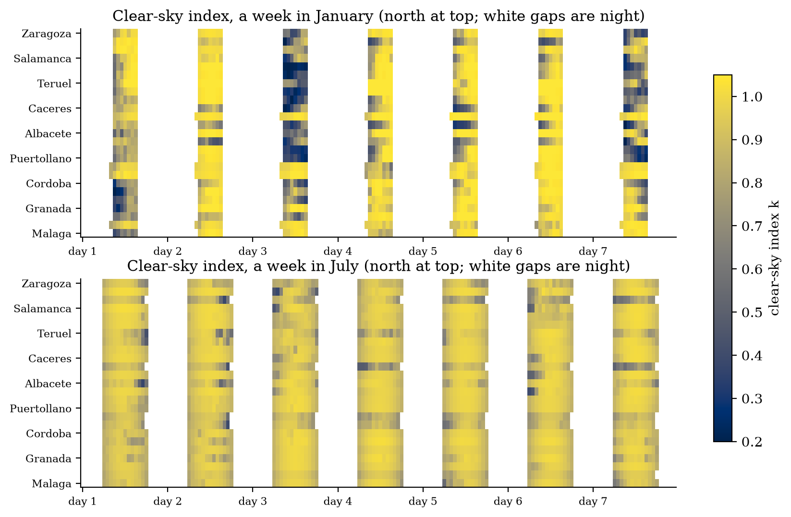
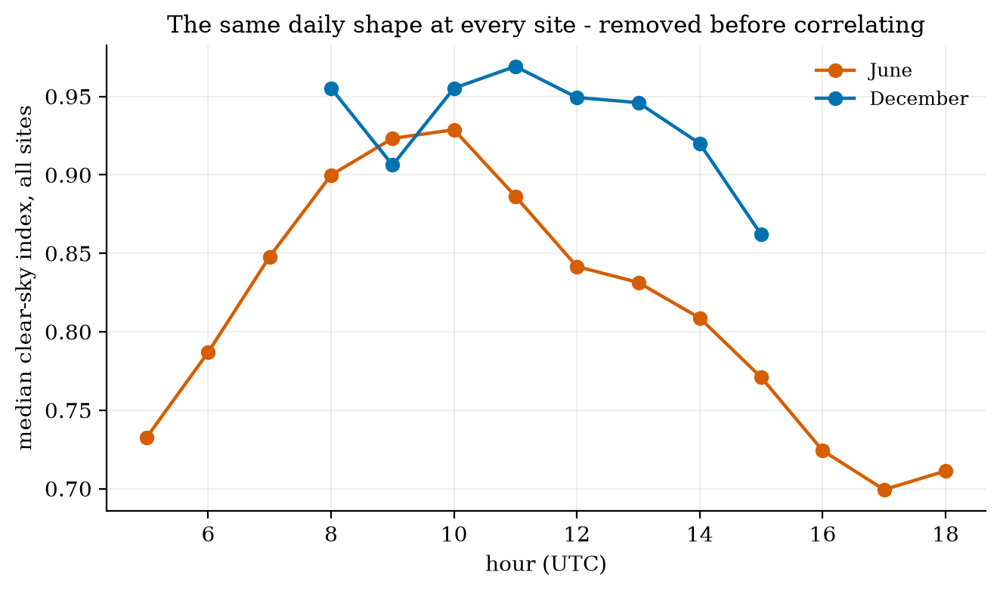
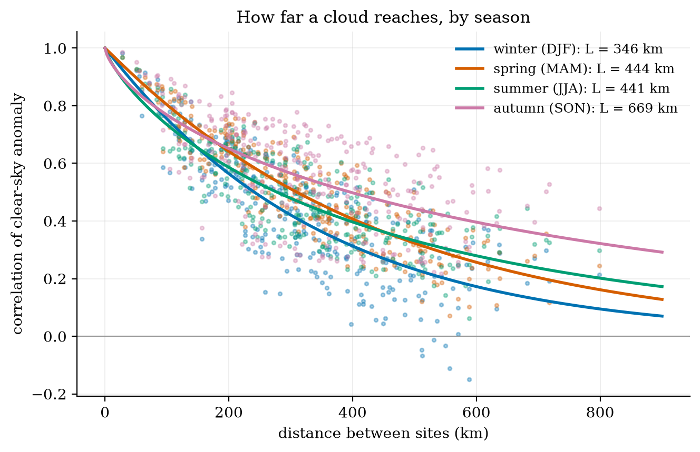
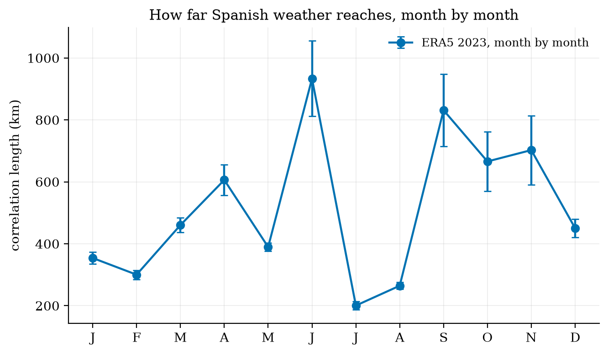
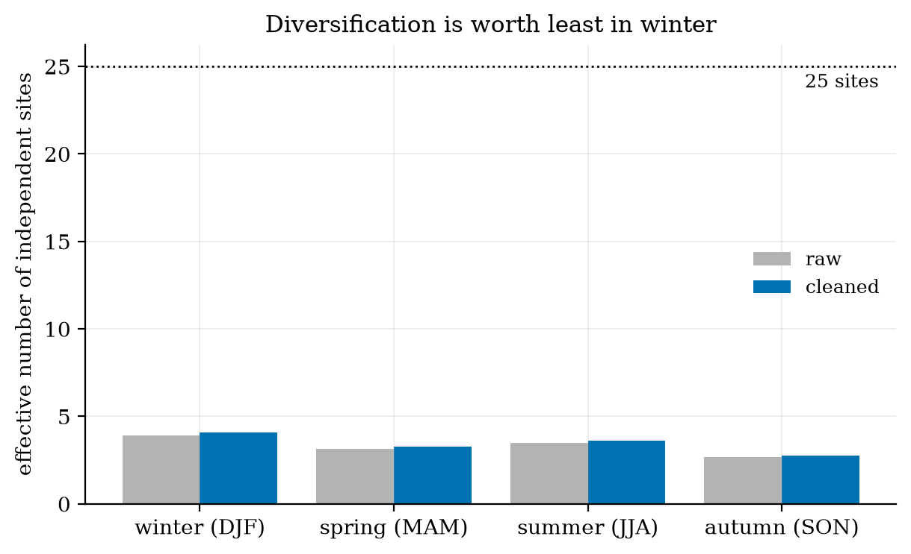
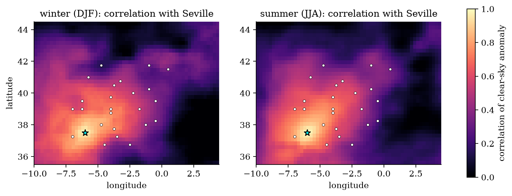
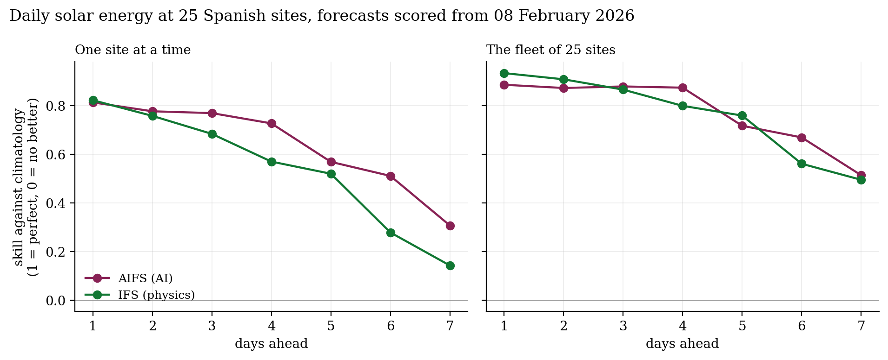
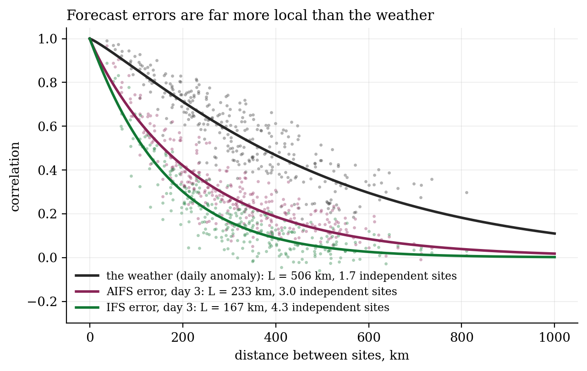
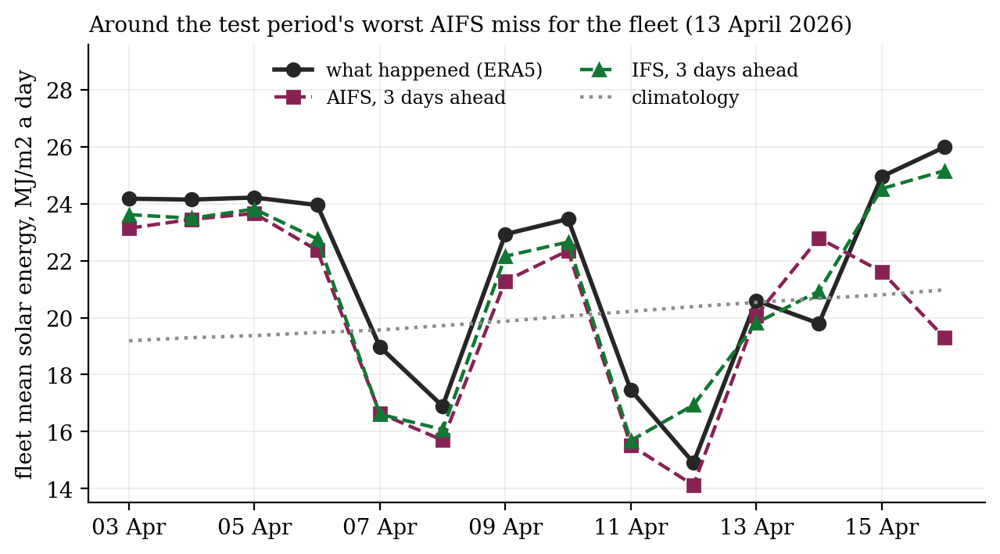

# How far does a cloud reach?

**Spain is building solar farms across a thousand kilometres of country. A year of ERA5 weather shows they behave like three or four.**

A solar fleet spread across a country should smooth itself out: when it is cloudy in Seville, it may be sunny in Zaragoza. How much smoothing you actually get depends on one number, the distance over which the weather stays correlated. This project builds the weather data the way ECMWF's AI forecasting models consume it (an Anemoi dataset), then uses it to measure that distance for 25 Spanish solar regions, season by season.

- **The weather reaches far.** Correlation falls to 1/e over about **350 km in winter, 440 km in spring and summer, and 670 km in autumn**. Twenty-five sites diversify like only **3-4 independent ones**.
- **The expected seasonal story does not appear.** Summer's local convective clouds should shorten correlations. Instead, summer's correlation drops faster over the first 100 km, then lingers at longer distances.
- **The first answer was an artefact.** On real data every site seemed almost perfectly correlated with every other. The cause was a daily shape left over by the clear-sky model, which every site shares; it was invisible on synthetic data. Removing it is what makes the numbers mean anything.

| | |
|:-:|:-:|
|  |  |
|  |  |
|  |  |

## AI against physics: whose forecast does a solar fleet want?

ECMWF now runs two global models side by side: IFS, the physics model, and AIFS, an AI model trained on ERA5 and built with the same Anemoi tools as the dataset above. Both forecast surface solar radiation. Their daily solar-energy forecasts 1–7 days ahead at the 25 sites, from March 2025, are scored against ERA5. The test period runs from February to October 2026, and skill is measured against each site's climatology:

$$\text{skill} = 1 - \frac{\text{MSE}(\text{forecast})}{\text{MSE}(\text{climatology})}.$$

- **For one site, the AI model wins from day 2.** By day 4 its skill is 0.73 against IFS's 0.57, and by day 7 it is 0.31 against 0.14.
- **For the fleet, physics wins the first two days.** IFS scores 0.93 against 0.89 on day 1, then the order flips: AIFS leads on day 4 (0.87 against 0.80) and day 6 (0.67 against 0.56). At days 5 and 7 they are level.
- **Forecast errors are far more local than the weather.** The weather's daily anomaly stays correlated over L = 506 km, so the 25 sites act like **1.7** independent ones. The day-3 forecast errors decorrelate over 233 km (AIFS) and 167 km (IFS), so 3.0 and 4.3 independent sites. Pooling the fleet cancels forecast error much better than it diversifies the weather. That is why fleet skill is higher than single-site skill, and why IFS, whose errors are the most local, gains the most from pooling.
- A straight-line correction per site and lead, trained on the first 60% of days, adds nothing to either model (it hurts IFS at days 6–7). It is kept in `aifs/results/skill.csv`.

| | |
|:-:|:-:|
|  |  |
|  | |

`aifs/fetch_openmeteo.py` · `aifs/score_forecasts.py` · `aifs/make_figures.py`. The forecasts come from Open-Meteo's archive by lead time. ECMWF's own open-data bucket (`aifs/fetch_forecasts.py`) throttled to a few kB/s, and its pre-2025 IFS files carry no solar radiation.

**Built:** an ERA5 → Anemoi Zarr pipeline for Iberia (recipe, restartable CDS download as a Slurm array, data-quality checks written as tests, Docker, CI); clear-sky index with correct ERA5 accumulation timing; Gaussian-rank correlation and random-matrix cleaning via [corrlib](../004-corrlib-correlation-toolbox); a fitted stretched-exponential correlation model; effective number of sites.

`iberia_datasets/` · `solar_sites.py` · `solar_01_correlation.ipynb` · `make_cover.py` · Python, anemoi-datasets, ERA5, Zarr, corrlib

**Next:** CERRA at 5.5 km, since ERA5's 31 km grid smooths small clouds and these lengths are upper bounds. Then prices, cannibalisation, and the forecasts scored in money.

*A side project, built for fun. Weather: ERA5 (Hersbach et al. 2020, [doi:10.1002/qj.3803](https://doi.org/10.1002/qj.3803)). Forecasts: ECMWF AIFS Single and IFS (Lang et al. 2024, arXiv:2406.01465), CC BY 4.0, via the Open-Meteo forecast archive. Contains modified Copernicus Climate Change Service information (2023); neither the European Commission nor ECMWF is responsible for any use of it.*
