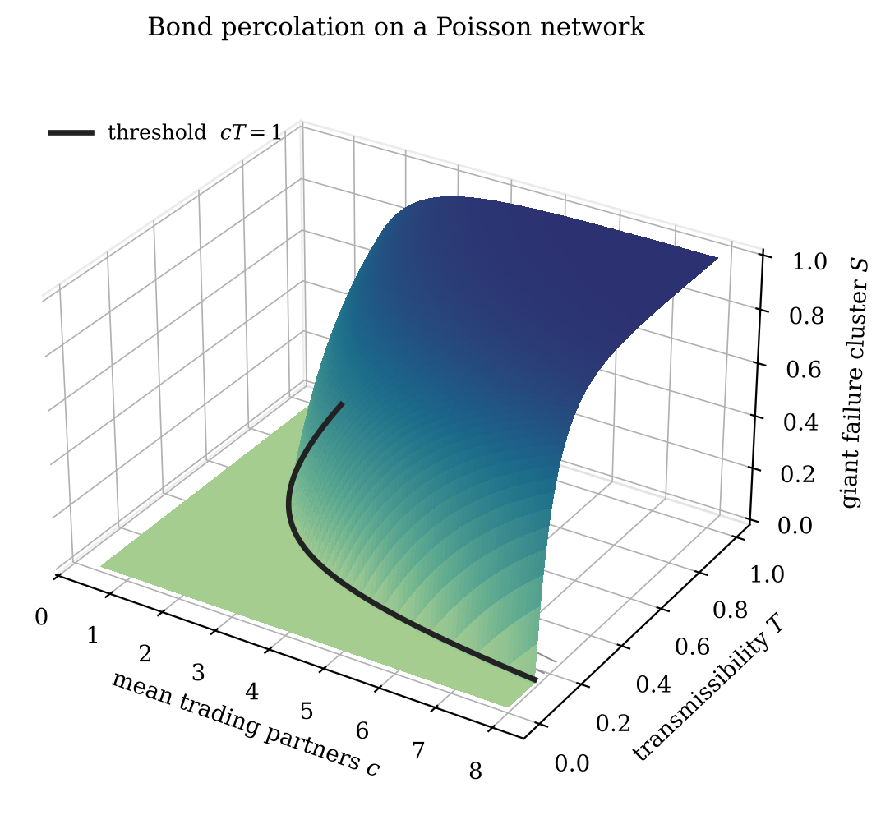
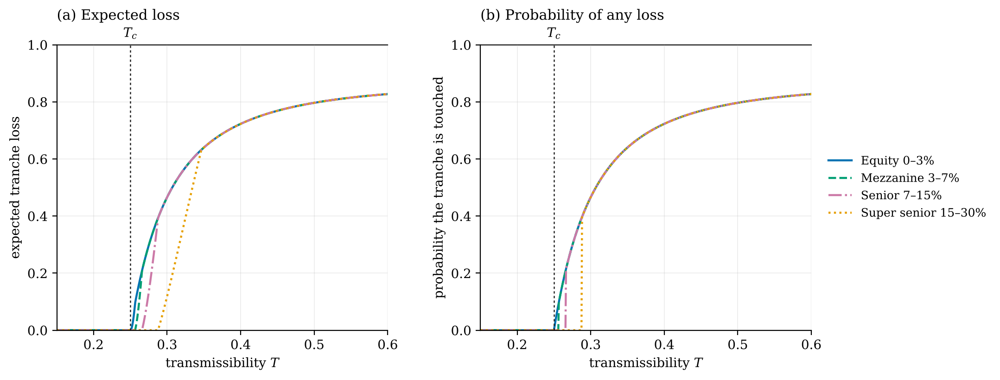
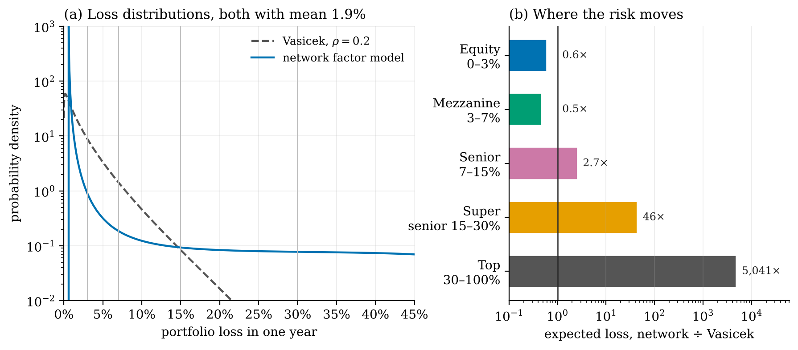
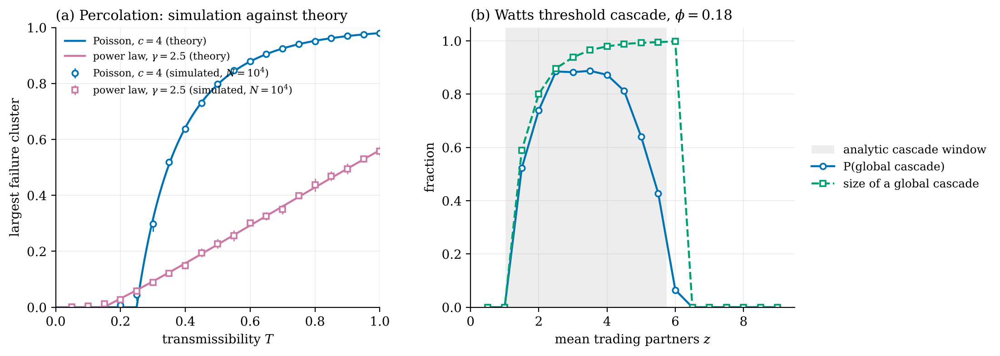

# When does a supply-chain failure reach the senior tranche?

**Percolation theory says a network of firms has a threshold: below it every failure stays local, above it one failure can take a finite share of the whole economy. Put a credit portfolio on that network and, at the same average loss, the risk moves from the bottom of the capital structure to the top.**

In 1972 Robert May showed that a large random ecosystem is stable only while $\sigma\sqrt{NC} < 1$: more species, more links or stronger links tip it into instability, and the change is sharp. In 2008, the year senior credit tranches rated as near riskless lost value together, May, Levin and Sugihara asked what bankers could learn from ecologists. This note follows that question to one precise answer.

Firms are nodes of a random network; a failure passes along each link with probability $T$. A failure cluster spanning the network exists only above

$$T_c = \frac{\langle k\rangle}{\langle k^2\rangle - \langle k\rangle}, \qquad S = 1 - G_0(u),\quad u = 1 - T + T\,G_1(u),$$

where $G_0$ and $G_1$ are the generating functions of the degree and excess-degree distributions (Newman, Strogatz and Watts 2001). The note derives what that does to tranche losses.

- **The senior tranche switches on.** With a single source of failure the loss is two-point, $0$ or $\ell S$. The probability that a tranche is touched at all is zero until the giant cluster passes its attachment point, then jumps.
- **A network-factor model.** With many own-cause defaults the loss of a large portfolio is deterministic, $L = \ell\,[1-(1-p)G_0(v)]$, so the randomness has to come from the economy moving the network across its threshold. The model then has the same one-factor structure as Vasicek's.
- **Equal mean, different tails.** Calibrated to a 1.9% mean annual loss and a network that crosses its threshold about once in 26 years, the 15–30% tranche's expected loss is **46 times** Vasicek's at the same mean (9× to 3,800× across correlations 0.3 to 0.1), while the equity tranche's is about 40% lower.
- **Checked by simulation** on networks of 10,000 firms, for percolation on Poisson and power-law networks and for Watts's threshold cascade, which reproduces the robust-yet-fragile window of Gai and Kapadia.

| | |
|:-:|:-:|
|  |  |
|  | |

**The note:** [`note/percolation_tranche_loss.pdf`](note/percolation_tranche_loss.pdf) (9 pages: percolation on random networks, directed supply networks, threshold cascades, tranche loss, numerical check, limits).

**Built:** generating-function solvers for the giant cluster, the failed fraction with many seeds and the Watts cascade condition; configuration-model networks and sparse cluster search for Monte Carlo; Vasicek tranche losses by quadrature.

`percolation.py` · `simulate.py` · `note/` · Python, NumPy, SciPy sparse, NetworkX, LaTeX

**Limits:** random networks apart from the degree distribution, static links, constant loss given default, own-cause defaults independent of the economy, and a calibration chosen for plausibility rather than fitted to a real pool. The result is structural, not numerical.

**Next:** a graph neural network trained on simulated cascades, tested on whether it recovers $T_c$ for degree distributions it has not seen.

*A side project, built for fun. All figures come from simulated networks. Credits: May (1972), Nature 238, 413; May, Levin & Sugihara (2008), Nature 451, 893; Haldane & May (2011), Nature 469, 351; Newman, Strogatz & Watts (2001), Phys. Rev. E 64, 026118; Callaway, Newman, Strogatz & Watts (2000), Phys. Rev. Lett. 85, 5468; Cohen, Erez, ben-Avraham & Havlin (2000), Phys. Rev. Lett. 85, 4626; Newman (2002), Phys. Rev. E 66, 016128; Watts (2002), PNAS 99, 5766; Gai & Kapadia (2010), Proc. R. Soc. A 466, 2401; Acemoglu, Carvalho, Ozdaglar & Tahbaz-Salehi (2012), Econometrica 80, 1977; Vasicek (2002), Risk 15(12), 160. The percolation and cascade results are theirs; the link to tranche loss is this note's.*
