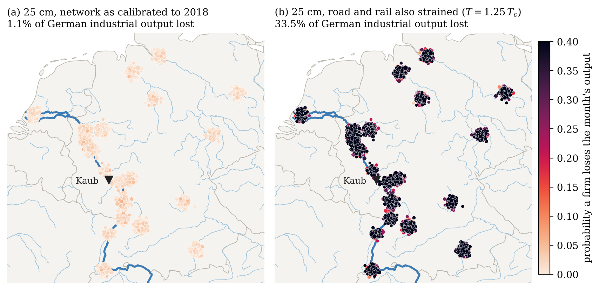
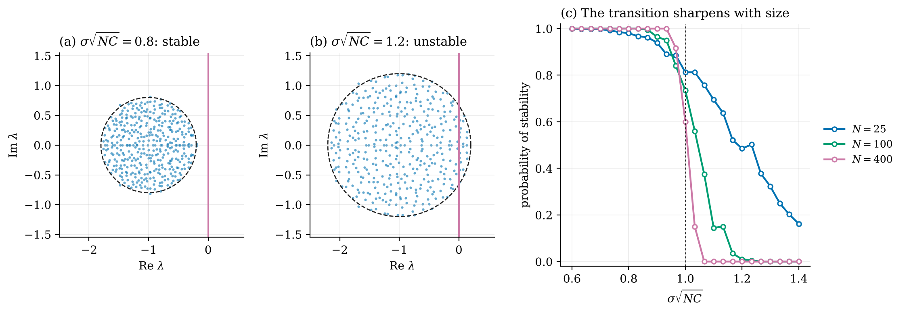
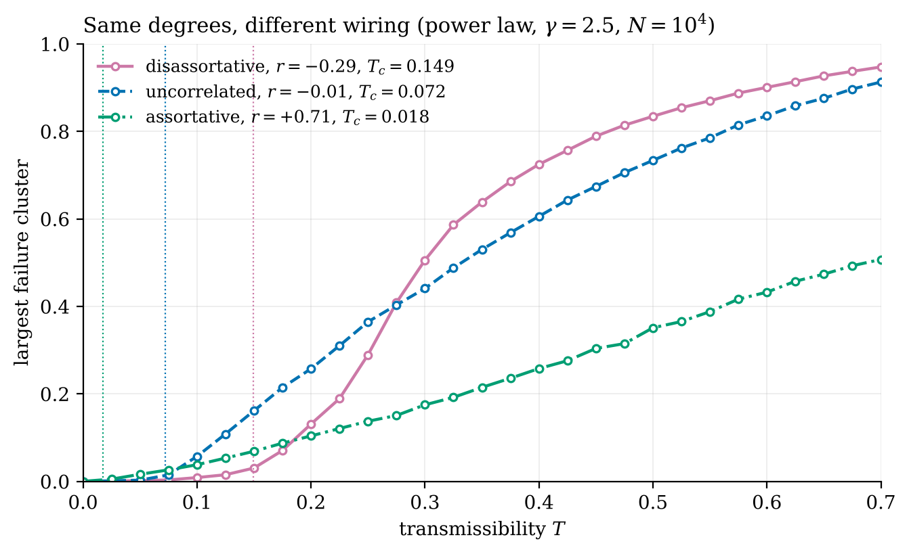
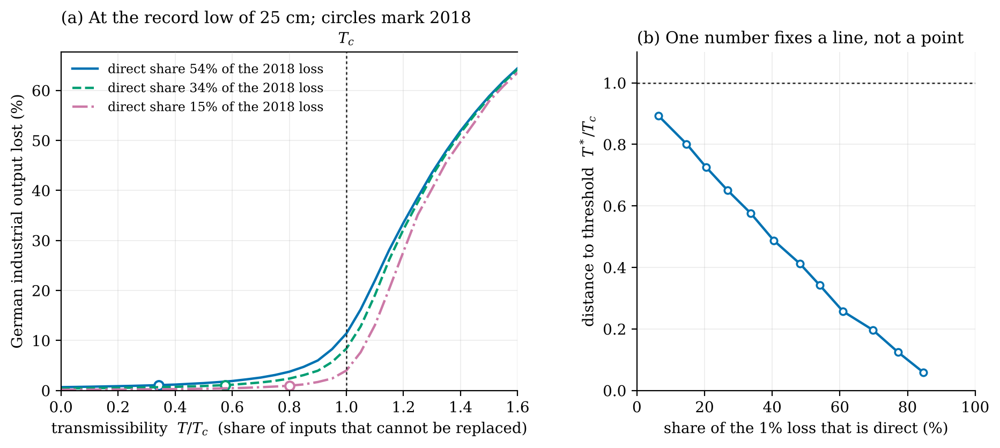
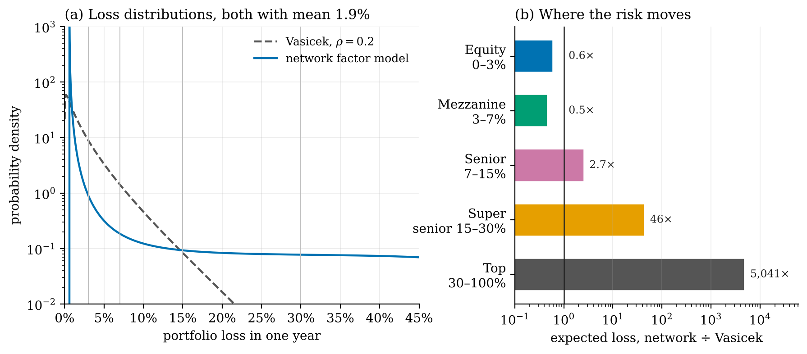

# Ecology for bankers, revisited

**In 2008 May, Levin and Sugihara asked what bankers could learn from ecologists. This note derives the ecologists' tools (May's stability bound, percolation thresholds, disassortative wiring) and turns them on two systems: German industry when the Rhine runs dry, and a structured credit portfolio.**

In 1972 Robert May showed that a large random ecosystem is stable only while $\sigma\sqrt{NC} < 1$. The eigenvalues of its community matrix fill a disc of that radius, and once the disc crosses zero the system tips. Percolation theory gives the network version: failure passing along each link with probability $T$ spreads to a finite share of the whole only above

$$T_c = \frac{\langle k\rangle}{\langle k^2\rangle - \langle k\rangle}, \qquad \text{or, with degree correlations,}\qquad T_c = 1/\Lambda\big[(k'-1)P(k'\mid k)\big].$$

Both are the inverse of a leading eigenvalue.

**Part I: theory.**
- **May's bound, checked.** Simulated community matrices fill the predicted disc, and the probability of stability drops from one to zero at $\sigma\sqrt{NC} = 1$, more sharply as $N$ grows.
- **Disassortative wiring doubles the threshold.** Hubs linked to small nodes (Fedwire, pollination webs) protect against weak contagion: $T_c$ goes from 0.072 to 0.149 for the same degree sequence. Above $T \approx 0.28$ the same wiring fails most completely.

**Part II, case A: the Rhine runs dry.** On 31 July 2026 the Kaub gauge matched its 2018 record of 25 cm. A spatial network of 4,000 firms at the real Rhine-basin centres is calibrated to the estimate that a low-water month costs about 1% of German industrial output.
- **One number fixes a line, not a point.** The same 1% is reproduced by economies anywhere from 6% to 89% of the way to their percolation threshold.
- **The river saturates.** From 55 cm to 25 cm the monthly loss rises by at most 13%.
- **The threshold is set on land.** If road and rail cannot replace the barges ($T = 1.25\,T_c$), the same low water costs about a third of output, and the cascade reaches Stuttgart, Munich and Berlin.

**Part II, case B: structured credit.** At the same 1.9% mean loss as a Vasicek model, the 15–30% tranche carries **46×** the expected loss and equity about 40% less. Risk moves up the capital structure.

| | |
|:-:|:-:|
|  |  |
|  |  |

**The note:** [`note/percolation_tranche_loss.pdf`](note/percolation_tranche_loss.pdf) (16 pages). **Interactive map:** [`maps/rhine_cascade.html`](maps/rhine_cascade.html).

**Built:** circular-law check of May's bound; generating-function solvers for giant clusters, failed fractions and the Watts cascade condition; degree-preserving assortative and disassortative rewiring with the correlated-threshold eigenvalue; a gravity-and-input-output spatial supply network with directed percolation and calibration by bisection; Vasicek tranche losses by quadrature; Monte Carlo checks on networks of 10,000 nodes.

`percolation.py` · `rhine.py` · `simulate_theory.py` · `simulate_rhine.py` · `simulate.py` · `note/` · Python, NumPy, SciPy sparse, NetworkX, folium, LaTeX

**Limits:** the Rhine network is generated, not observed. Its input–output matrix is a stylised eight-sector one, to be replaced by the Destatis 2018 table, which also pins a point on the calibration line. The barge-exposure shares are assumptions. The credit calibration is chosen for plausibility, not fitted to a pool.

*A side project, built for fun. Credits: May, Levin & Sugihara (2008), Nature 451, 893; May (1972), Nature 238, 413; Tao & Vu (2010), Ann. Probab. 38, 2023; Allesina & Tang (2012), Nature 483, 205; Bascompte, Jordano & Olesen (2006), Science 312, 431; Soramäki et al. (2007), Physica A 379, 317; Newman, Strogatz & Watts (2001), Phys. Rev. E 64, 026118; Callaway et al. (2000), Phys. Rev. Lett. 85, 5468; Cohen et al. (2000), Phys. Rev. Lett. 85, 4626; Newman (2002), Phys. Rev. E 66, 016128 and Phys. Rev. Lett. 89, 208701; Boguñá & Pastor-Satorras (2002), Phys. Rev. E 66, 047104; Vázquez & Moreno (2003), Phys. Rev. E 67, 015101; Xulvi-Brunet & Sokolov (2004), Phys. Rev. E 70, 066102; Watts (2002), PNAS 99, 5766; Gai & Kapadia (2010), Proc. R. Soc. A 466, 2401; Haldane & May (2011), Nature 469, 351; Acemoglu et al. (2012), Econometrica 80, 1977; Vasicek (2002), Risk 15(12), 160; Ademmer, Jannsen & Meuchelböck (2023), German Economic Review, doi:10.1515/ger-2022-0077. Rhine facts from KBC Economics (2022), BASF (2019) and ICIS (2018). Basemap: Natural Earth.*
