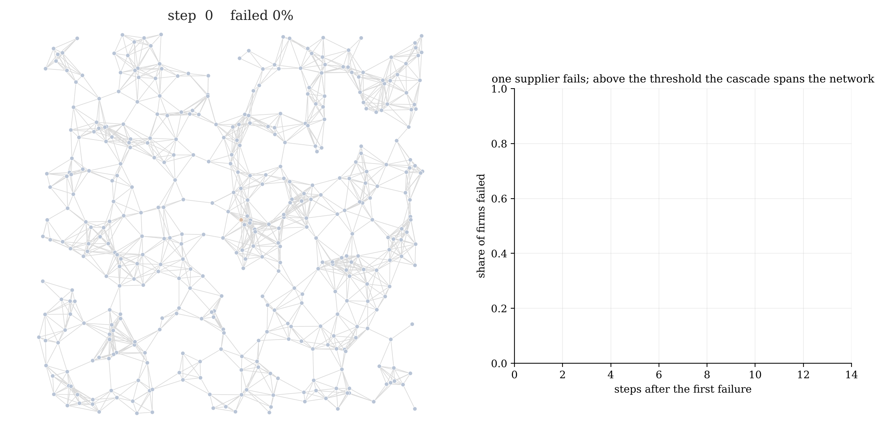
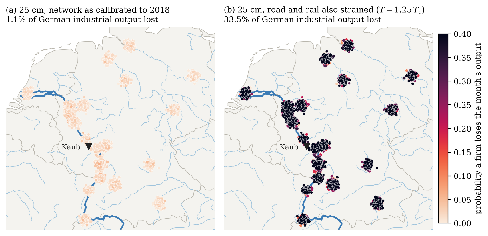
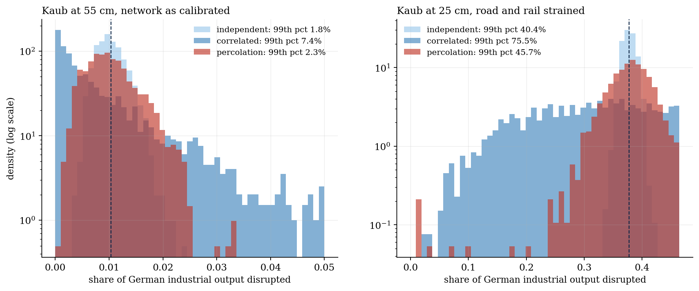
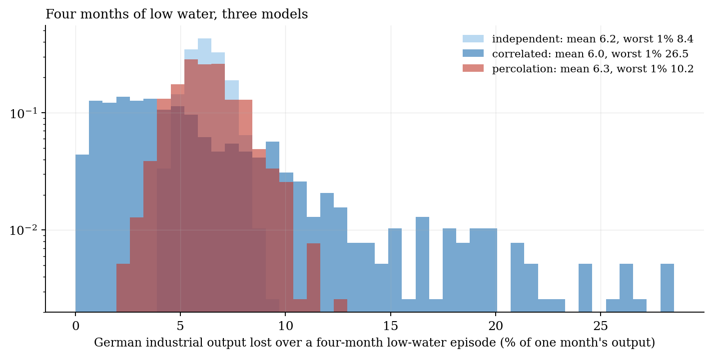
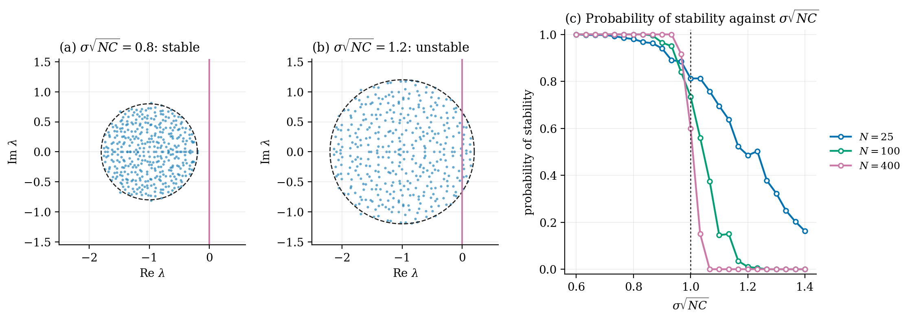
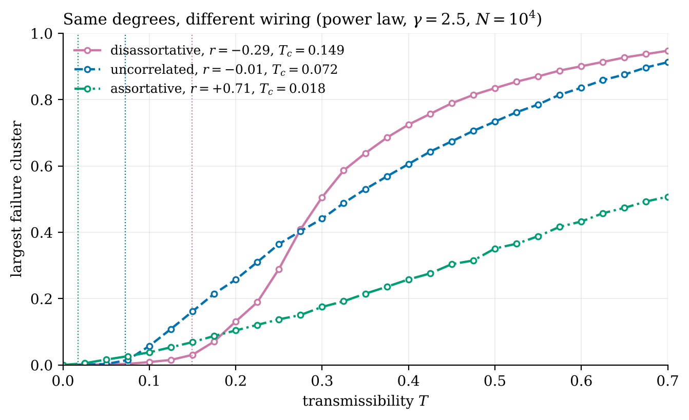
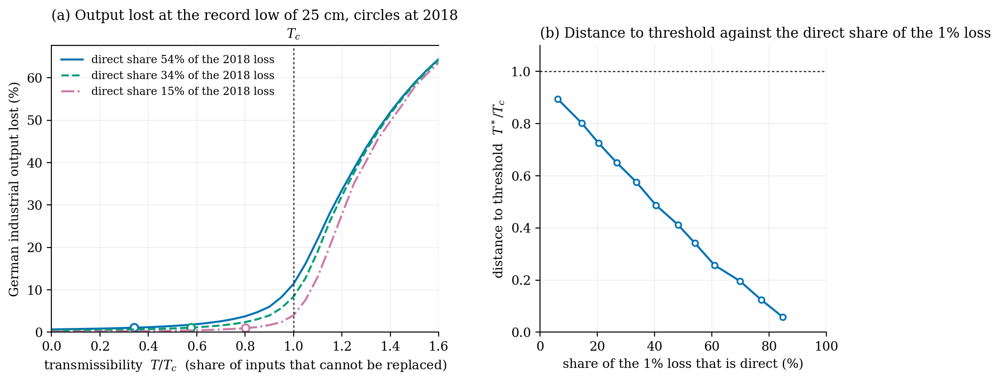
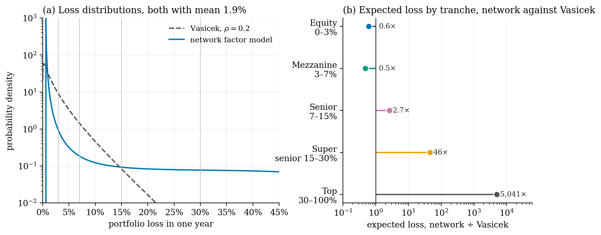

# Supply chain risk on networks: percolation and stability

**This note works out how far one failure spreads through a connected supply network. The tools come from ecology (May's stability bound, percolation thresholds, disassortative wiring), following May, Levin and Sugihara (2008), who proposed using them for banking. I derive them and then apply them to two systems: German industry when the Rhine runs dry, and a structured credit portfolio.**

In 1972 Robert May showed that a large random ecosystem is stable only while $\sigma\sqrt{NC} < 1$. The eigenvalues of its community matrix fill a disc of that radius, and once the disc crosses zero the system tips. Percolation theory gives the network version: failure passing along each link with probability $T$ spreads to a finite share of the whole only above

$$T_c = \frac{\langle k\rangle}{\langle k^2\rangle - \langle k\rangle}, \qquad \text{or, with degree correlations,}\qquad T_c = 1/\Lambda\big[(k'-1)P(k'\mid k)\big].$$

Both are the inverse of a leading eigenvalue.

## Part I: theory

We first check May's bound. Simulated community matrices fill the predicted disc, and the probability of stability drops from one to zero at $\sigma\sqrt{NC} = 1$, more sharply as $N$ grows. Disassortative wiring, where hubs link to small nodes (Fedwire, pollination webs), then doubles the threshold for the same degree sequence: $T_c$ goes from 0.072 to 0.149. This means it protects against weak contagion. Above $T \approx 0.28$ the same wiring fails most completely.

## Part II, case A: the Rhine runs dry

On 31 July 2026 the Kaub gauge matched its 2018 record of 25 cm. Our spatial network of 4,000 firms at the real Rhine-basin centres is calibrated to the estimate that a low-water month costs about 1% of German industrial output. This means one aggregate number cannot pin down our network: the same 1% is reproduced by economies anywhere from 6% to 89% of the way to their percolation threshold. Lowering the river further adds little, since from 55 cm to 25 cm the monthly loss rises by at most 13%. What decides the outcome is whether road and rail can replace the barges. If they cannot ($T = 1.25\,T_c$), the same low water costs about a third of output, and the cascade reaches Stuttgart, Munich and Berlin.

### Three ways of modelling the same low water

Each firm is simply disrupted or not for the month, and all three models give each firm the same chance of failing, so they agree on the average loss and differ only in how failures cluster.

| Kaub level | Model | Average loss | Worst 1% of months |
|---|---|:-:|:-:|
| 55 cm, as calibrated | independent | 1.0% | 1.8% |
| | correlated (one-factor Gaussian, rho = 0.2) | 1.0% | 7.4% |
| | supply network (percolation) | 1.0% | 2.3% |
| 25 cm, road and rail strained | independent | 38% | 40% |
| | correlated | 38% | 75% |
| | supply network | 38% | 46% |

We see independent failures understate the tail, because neighbouring suppliers fail together and that model ignores it. A standard correlation model overstates it: one common shock makes the whole economy fail at once, while in a supply chain the dependence is local, along the links. The larger risk is a shift in the average loss itself. Past the network's threshold the expected loss jumps from 1% to 38%. The independent and correlated models only reproduce that here because they were handed the network's failure probabilities, and fitted to an ordinary low-water year neither would predict it.

`three_models.py`

### How long it lasts

Run as a four-month low-water episode at 55 cm, with a disrupted firm staying down the next month half the time while it rebuilds stocks (an assumption), each model loses about 6% of one month's German output in total, more than four months at 1% because failures linger. In the worst 1% of episodes the independent model loses 8.4%, the network 10.2% and the correlated model 26%; about 1.5% of firms are out for two months or more. `duration.py`

## Part II, case B: structured credit

At the same 1.9% mean loss as a Vasicek model with ρ = 0.2, the 15–30% tranche carries 46× the expected loss (the note shows the ratio runs from 9 to several thousand as ρ goes from 0.3 to 0.1) and equity about 40% less. This means risk moves up the capital structure.

| | |
|:-:|:-:|
|  |  |
|  |  |

**The note:** [`note/percolation_tranche_loss.pdf`](note/percolation_tranche_loss.pdf) (16 pages). **Interactive map:** [`maps/rhine_cascade.html`](maps/rhine_cascade.html).

**Built:** circular-law check of May's bound; generating-function solvers for giant clusters, failed fractions and the Watts cascade condition; degree-preserving assortative and disassortative rewiring with the correlated-threshold eigenvalue; a gravity-and-input-output spatial supply network with directed percolation and calibration by bisection; Vasicek tranche losses by quadrature; Monte Carlo checks on networks of 10,000 nodes.

`percolation.py` · `rhine.py` · `simulate_theory.py` · `simulate_rhine.py` · `simulate.py` · `note/` · Python, NumPy, SciPy sparse, NetworkX, folium, LaTeX

**Limits:** our Rhine network is generated. No firm-level supply data was used. Its input–output matrix is a stylised eight-sector one, to be replaced by the Destatis 2018 table, which also pins a point on the calibration line. The barge-exposure shares are assumptions. The credit calibration is chosen for plausibility and is not fitted to a real pool.

*A side project, built for fun. Credits: May, Levin & Sugihara (2008), Nature 451, 893; May (1972), Nature 238, 413; Tao & Vu (2010), Ann. Probab. 38, 2023; Allesina & Tang (2012), Nature 483, 205; Bascompte, Jordano & Olesen (2006), Science 312, 431; Soramäki et al. (2007), Physica A 379, 317; Newman, Strogatz & Watts (2001), Phys. Rev. E 64, 026118; Callaway et al. (2000), Phys. Rev. Lett. 85, 5468; Cohen et al. (2000), Phys. Rev. Lett. 85, 4626; Newman (2002), Phys. Rev. E 66, 016128 and Phys. Rev. Lett. 89, 208701; Boguñá & Pastor-Satorras (2002), Phys. Rev. E 66, 047104; Vázquez & Moreno (2003), Phys. Rev. E 67, 015101; Xulvi-Brunet & Sokolov (2004), Phys. Rev. E 70, 066102; Watts (2002), PNAS 99, 5766; Gai & Kapadia (2010), Proc. R. Soc. A 466, 2401; Haldane & May (2011), Nature 469, 351; Acemoglu et al. (2012), Econometrica 80, 1977; Vasicek (2002), Risk 15(12), 160; Ademmer, Jannsen & Meuchelböck (2023), German Economic Review, doi:10.1515/ger-2022-0077. Rhine facts from KBC Economics (2022), BASF (2019) and ICIS (2018). Basemap: Natural Earth.*
