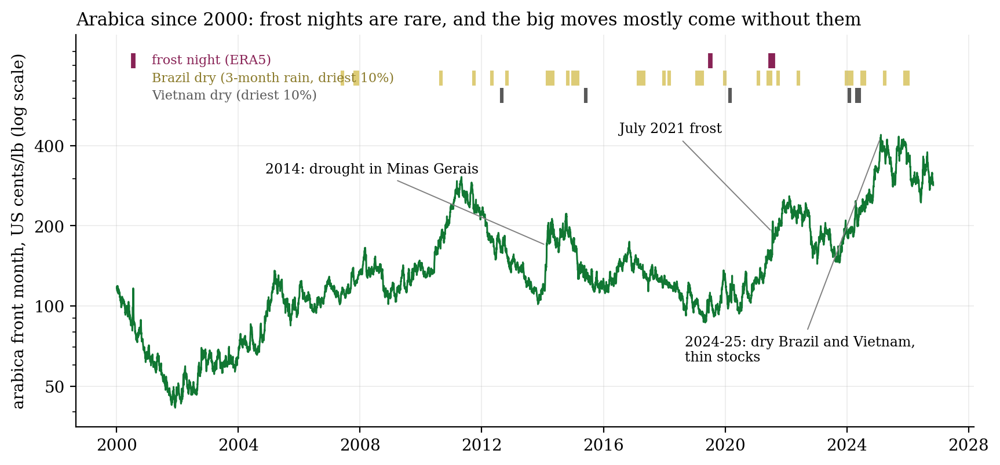
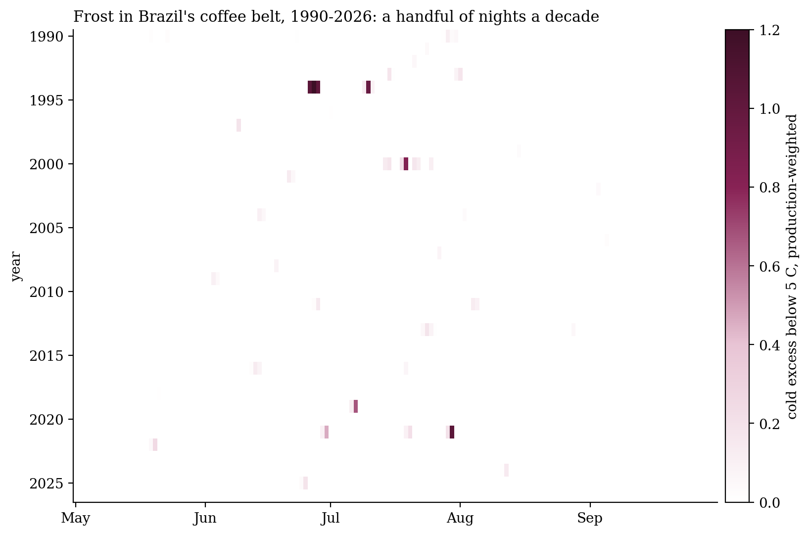
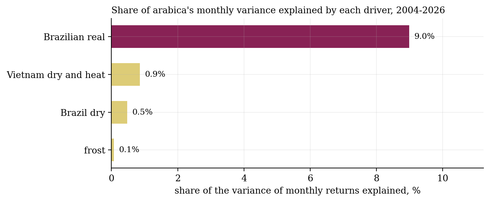
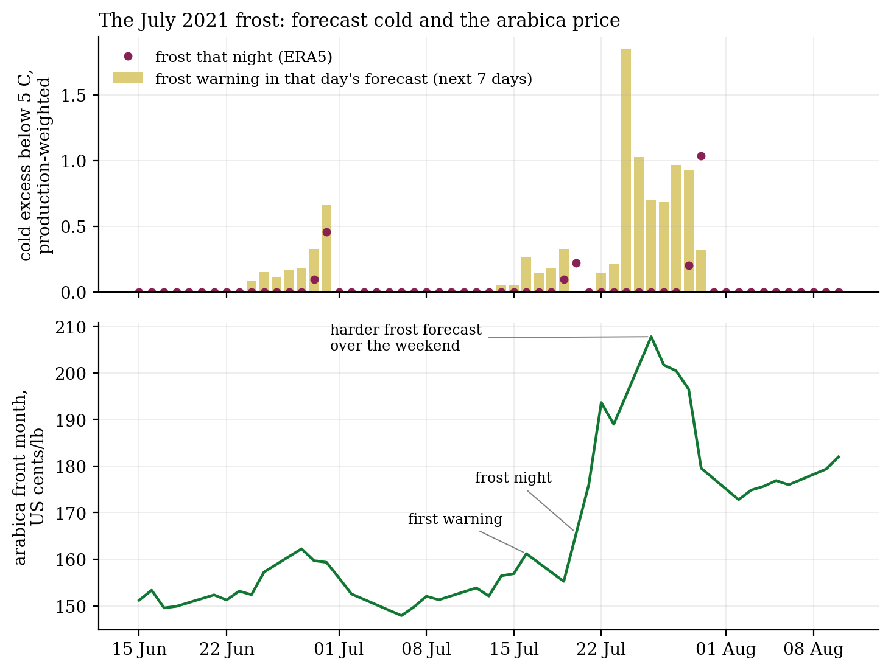
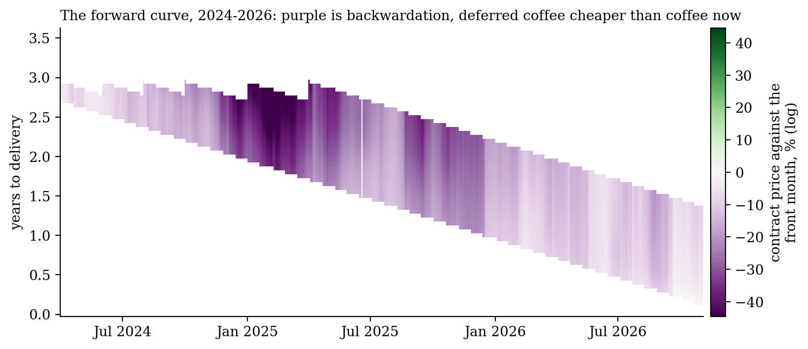

# How much of the coffee price is weather?



## Why I asked this

I started from the frost of July 2021, when arabica rose by a third in a week, and from Richard Roll's (1984) finding that orange-juice futures forecast Florida's weather better than the weather service did. The first version of this project asked whether the coffee market reads frost forecasts as promptly. It does, but that turned out to be the smaller question. Looking at 26 years of prices, the frost nights barely register, so the project now asks how much of the price weather explains at all, and what explains the rest.

## The idea, from one frost

Frost damages coffee at ground level in hollows on clear nights, several degrees colder than the 2 m air temperature a 25 km model cell reports, so a grid-cell minimum near 5 °C is already frost weather. Over eight producing regions in Brazil, weighted by output, our frost index can be written as such:

$$C(\text{day}) = \sum_r w_r \max\big(0,\ 5 - T^{\min}_r(\text{day})\big), \qquad W(t) = \max_{n = 1..7} C(t+n \mid \text{issued } t).$$

Where C is the frost that actually happened (ERA5) and W(t) is the frost warning in the forecasts issued on day t (GFS archived by lead time from 2021, ECMWF from 2024). The interactive map on the website shows our eight regions and the worst frost nights since 1990, one layer per night.



The calendar is the first surprise. Damaging frost comes a handful of nights a decade (1994, 2000, 2019 and 2021), and most winters have none.

## What I expected, and what happened

I expected frost to be the main weather risk in coffee, since it is the one that makes the news. We can test that two ways.

We can start with daily data since 2000. The days from two before to five after an ERA5 frost night are 0.5% of trading days and carry 3% of the price variance. Of the fifteen largest weekly moves since 2000 only one, July 2021, follows a frost. The largest of all, +19% in February 2014, came from a drought in Minas Gerais with no frost anywhere near it.

Next we need the other candidates, so I regressed each month's change in the front-month price, 2004 to 2026 (255 months), on four drivers. These are the month's worst frost, Brazilian dryness (three-month rain against the same months of other years), dryness and heat in Vietnam's Central Highlands (where most of the world's robusta grows), and the month's change in the Brazilian real against the dollar. To split the explained variance fairly between drivers that overlap I used Shapley values, which give each driver its average gain in R² over every order of adding them, so the shares add up to the total.



We see all four together explain 10% of the monthly moves, and the Brazilian real alone explains 9%. This is because when the real weakens, a Brazilian farmer earns more reais per dollar of coffee and sells more, and the dollar price falls (a correlation of −0.29). Vietnam's weather adds 0.9%, Brazil's dryness 0.5% and frost 0.07%. This means the currency matters more than all the weather put together, and most of what moves coffee (stocks, demand, positioning) is not in our data.

There is an honest caveat, and it is one I only saw once I looked at 2024. A monthly regression credits a driver only in the month it moves. Through 2024 Brazil stayed dry and Vietnam stayed hot for most of the year while the price doubled, and the real weakened at the same time, which by itself would have pushed the price down. Weather that builds slowly is undercounted by this test, so 2% is a floor for weather rather than a ceiling.

## How I checked it

The frost-timing test is the one from the first version, and it still stands. In the frost seasons of 2021 to 2026 the day's price change does not depend on the previous two days' changes in the warning (t-statistics between −1.3 and 1.4, with Newey–West standard errors). This agrees with Roll: the forecasts are read the same day. In July 2021 the first warning moved the price 3%, but the largest move (+25% over three days) came as the damage reports arrived, which no forecast carries.



The forward curve gives a second view. Schwartz's (1997) two-factor model treats the spot price and the convenience yield (the benefit of holding physical coffee rather than a contract) as hidden states, and a Kalman filter recovers them from each day's curve. In our case κ = 0.22, so a shock to the convenience yield has a half-life of about three years, and a contract four years out still feels two-thirds of it.



We see in the heatmap each live contract against the front month. Through the 2024–25 rally our curve sat in deep backwardation, with coffee for delivery two to three years out up to 40% cheaper than coffee now. This is what a shortage looks like on a curve. It eased through 2026 as the price fell back.

## What went wrong, and what I learned

The first version answered its question well and still felt thin, because frost is a rare event and a rare event cannot carry a whole price. Yahoo lists only contracts that are still trading, so our curves start in January 2024 and the heatmap is a diagonal band rather than a full surface. The regional weights are rough shares of Brazil's arabica output, partly checked against CONAB, and Vietnam is only two points. Five frost warnings and four damaging frost nights are few events for any test.

## What I'd do next

I'd like to add exchange stocks (the ICE certified stocks) and a crop-size forecast (CONAB's), since those are the obvious candidates for the missing 90%. A slower test, regressing six- or twelve-month returns on season-long dryness, would give the slow weather its due. The 2024 curve, deep in backwardation while the price doubled, is also a good case for a model where the convenience yield responds to stocks.

## Reproducing it

```
pip install yfinance pandas numpy scipy folium
python fetch_data.py
python run_analysis.py
python drivers.py
python make_figures.py
python make_map.py
```

`fetch_data.py` downloads the prices, ERA5, the forecasts, Vietnam's weather and the real in a few minutes. `run_analysis.py` runs the event study, the timing test and the Schwartz fit, `drivers.py` the monthly decomposition, and `make_map.py` the interactive coffee-belt map. Python, NumPy, SciPy, pandas, folium.

## Credits

Roll (1984), Am. Econ. Rev. 74, 861. Schwartz (1997), J. Finance 52, 923. Gibson & Schwartz (1990), J. Finance 45, 959. Working (1949), Am. Econ. Rev. 39, 1254. Newey & West (1987), Econometrica 55, 703. Shapley (1953) for the decomposition. Weather: ECMWF IFS and NOAA GFS forecasts via the Open-Meteo forecast archive, and ERA5 (Hersbach et al. 2020, QJRMS 146, 1999), CC BY 4.0. Prices and the Brazilian real: Yahoo Finance.
