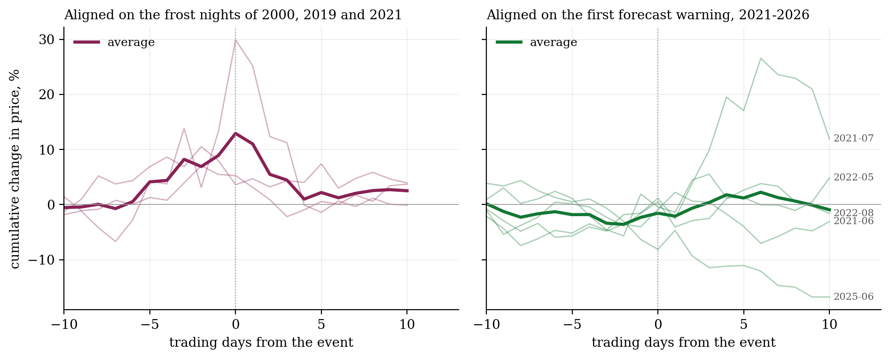
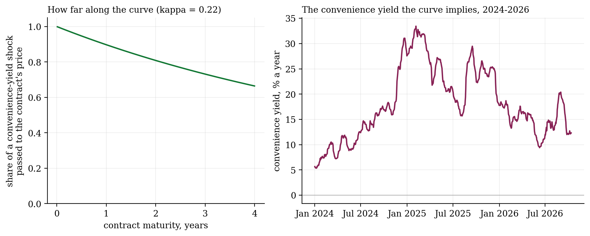

# Coffee, frost and the forward curve

**In July 2021 frost hit Brazil's coffee belt and New York arabica rose by a third in a week. The weather models had seen the cold coming. When a forecast warns of frost, does the price move with the warning, or only once the damage is known? And how far along the forward curve does the shock reach?**

Richard Roll asked the same question of orange juice in 1984 and found futures prices forecasting Florida's weather better than the weather service did. Coffee is a harder test: frost strikes a few nights a decade, but each strike moves the world price.

**The frost index.** Forecast models give the 2 m minimum temperature over a 25 km cell. Leaves freeze at ground level in hollows on clear nights, several degrees colder, so a grid-cell minimum near 5 °C is already frost weather. Over eight producing regions, weighted by output:

$$C(\text{day}) = \sum_r w_r \max\big(0,\ 5 - T^{\min}_r(\text{day})\big), \qquad W(t) = \max_{n = 1..7} C(t+n \mid \text{issued } t).$$

$W(t)$ is the frost warning in the forecasts issued on day $t$. GFS forecasts are archived by lead time from 2021, ECMWF's from 2024.

**The curve.** In Schwartz's (1997) two-factor model, the spot price $S$ and the convenience yield $\delta$ (the benefit of holding physical coffee rather than a contract) evolve together, and futures are linear in the hidden state:

$$\frac{dS}{S} = (\mu - \delta)\,dt + \sigma_1 dW_1, \qquad d\delta = \kappa(\alpha - \delta)\,dt + \sigma_2 dW_2,$$
$$\ln F(t,T) = \ln S - \delta\,\frac{1 - e^{-\kappa\tau}}{\kappa} + A(\tau).$$

A frost lifts $\delta$. The loading $(1 - e^{-\kappa\tau})/\kappa$ says how far along the curve that is felt. A Kalman filter recovers $S$ and $\delta$ from each day's curve.

**What the data say:**
- **July 2021, day by day.** The first warning appeared on 16 July and the price rose 3%, then slipped back. Over the three trading days from the eve of the frost night of 20 July, as damage reports came in, it rose 25%. A harder frost was forecast on Saturday 24 July, and the price rose 10% at Monday's first trade. The forecasts were read promptly. The biggest move came from learning the damage, which no forecast carries.
- **No sign that the market reacts late.** Across every frost season from 2021 to 2026, the day's price change does not depend on the previous two days' changes in the warning (t-statistics between −1.3 and 1.4). This agrees with Roll, but five events is too few to prove it.
- **Real frost nights move the price before they happen.** Around the frosts of 2000, 2019 and 2021, the price had already risen in the week before the frost night.
- **A curve shock lasts for years.** κ = 0.22, so a jump in the convenience yield has a half-life of about three years. A contract four years out still takes two-thirds of it. The weather term adds nothing to the 2024–2026 fit (β ≈ 0), but no real frost fell in that window, so the test is uninformative, not negative.

| | |
|:-:|:-:|
|  |  |

**Built:** a production-weighted frost index from ERA5 and from archived ECMWF and GFS forecasts by lead time; an event study; a Newey–West timing regression; the Schwartz two-factor model with a weather term in the convenience yield, fitted by Kalman-filter maximum likelihood with missing contracts handled.

`fetch_data.py` · `coffee_regions.py` · `coffee_data.py` · `schwartz.py` · `run_analysis.py` · `make_figures.py` · Python, NumPy, SciPy, pandas

**Limits:** Yahoo lists only contracts still trading, so full curves start in January 2024. Before 2025 the curve has just the front month and contracts three to four years out. The regional weights are rough shares of Brazil's arabica output, partly checked against CONAB (Sul de Minas is over-weighted at 40% against about 29%). The timing result holds with equal weights. Five warnings and three frost nights are few events.

*A side project, built for fun. Credits: Roll (1984), Am. Econ. Rev. 74, 861; Schwartz (1997), J. Finance 52, 923; Gibson & Schwartz (1990), J. Finance 45, 959; Working (1949), Am. Econ. Rev. 39, 1254; Newey & West (1987), Econometrica 55, 703. Weather: ECMWF IFS and NOAA GFS forecasts via the Open-Meteo forecast archive, and ERA5 (Hersbach et al. 2020, QJRMS 146, 1999), CC BY 4.0. Prices: ICE arabica futures via Yahoo Finance.*
