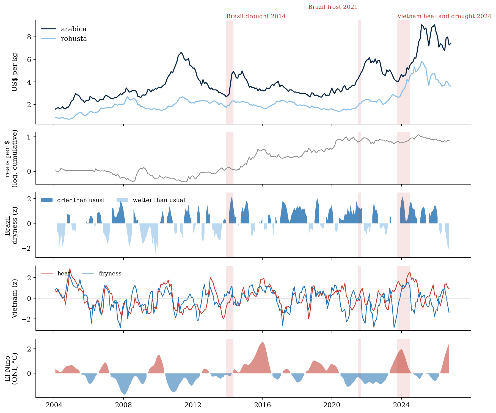
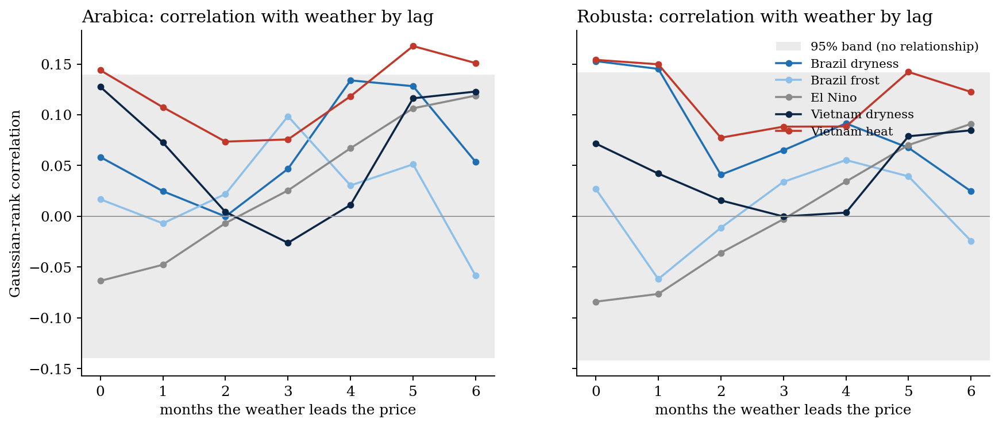
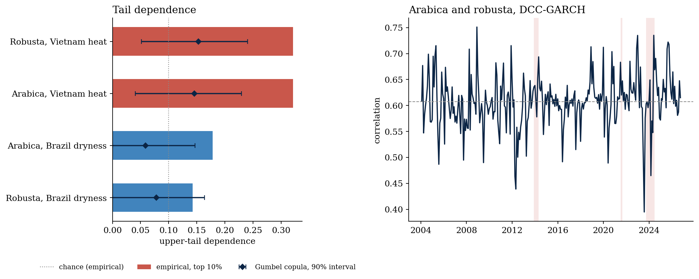
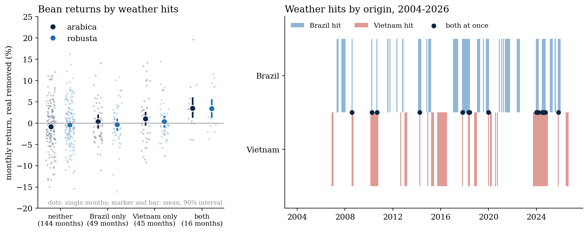
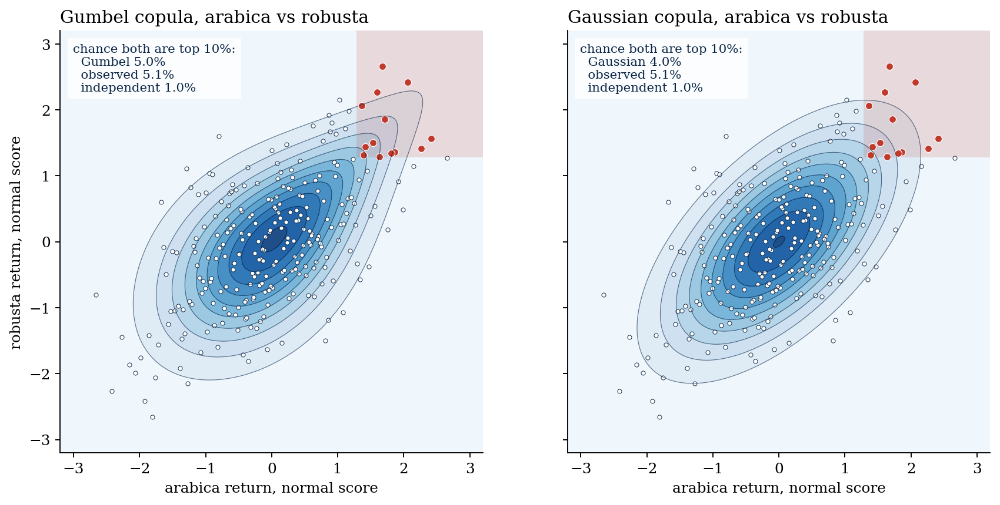
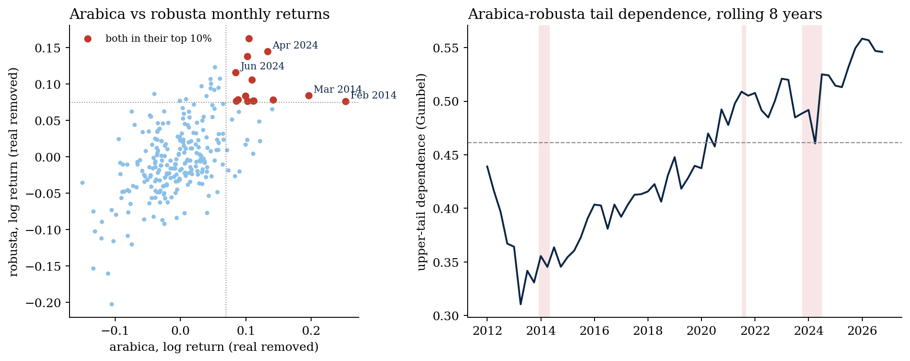
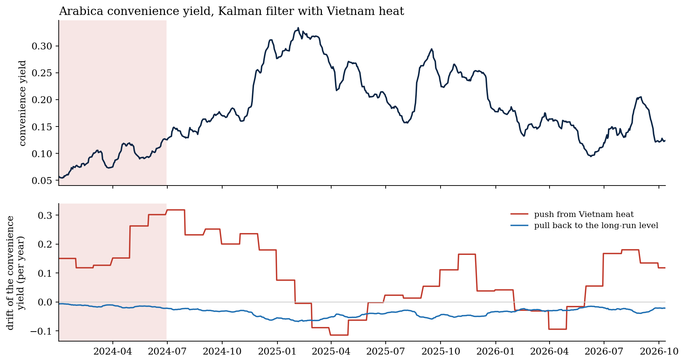
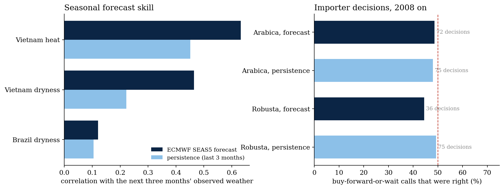
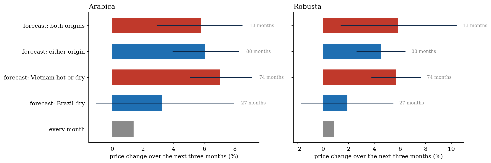
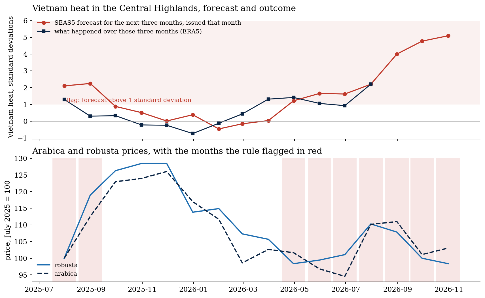

# Weather and coffee price correlation

## Why I did this

There is a large literature on weather and coffee prices. I started from the Brazilian frost of July 2021, when arabica rose by a third in a week, and from Richard Roll's (1984) finding that orange-juice futures forecast Florida's weather. Frost turned out to be rare, so the project widened: how much do the weather risks of the two main origins, Brazil (arabica) and Vietnam (robusta), move both beans, how do those risks combine, and can a seasonal forecast tell a European importer when to buy forward? Coffee buyers hedge, so this is written from the importer's side.

## Data

- **Prices.** World Bank Pink Sheet, monthly arabica and robusta, 2004-2026, as log returns.
- **The standard driver, stripped out first.** Each bean's return is regressed on the month's change in Brazilian reais per dollar and only the residual is kept, as gas was taken out of the Italian power price (009). On these monthly prices the real explains about 4% of each bean's moves.
- **Weather.** ERA5 for each origin: the worst frost night and three-month dryness over eight producing regions of Brazil, weighted by output; three-month heat and dryness in Vietnam's Central Highlands. El Niño from NOAA's Oceanic Niño Index.
- **Seasonal forecasts.** ECMWF SEAS5, issued every month since 1993, rain and temperature over both origins for the next three months.

## Weather moves both beans, in both regions

A single correlation coefficient undersells weather, which rarely matters and then matters a lot, so four measures are used:

- **Partial correlation** (Gaussian-rank, the real held fixed): Vietnam heat is about 0.17 with each bean, Brazilian dryness 0.13 with robusta.
- **Lags:** Vietnam heat moves robusta in the same month and leads arabica by about five months.
- **Tail dependence:** of the hottest tenth of months in Vietnam, 32% were also top-10% price rises for each bean, against 10% by chance (p ≈ 0.003 from block-shuffled prices). Brazilian dryness doesn't pass this test.
- **A Gumbel copula,** which models extremes arriving together, fits Vietnam heat against each bean better than a Gaussian copula and puts the tail dependence at about 0.15 (90% interval 0.05-0.24). A Gaussian copula has none by construction.

## The risk compounds across origins

A month is a weather hit in Brazil if it is unusually dry or has a damaging frost, and in Vietnam if it is unusually hot or dry. Hits in the two regions come together about as often as chance would give (6.3% of months against 6.1%), but the price impact compounds:

| Weather hit | Arabica | Robusta | Months |
|---|:-:|:-:|:-:|
| Neither | -0.8% | -0.4% | 144 |
| Brazil only | +0.3% | -0.3% | 49 |
| Vietnam only | +1.0% | +0.4% | 45 |
| Both at once | +3.5% | +3.4% | 16 |

The both-at-once months are significant against block-shuffled prices (p = 0.02 for arabica, 0.009 for robusta). Seven of the sixteen fall in 2024.

The two beans themselves spike together. A Gumbel copula of arabica against robusta gives an upper-tail coefficient of 0.46 (90% interval 0.39-0.51): when one bean has a top-10% month, the other does too about half the time, about five times what independence would give. The Gaussian copula fits the bulk of the months slightly better but puts the chance of a joint spike at 4.0% against 5.1% observed. On a rolling eight-year window the tail coefficient has risen from about 0.31 in 2013 to 0.55 now (with only about ten extreme months per window, so the line is noisy). DCC-GARCH puts the arabica-robusta correlation between 0.39 and 0.75, with its low point as Vietnam's 2023-24 heat began, when robusta broke away from arabica for a few months.

**So what for an importer:** buying from the other origin is a hedge that works in ordinary months and fails in the months that matter, and it has been failing more. A global hedge has to be sized for joint weather risk, not for the average correlation.

## A weather-informed forward curve

A Kalman filter tracks two hidden states from each day's arabica futures curve since 2024: the spot price and the convenience yield (the benefit of holding physical coffee rather than a contract), with Schwartz's (1997) two-factor dynamics. Adding Vietnam heat as a push on the convenience yield improves the fit significantly (likelihood ratio 8.4, p = 0.004); Brazilian dryness doesn't (p = 0.53). The heat push peaks in mid-2024, ahead of the yield's early-2025 high. A frost term, tried first, had nothing to find: no damaging frost fell in the window.

## The seasonal forecast as an importer's signal

Each quarter from 2008 to 2025, the ECMWF forecast issued that month is fed through the weather-price relationship, learned only from earlier years. If it predicts a rise, the importer buys forward; otherwise it waits three months and buys at the market. The benchmark is the same rule fed climatology: a normal season for the time of year.

- **The forecast beats climatology on the weather.** Its skill score against climatology is 0.41 for Vietnam's heat and 0.13 for Vietnam's dryness (0 would mean no better than a normal season). For Brazil's dryness it is close to zero (0.02).
- **It helps with the price, a little.** Driven by the forecast, the importer's calls were right 49% of the time for arabica and 50% for robusta, against 43% and 40% with climatology. On average the forecast-driven rule did about 0.6 percentage points of the purchase price better per quarter for arabica and 0.7 for robusta than the climatology rule.
- **But not enough to rely on alone.** Half the calls were still wrong, and the average saving against simply waiting is close to zero. The weather-price link, a correlation of about 0.15, is too weak for a rule that calls every quarter.

**Where the forecast earns its keep: the tail.** A tail rule buys forward only when the forecast puts an origin beyond one standard deviation of its normal season, and otherwise waits. In the 78 months from 2008 to July 2026 when the forecast flagged Vietnam as unusually hot or dry, arabica rose 6.9% over the next three months and robusta 5.5% (90% intervals 5.1-8.8% and 3.7-7.3%), against 1.1% and 0.6% over all months. The result isn't the 2023-25 rally: checked on 2008-2025, without those years the flagged months still rose 5.1% and 3.3% while other months fell, and it holds when the forecast's warming drift is removed. A dry-Brazil flag alone isn't reliable (27 months, intervals spanning zero). For an importer, a hot or dry Vietnam forecast is a signal worth hedging on.

`seasonal_backtest.py` · `tail_rule.py`

**2026 so far.** Followed month by month, the rule worked through 2025 and was mixed in 2026. The forecasts issued in July and August 2025 put Vietnam heat above two standard deviations, and robusta rose 26% by November 2025. In 2026 the forecast flagged Vietnam heat from April, and the heat came: the following three months ran 0.9 to 2.2 standard deviations above normal in ERA5. Robusta rose 11% and 8% in the three months after the April and May flags, was flat after June and fell 11% after July, as prices came back from an August peak. The forecasts issued from August to October put Vietnam heat 4 to 5 standard deviations above normal, beyond anything in the record. Part of that is the warming since the 1993-2016 period the forecast is measured against, so each forecast was also measured against the same month in the 15 years before it, using only what was known then. The rule holds: 70 months flagged instead of 78, and arabica rose 6.4% and robusta 4.9% in the following three months (90% intervals 4.5-8.3% and 2.9-7.0%). The latest forecasts are still 2.7 to 4.1 standard deviations above the recent normal, so the extreme reading isn't only the warming. `year_2026.py` · `recent_normal.py`

## Earlier findings kept

The frost study that started this: across 2000-2026 the days around a frost night carry 3% of the price variance, and in July 2021 the forecasts were read the same day but the biggest move came with the damage reports. `run_analysis.py`, figures 1-7.

## Limits

Monthly prices smooth short spikes. ERA5 rain over coffee regions is coarse (about 30 km). Only two origins are modelled. The forward curve covers 2024-2026 only, because free data lists only live contracts.

## Code

`weather_signal.py` (the real out, lags, events) · `dependence.py` (partial, tail, copulas, DCC) · `compound.py` · `kalman_weather.py` · `seasonal_backtest.py` · `fetch_prices_enso.py` · `fetch_seas5.py` · `make_weather_figures.py` · earlier: `fetch_data.py`, `run_analysis.py`, `schwartz.py`, `drivers.py` · Python, NumPy, SciPy, arch, xarray, cfgrib, corrlib

*A side project, built for fun. Credits: Roll (1984); Schwartz (1997); Engle (2002) for DCC; Joe (1997) for copulas; Newey & West (1987). Data: World Bank Pink Sheet; NOAA CPC Oceanic Niño Index; ERA5 (Hersbach et al. 2020) via Open-Meteo; ECMWF SEAS5 via the Copernicus Climate Data Store; Brazilian real and arabica futures via Yahoo Finance.*
