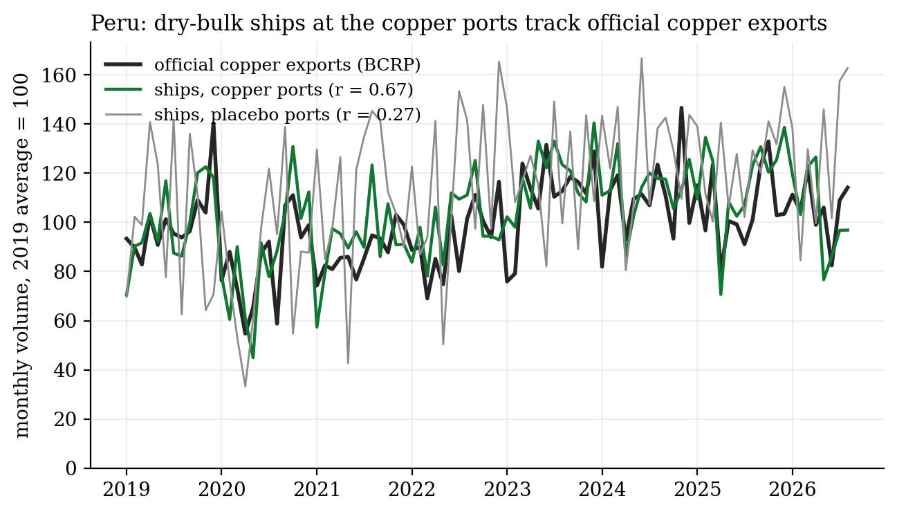
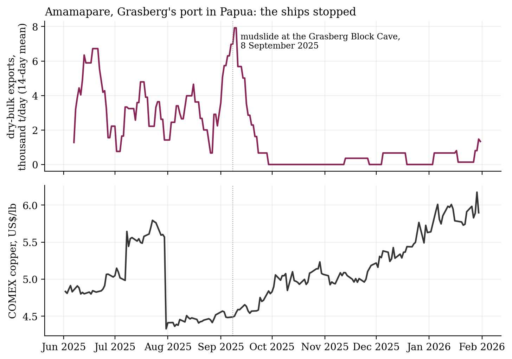

# Copper seen from space

**Copper's supply chain is short and visible. Concentrate leaves a handful of ports in Chile and Peru, and it is smelted in a few dozen plants that glow in shortwave infrared. Can you watch supply from space, and is what you see worth anything to someone trading copper?**

Commercial services sell exactly this: Earth-i's SAVANT index watches smelters, and AIS feeds watch ships. This project builds a free, open version and tests it, with placebos.

**Ships.** IMF PortWatch turns AIS (the position beacon every large ship carries) into daily port calls and estimated cargo by ship type. It covers 11 copper export ports in Chile and Peru, Grasberg's port in Papua, and 7 placebo ports that ship forestry, salmon, fishmeal and phosphate.

**Heat.** A Sentinel-2 pixel is hot when shortwave infrared climbs steeply towards 2.2 μm, which only happens above a few hundred degrees (Murphy et al. 2016):

$$\frac{\rho_{12}}{\rho_{11}} \ge 1.4, \qquad \frac{\rho_{12}}{\rho_{8A}} \ge 1.4, \qquad \rho_{12} \ge 0.15.$$

**What the data say:**
- **The ships see copper.** Dry-bulk exports from Peru's copper ports follow Peru's official copper export volumes: correlation 0.67 in monthly levels and 0.55 year on year. The placebo ports manage 0.27 and 0.20.
- **But they don't predict the price.** Each port's last four weeks of exports, as a log ratio to the same weeks a year earlier, is used as the signal. It has no out-of-sample skill for the next four weeks of COMEX copper (R² = −5%, no better than the placebo ports' −7%). Supply is visible, and it is already in the price.
- **Grasberg, September 2025.** After the mudslide at the Grasberg Block Cave on 8 September, dry-bulk exports from Amamapare fell 89%, from 3,850 to 410 tonnes a day over the next three months. The port was effectively closed from October to mid-November.
- **24 of 30 smelters show heat from space** within 4 km of their published location. The check is honest about its weakness: Tuticorin, closed since 2018 and included as a negative control, also lights up from neighbouring industry. A hot spot has to be matched to the smelter's buildings before it is trusted.

| | |
|:-:|:-:|
|  |  |

**Smelter activity over time** runs on Google Earth Engine (`smelter_heat.py`). It covers Sentinel-2 hot pixels, Landsat surface temperature and FIRMS active fire, reduced to a small table per site on Google's side. It needs a one-time free non-commercial sign-in, and has not been run yet.

**Built:** a PortWatch downloader with copper, case and placebo ports; validation against Peru's central bank statistics; an expanding-window out-of-sample test; a Sentinel-2 hot-spot finder that locates furnaces from approximate coordinates; and an Earth Engine pipeline for the smelter time series.

`fetch_ports.py` · `analyse_ports.py` · `verify_smelters.py` · `smelter_heat.py` · `smelters.csv` · `make_figures.py` · Python, pandas, rasterio, Earth Engine API

**Limits:** PortWatch does not say what a ship carries, so dry-bulk tonnes at a copper port is a proxy. Only Peru publishes a free monthly series to check it against. Which mine ships through which port is marked "check" where uncertain. The hot-spot check proves heat near a site, not that the heat is the smelter's.

*A side project, built for fun. Credits: IMF PortWatch (Arslanalp, Koepke & Verschuur 2021, IMF WP 21/225; Cerdeiro et al. 2020, IMF WP 20/57); Banco Central de Reserva del Perú, series PN38783BM; Murphy et al. (2016), Remote Sens. Environ. 175, 133; Marchese et al. (2019), Remote Sensing 11, 2876; Schroeder et al. (2014), Remote Sens. Environ. 143, 85; Campbell & Thompson (2008), Rev. Financ. Stud. 21, 1509. Sentinel-2 imagery: Copernicus, via Microsoft Planetary Computer. Prices: COMEX copper via Yahoo Finance.*
