# EO proxies for copper production intensity: an alternative data method

**Earth-observation proxies for copper supply: ship traffic at the export ports and furnace heat at the smelters, tested against official exports, the copper price and a real disruption.**

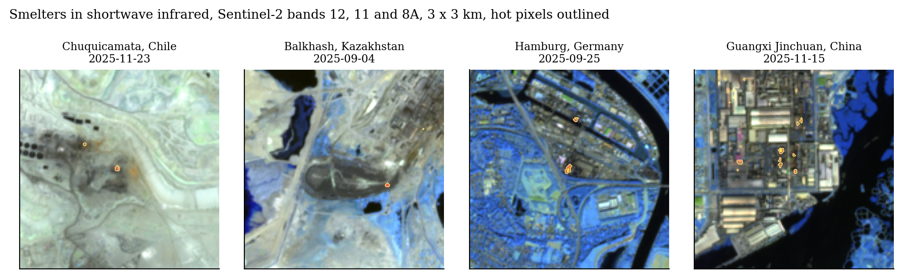

Commercial services sell exactly this: Earth-i's SAVANT index watches smelters, and AIS feeds watch ships. This project builds a free, open version and tests it, with placebos.

**Ships.** IMF PortWatch turns AIS (the position beacon every large ship carries) into daily port calls and estimated cargo by ship type. It covers 11 copper export ports in Chile and Peru, Grasberg's port in Papua, and 7 placebo ports that ship forestry, salmon, fishmeal and phosphate.

**Heat.** A Sentinel-2 pixel is hot when shortwave infrared climbs steeply towards 2.2 μm, which only happens above a few hundred degrees (Murphy et al. 2016):

$$\frac{\rho_{12}}{\rho_{11}} \ge 1.4, \qquad \frac{\rho_{12}}{\rho_{8A}} \ge 1.4, \qquad \rho_{12} \ge 0.15.$$

**What the data say:**
- **The ships see copper.** Dry-bulk exports from Peru's copper ports follow Peru's official copper export volumes: correlation 0.67 in monthly levels and 0.55 year on year. The placebo ports manage 0.27 and 0.20.
- **But they don't predict the price.** Each port's last four weeks of exports, as a log ratio to the same weeks a year earlier, is used as the signal. It has no out-of-sample skill for the next four weeks of COMEX copper (R² = −5%, no better than the placebo ports' −7%). Supply is visible, and it is already in the price.
- **Grasberg, September 2025.** After the mudslide at the Grasberg Block Cave on 8 September, dry-bulk exports from Amamapare fell 89%, from 3,850 to 410 tonnes a day over the next three months. The port was effectively closed from October to mid-November.
- **24 of 30 smelters show heat from space** within 4 km of their published location. The check has a known weakness: Tuticorin, closed since 2018 and included as a negative control, also lights up from neighbouring industry. A hot spot has to be matched to the smelter's buildings before it is trusted.

| | |
|:-:|:-:|
| 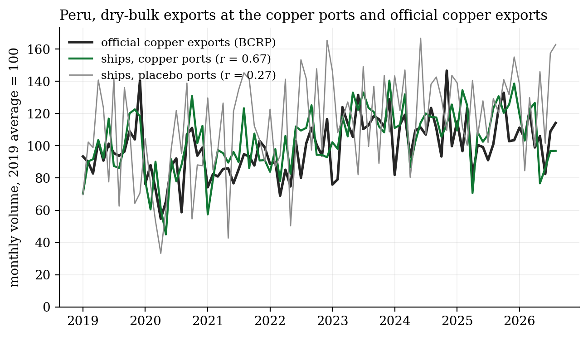 | 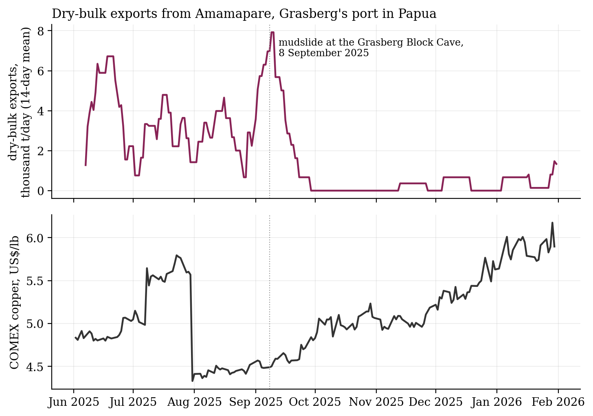 |

**Smelter heat over time.** Every Sentinel-2 pass with under 20% cloud over the 24 sites from 2019 to 2026 (9,900 passes, from Microsoft Planetary Computer with no account) is reduced to a hot-pixel count and a clear-sky share, and averaged by month over clear passes.
- **The heat is visible and steady where it should be.** Caletones and Mount Isa hover around their averages, month after month.
- **Ventanas cannot be the check it was meant to be.** Codelco closed the Ventanas smelter at the end of May 2023, but it showed almost no heat before then either (0 to 1.5 hot pixels per clear pass), so its furnaces are not visible from above and there is nothing to see switch off.
- **Some sites are seasonal for reasons that are not production.** Xiangguang, in Shandong, reads near zero every winter, from haze or the low winter sun. The indices are therefore compared year on year.
- **No skill for the price either.** The year-on-year change in the worldwide heat index does not predict next month's copper price out of sample (R² −7%). The Chinese index scores +4.6% over 47 months but with no correlation at all (r = 0.006), which is indistinguishable from chance.

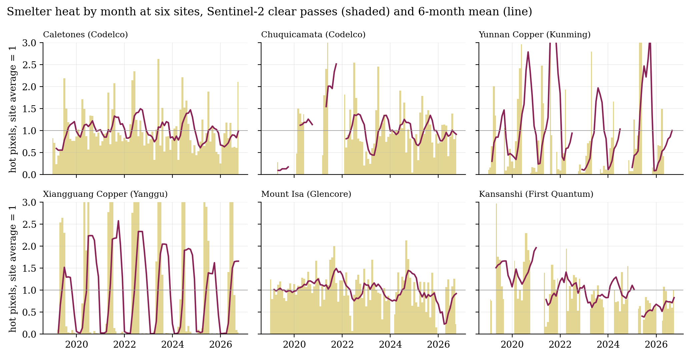

## Heat intensity, duration and lags

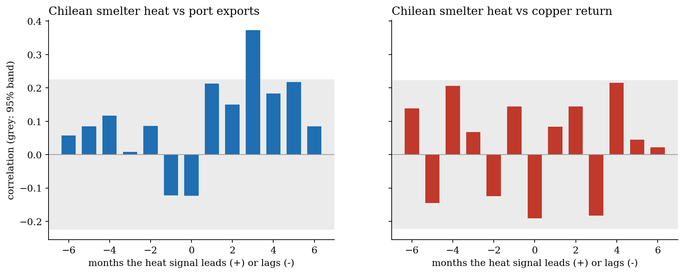

- **Heat leads exports by about three months.** The year-on-year change in the Chilean smelter heat index (Altonorte, Caletones, Chagres, Chuquicamata, each relative to its own median) correlates 0.37 with exports from the Chilean copper ports three months later, above the 95% band of 0.22; no other lag clears it. Year-on-year series are autocorrelated and 13 lags were tried, so this is a lead worth following, not a firm result.
- **No lag of heat predicts the copper price.** Every correlation sits inside the band, as expected if visible supply is already priced in.
- **Low-heat episodes are mostly short.** A smelter ran below half its usual heat in 189 episodes; 60% lasted a single month, many of them likely cloudy passes or brief stops. In the month after one, copper rose 1.4% against 0.7% in all months, suggestive but not significant (p of about 0.07). `heat_lags.py`

## A disruption up close: the central Chile storm of July 2026

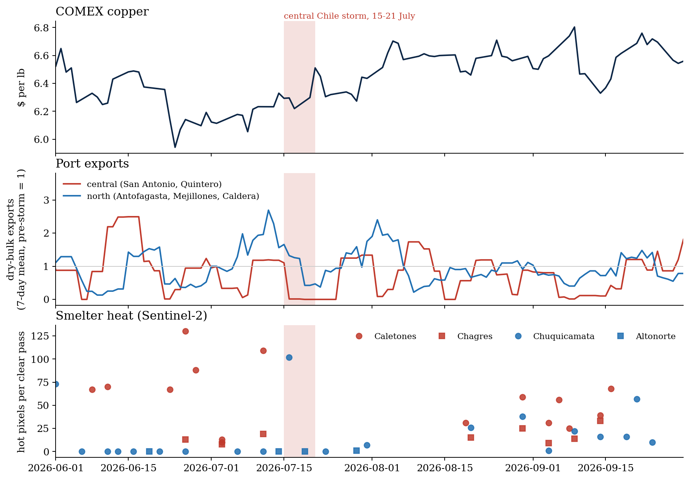

A winter storm hit central Chile on 15-21 July 2026 (CRU). Codelco halted Andina's surface operations and El Teniente's open pit stopped shipping ore while the underground mine kept running. Northern Chile was unaffected, so it serves as the control.

- **The ports saw it at once.** Dry-bulk exports from the central ports (San Antonio, Quintero) fell to zero from the first day of the storm and stayed there until about 25 July, then recovered to their pre-storm level by 26 July. The northern copper ports kept shipping.
- **The price moved within the week.** COMEX copper rose about 3% over the storm and 4.6% by 4 August.
- **The satellites went blind.** Caletones, which smelts El Teniente's ore, had its last clear Sentinel-2 pass on 11 July and its next on 19 August, a 39-day gap, because cloud and snow covered it. After the storm its heat ran at about 57% of the June level, against a usual summer ratio of about 1.1. Optical imagery can't see a storm while it happens, which is why radar (Sentinel-1) or night-time thermal (VIIRS) is the next step for disruption monitoring.
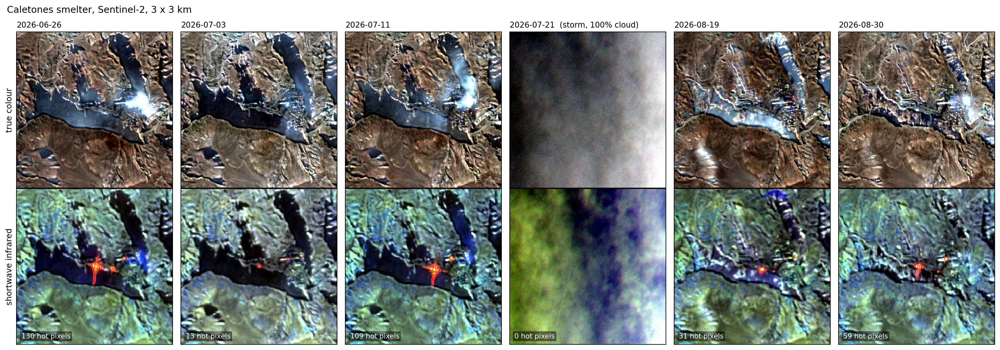

- **In the images.** Before the storm Caletones glows in the shortwave infrared (130 and 109 hot pixels on 26 June and 11 July) under a white smoke plume; on 3 July the plume is gone and only 13 pixels show, a short stop before the storm. During the storm (21 July) the scene is 100% cloud. On 19 August the valley is under snow and the heat is down to 31, recovering to 59 by 30 August.
- **Radar sees through the storm.** Sentinel-1 radar isn't stopped by cloud: the sea is dark and a ship's hull a bright point. Counted by eye at San Antonio's anchorage, four ships waited on 12 July, two on 16 July in the storm, one on 22 July, and about seven on 24 July as the queue rebuilt, matching the stop and restart in the port data. A fixed brightness threshold couldn't count them automatically: rough storm seas hide ships, and strong port reflectors leave streaks.

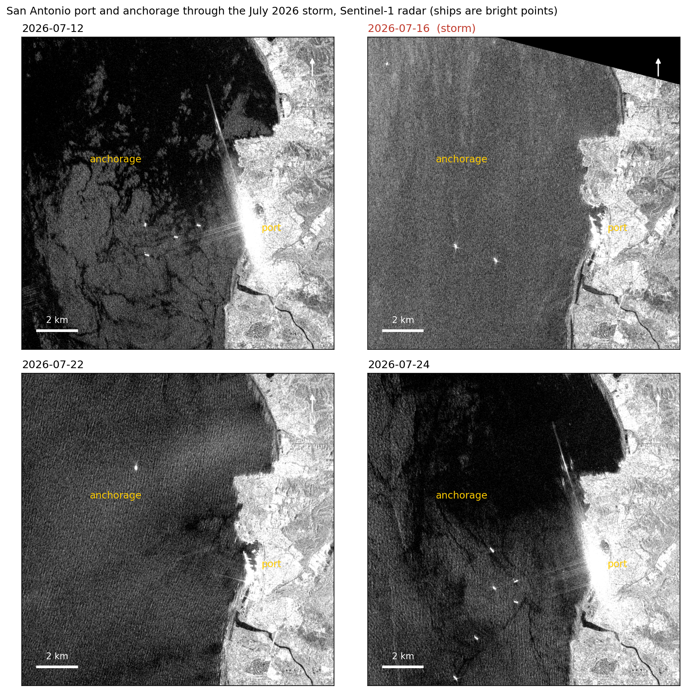

- **An automatic ship count.** A CFAR detector (constant false alarm rate), the standard method for radar ship detection, sets the threshold from the sea around each pixel instead of fixing it. The background is a ring 250-500 m around the pixel, and a pixel is flagged when it stands five standard deviations above it. Objects then have to be compact, at least 2,000 m², bright at their peak (above 0 dB, as a steel hull is and sea clutter here never is) and on water away from the harbour. Two fixes mattered. CFAR alone let rough sea through, which the peak test removed. And a land mask made from each pass hid the ships in the storm, because the rough sea was as bright as land, so the mask is now fixed, from all 58 passes. The detector agrees with the by-eye counts: 4 against 4 on 12 July, 3 against 2 in the storm, 1 against 1, and 6 against 7 on 24 July. Over January-August 2026 it finds about five ships per pass. The count no longer follows sea roughness (correlation −0.02), and it rises and falls with daily port calls from PortWatch (correlation 0.38 with their 7-day mean), though one radar pass every few days is a sparse sample of a queue that changes daily. `ships_cfar.py`

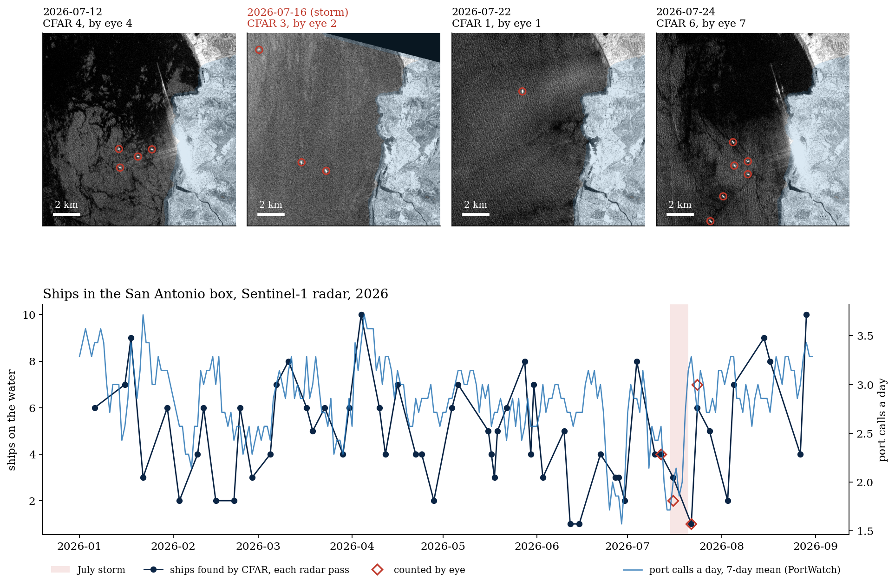

- **So detection and price were close together here.** Ships showed the stop the same day and the price moved the same week; the gap between seeing and pricing a disruption was days, not weeks.

## A second disruption: Kazakhstan's 2012 cold snap

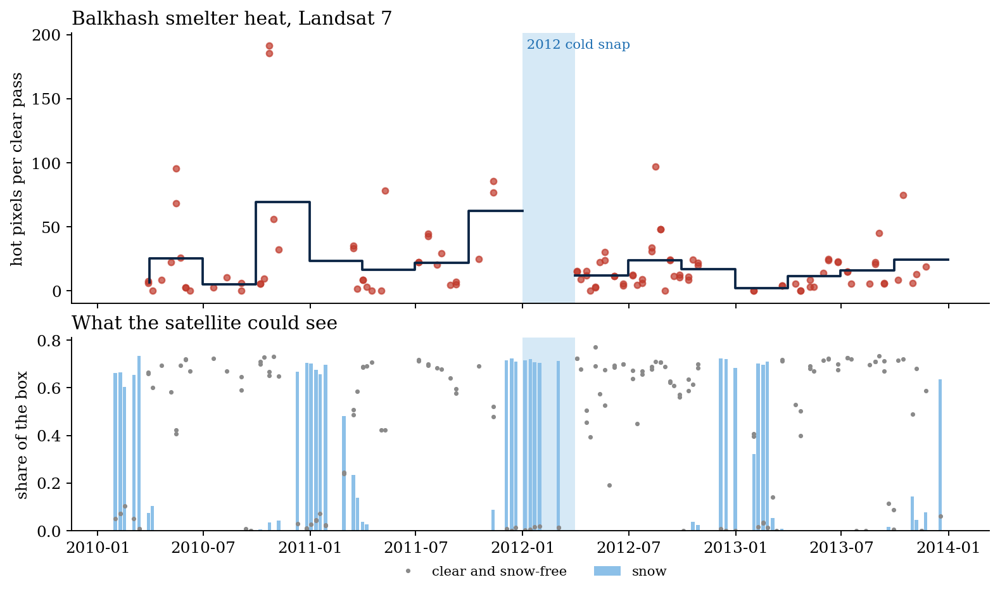

Kazakhmys reported that a severe winter hit transport and processing in early 2012, and first-quarter output fell to 65,100 tonnes from 74,200 a year earlier. Sentinel-2 only starts in 2015, so the Balkhash smelter is read from Landsat 7 (Planetary Computer, no account) with the same hot-spot test on the matching bands.

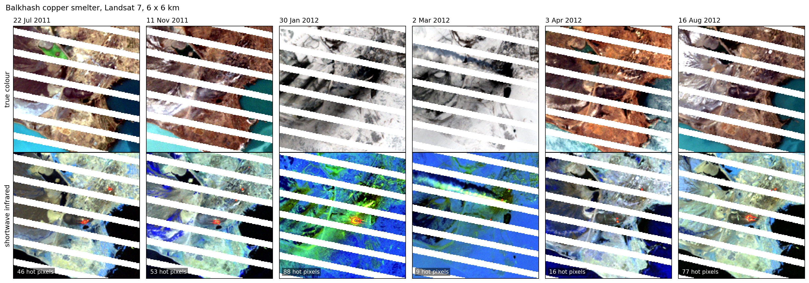

The white stripes are a known Landsat 7 fault: its Scan Line Corrector failed on 31 May 2003, leaving wedges with no data in every scene since.

- **The furnace showed through the snow.** On 30 January 2012, in the middle of the cold snap, the land around the smelter is white in true colour, but in the shortwave infrared the furnace glows with 88 hot pixels, as hot as in summer. The smelter was running; the output Kazakhmys lost most likely came from transport and the mines, not from the furnaces stopping.
- **It slowed afterwards.** On 2 March a band of cloud or plume crosses the site, so that pass says little; on 3 April, with the snow gone, the heat was low (16 hot pixels in the 6 x 6 km box), and by August it was back (77). A per-pass measure that discards scenes with mostly snow-covered ground, as the time series above does, would have missed the January signal altogether.
- **The lesson for the method.** Cloud blinds optical imagery, as in Chile; snow doesn't, because a furnace is far hotter than the ground around it, but the cloud and snow masks have to be applied around the hot spot, not across the whole scene. Radar (Sentinel-1) and night-time thermal imagery (VIIRS, from 2012) are the next step for cloudy disruptions.

The same measurement runs on Google Earth Engine (`smelter_heat.py`), closer to live and with Landsat and FIRMS added. It needs a free non-commercial sign-in.

**Built:** a PortWatch downloader with copper, case and placebo ports; validation against Peru's central bank statistics; an expanding-window out-of-sample test; a Sentinel-2 hot-spot finder that locates furnaces from approximate coordinates; a smelter heat series from 9,900 Sentinel-2 passes; and the same pipeline on Earth Engine.

`fetch_ports.py` · `analyse_ports.py` · `verify_smelters.py` · `smelter_series.py` · `analyse_smelters.py` · `smelter_heat.py` · `event_chile_2026.py` · `event_kazakhstan_2012.py` · `kazakhstan_scenes.py` · `chile_scenes.py` · `ships_radar.py` · `ships_cfar.py` · `smelters.csv` · `make_figures.py` · Python, pandas, rasterio, Earth Engine API

**Limits:** PortWatch does not say what a ship carries, so dry-bulk tonnes at a copper port is a proxy. Only Peru publishes a free monthly series to check it against. Which mine ships through which port is marked "check" where uncertain. The hot-spot check proves heat near a site, not that the heat is the smelter's.

*A side project, built for fun. Credits: IMF PortWatch (Arslanalp, Koepke & Verschuur 2021, IMF WP 21/225; Cerdeiro et al. 2020, IMF WP 20/57); Banco Central de Reserva del Perú, series PN38783BM; Murphy et al. (2016), Remote Sens. Environ. 175, 133; Marchese et al. (2019), Remote Sensing 11, 2876; Schroeder et al. (2014), Remote Sens. Environ. 143, 85; Campbell & Thompson (2008), Rev. Financ. Stud. 21, 1509. Sentinel-2 imagery: Copernicus, via Microsoft Planetary Computer. Prices: COMEX copper via Yahoo Finance.*
