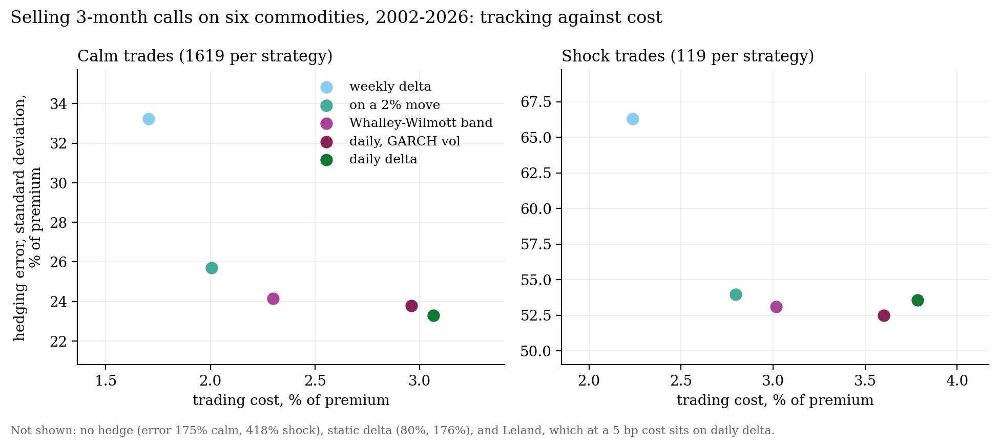
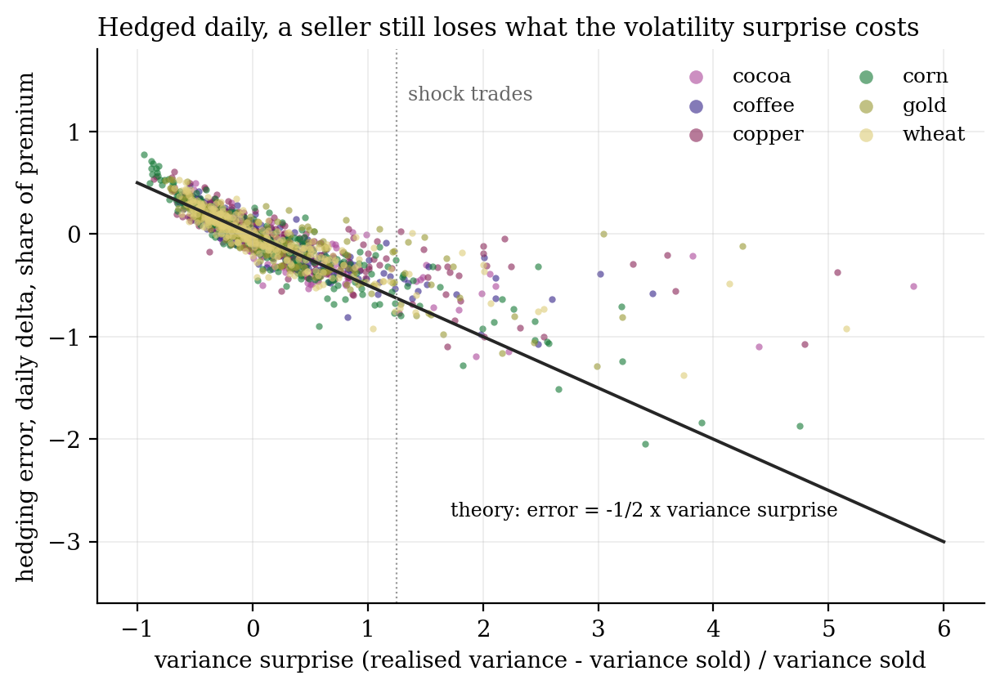
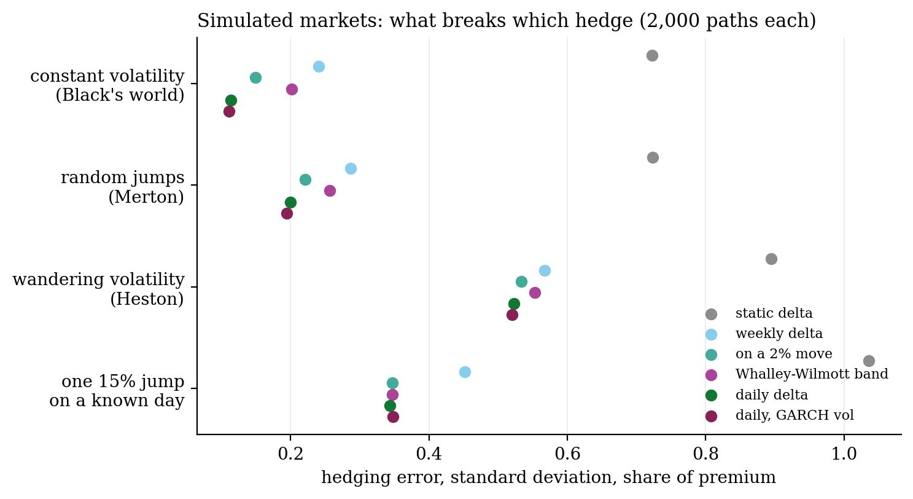

# Hedging commodity options through a shock

**Sell an option, hedge it with futures, and in theory you carry no risk. In practice you choose how often to trade, which volatility to trust and how much to spend on trading. Eight ways of hedging, six commodities, 24 years: which ones survive a shock?**

On 8 July 2025 COMEX copper jumped 13% on a tariff announcement. Three weeks later it fell 22% in a day when refined copper was exempted. Anyone short a copper option was hedging through both.

**The trade.** Each month since 2002, sell a 3-month at-the-money call on the futures of copper, gold, wheat, corn, arabica coffee or cocoa. No energy. Price it by Black (1976) at the trailing 60-day volatility, and hedge it to expiry. The error is what remains:

$$\text{error} = C_0 - (F_T - K)^+ + \sum_t h_t\,(F_{t+1} - F_t) - k \sum_t |h_t - h_{t-1}|\,F_t, \qquad \Delta = e^{-r\tau} N(d_1).$$

**The eight strategies:** no hedge; static delta; weekly; on every 2% move; daily; daily with a GARCH(1,1) volatility; Leland's cost-adjusted volatility; and the Whalley–Wilmott no-trade band, $|h - \Delta| \le (3 e^{-r\tau} k F \Gamma^2 / 2\gamma)^{1/3}$.

A trade counts as a **shock** when realised volatility over its life comes in at least 1.5 times the volatility it was sold at. The same rule applies to every commodity.

**What the data say:**
- **In calm markets, trading more pays.** Daily delta misses by 23% of the premium (one standard deviation) for a cost of 3%. The Whalley–Wilmott band gets within a point (24%) at three-quarters of the cost. Weekly hedging misses by 33%, and no hedge by 175%.
- **In a shock, how you hedge barely matters.** Every dynamic hedge lands between 52% and 54%, and on average each loses 70% of the premium. Hedging daily instead of on 2% moves buys almost nothing.
- **The reason is one line of algebra.** For a continuously hedged at-the-money option,

  $$\frac{\text{error}}{\text{premium}} \approx -\tfrac{1}{2}\,\frac{\sigma_\text{realised}^2 - \sigma_\text{sold}^2}{\sigma_\text{sold}^2}.$$

  The 1,738 real trades sit on that line. A hedge can only remove the price risk. The volatility the option was sold at is a bet the hedge cannot undo.
- **Simulations show what does the damage.** In Black's world of constant volatility, daily hedging cuts the error to 11% of the premium. Random jumps raise it to 20%. Volatility that wanders (Heston) lifts every strategy to 52–57%, the same picture as the real shocks. One 15% jump on a known day costs about 34% of the premium whatever the dynamic hedge, 45% hedged weekly, and over 100% with a static delta.

| | |
|:-:|:-:|
|  |  |
|  | |

**Built:** Black-76 pricing and Greeks; eight hedging rules, including the Whalley–Wilmott band and Leland's adjustment; GARCH(1,1) by maximum likelihood, refitted each January on five years of data; a rolling backtest over six commodities; Monte Carlo under GBM, Merton jumps, Heston and a scheduled jump.

`hedging.py` · `backtest.py` · `monte_carlo.py` · `make_figures.py` · Python, NumPy, SciPy, pandas

**Limits:** free histories of commodity option prices don't exist, so options are sold at realised volatility, not at market implied volatility. The test measures hedging, not pricing. Continuous front-month series jump a little at each roll; the jump is the same for every strategy. Trading cost is a flat 5 bp of notional.

*A side project, built for fun. Credits: Black (1976), J. Financ. Econ. 3, 167; Boyle & Emanuel (1980), J. Financ. Econ. 8, 259; Leland (1985), J. Finance 40, 1283; Whalley & Wilmott (1997), Math. Finance 7, 307; Hull & White (2017), J. Bank. Finance 82, 180; Merton (1976), J. Financ. Econ. 3, 125; Heston (1993), Rev. Financ. Stud. 6, 327; Bollerslev (1986), J. Econometrics 31, 307. Prices: COMEX, CBOT and ICE futures via Yahoo Finance.*
