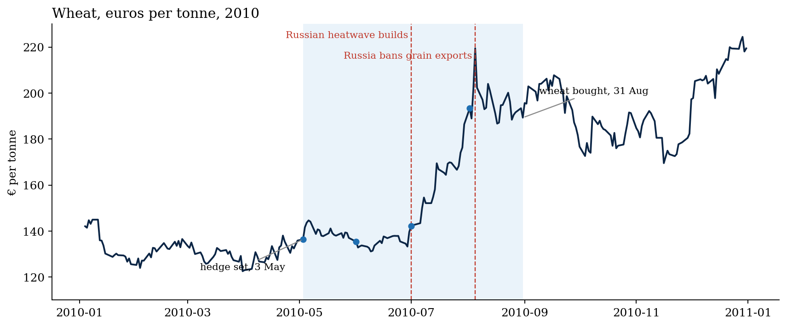
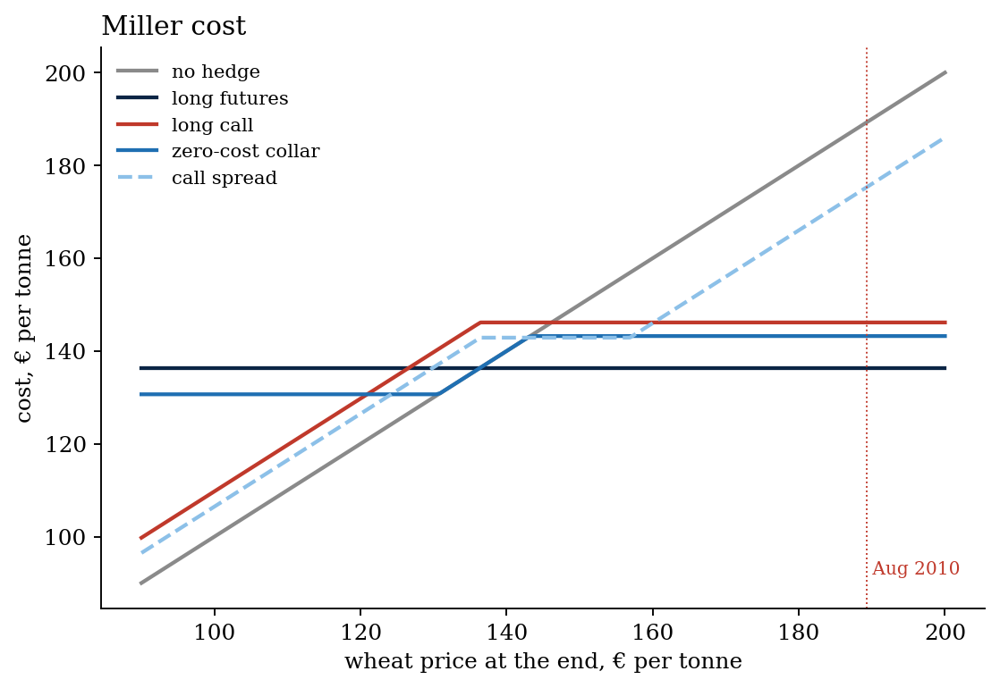
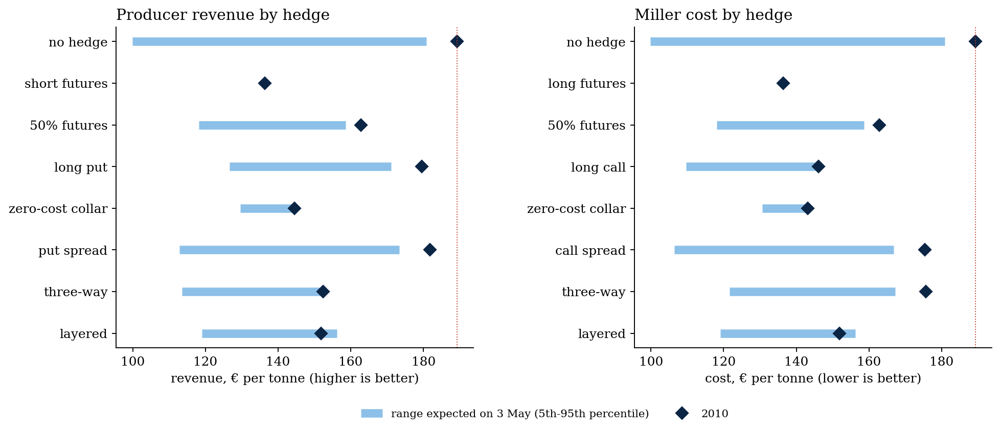
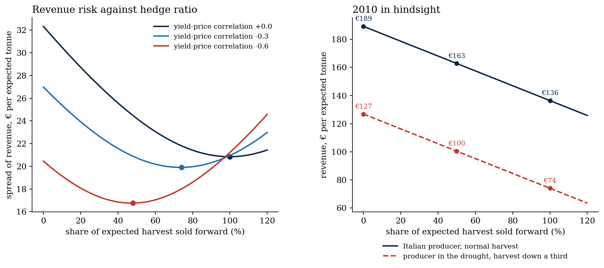
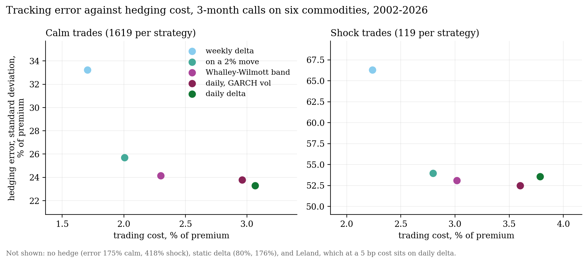
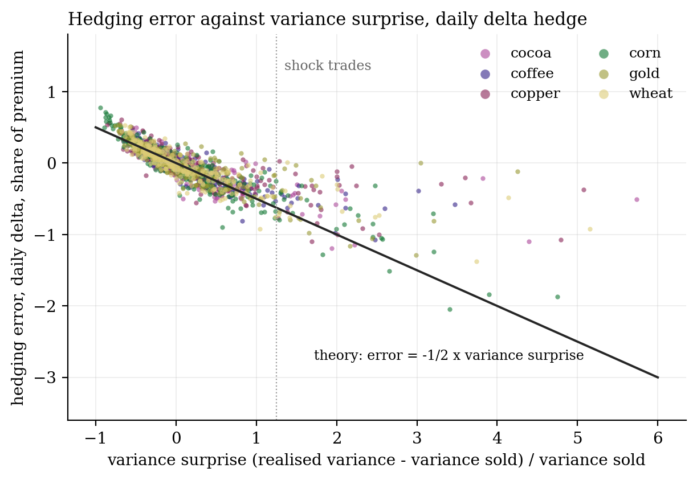

# Hedging Italian wheat through Russia's 2010 export ban: producer and miller

## Why I did this

In commodities the hedger who matters most is often the producer: a farm that knows roughly how much it will harvest but not what it will be paid. The standard tools are futures, puts and a handful of option structures, and a producer has to choose between them months before the price is known. I wanted to test those choices against one real shock, set up the way a producer would have set them up beforehand, and then see in hindsight what each would have paid. The options are priced with the same Black (1976) model used in the Asian option pricer (014).

## The shock

Russia had its worst heatwave on record through July 2010. On 5 August it banned grain exports, and European wheat, which competes with Black Sea grain for the same buyers, jumped with it. Wheat went from 136 euros a tonne on 3 May to 189 on 31 August, up 39%. Seen from May, with the volatility the market had shown, a price that high had about a 3% chance under Black-76's risk-neutral (zero-drift) model.

## The setup

An Italian soft-wheat producer hedges on 3 May 2010 the crop it will sell on 31 August. It would hedge on Euronext (MATIF) milling wheat, but that market's daily 2010 history isn't freely available, so CBOT wheat converted to euros per tonne at each day's EUR/USD rate stands in for it. The two moved together on the Russian ban. Basis to the Italian cash price is ignored and everything is in euros per tonne. Options are European, expire on the sale date and are priced by Black (1976) at the 60-day volatility before 3 May (31% a year), since free option quotes for 2010 don't exist.

The eight hedges are the ones producers use day to day:

| Hedge | What it is |
|---|---|
| No hedge | Sell at harvest at whatever the price is. |
| Short futures | Sell the whole crop forward on 3 May at €136. |
| 50% futures | Sell half forward, leave half open. |
| Long put | Buy an at-the-money put (€9.8): a floor at €136 less the premium, upside kept. |
| Zero-cost collar | Buy a 95% put and pay for it by selling a call at €145: a floor and a cap. |
| Put spread | Buy the at-the-money put and sell an 85% put: a cheaper floor that only covers a fall to €116. |
| Three-way (fence) | A 95% / 85% put spread paid for by selling a call at €152. |
| Layered | Sell a quarter of the crop forward at the start of May, June, July and August. |

## What happened

| Hedge | Revenue in 2010 (€/t) | Average of the worst 5% expected on 3 May (€/t) |
|---|:-:|:-:|
| No hedge | 189 | 93 |
| Put spread | 182 | 106 |
| Long put | 180 | 127 |
| 50% futures | 163 | 115 |
| Three-way | 152 | 106 |
| Layered | 152 | 115 |
| Zero-cost collar | 145 | 130 |
| Short futures | 136 | 136 |

We see that in hindsight the producer did best unhedged. This is because a price spike is good news for a seller, and every hedge gave some of it away. Of the hedges, the ones that kept the upside did best: the put spread and the long put lost only their premium. Short futures gave up the whole rally, and the collar and the three-way were capped at their call strikes.

Judged on 3 May, before the event, the ranking reverses. By the average of the worst 5% of outcomes under the same model (the expected shortfall, or CVaR at 5%), short futures and the collar protected the producer best, and staying unhedged was the most dangerous. The put is in between, giving a decent floor at a known cost while keeping the upside. This means the right hedge depends on what the producer can't afford. A farm that must cover its costs whatever happens should lock in a price, and one that can stand a bad year but hates missing a rally should buy puts. In 2010 the second kind did well, but that was about a 1-in-30 outcome.

## The other side: an Italian miller

The same shock looks opposite to a buyer. An Italian miller (flour and pasta) that must buy wheat on 31 August can hedge on 3 May with the mirror-image tools: buy futures, buy a call, a zero-cost collar (buy a 105% call, sell a put at €131), a call spread (buy the at-the-money call, sell a 115% call), a three-way (a 105% / 115% call spread paid for by selling a put at €122), or layer its purchases.

| Hedge | Cost in 2010 (€/t) | Saved against no hedge (€/t) | Average of the worst 5% expected on 3 May (€/t) |
|---|:-:|:-:|:-:|
| No hedge | 189 | 0 | 195 |
| Long futures | 136 | 53 | 136 |
| Zero-cost collar | 143 | 46 | 143 |
| Long call | 146 | 43 | 146 |
| Layered | 152 | 38 | 162 |
| 50% futures | 163 | 26 | 166 |
| Call spread | 175 | 14 | 181 |
| Three-way | 176 | 14 | 182 |

For the miller, hedging paid. Buying forward saved €53 a tonne, 28% of the cost, and the collar and the call saved €43-46. The cheaper structures did much less well in the shock. The call spread and the three-way cut the premium by capping the protection at +15%, and the price rose 39%, so they saved only €14.

The producer regretted hedging and the miller was saved by it. This means which side of the market a firm is on decides whether a weather shock in another country is a windfall or a loss, and so which hedge it should hold.

## Yield risk: when the harvest moves with the price

A producer's revenue is price times harvest. If the drought that lifts the price also shrinks the harvest, as for a Russian farm in 2010, the crop partly hedges itself and selling the whole expected harvest forward over-hedges. With a yield volatility of 15% a year, the hedge ratio that minimises the spread of revenue is 100% of the expected harvest when yield and price are unrelated (the Italian producer), 74% at a correlation of -0.3 and 48% at -0.6, where a full hedge is riskier than none. In 2010 a producer inside the drought with a third of its harvest lost and everything sold forward ended with €74 per expected tonne against €127 unhedged. This is because it had to buy back, at the spike, wheat it never grew. `yield_risk.py`

## Before this: the option seller's side

The first version of this project took the other side: sell a 3-month at-the-money call on copper, gold, wheat, corn, coffee or cocoa every month since 2002, and delta-hedge it eight ways (static, weekly, on 2% moves, daily, daily with GARCH volatility, Leland's cost adjustment and the Whalley–Wilmott band). In calm markets hedging daily tracks best, and the band comes within a point at three-quarters of the cost. In a shock every dynamic hedge lands within two points of the others, because the loss is set by the volatility the option was sold at: error / premium ≈ −½ × (σ²_realised − σ²_sold) / σ²_sold, a well-known result that the 1,738 trades follow closely.

| | |
|:-:|:-:|
|  |  |

## Limits

One shock, one producer and one sale date. CBOT in euros stands in for Euronext, so the dollar's moves against the euro are in the price; a real Italian hedge on Euronext would not carry them. Basis to the Italian cash price is ignored. Yield risk is treated only in the simple model above, with an assumed yield volatility of 15%. Options are priced at realised volatility rather than market quotes. The continuous front-month series jumps slightly at each roll.

## What I'd do next

Repeat the test across several shocks (the 2018 northern European drought, the 2022 invasion of Ukraine) to see whether the ranking holds. Swap in Euronext milling wheat and the Italian cash price, and price the options at market implied volatility where it can be found.

## Code

`wheat_2010.py` (both sides of the hedge) · `make_wheat_figures.py` · `hedging.py` (Black-76 and the delta-hedging rules) · `backtest.py` · `monte_carlo.py` · `make_figures.py` · Python, NumPy, SciPy, pandas

*A side project, built for fun. Credits: Black (1976), J. Financ. Econ. 3, 167; Leland (1985), J. Finance 40, 1283; Whalley & Wilmott (1997), Math. Finance 7, 307; Hull & White (2017), J. Bank. Finance 82, 180. Prices: CBOT, COMEX and ICE futures and EUR/USD via Yahoo Finance.*
