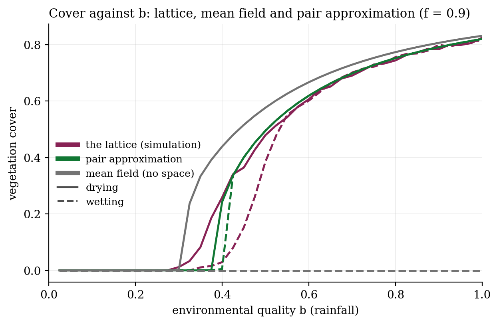
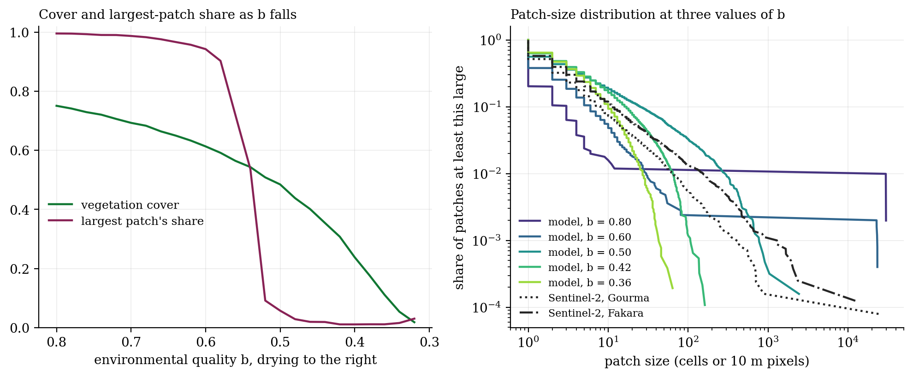
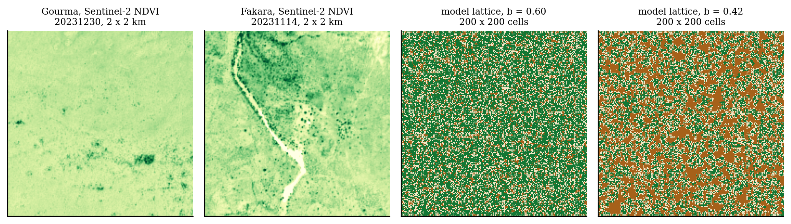
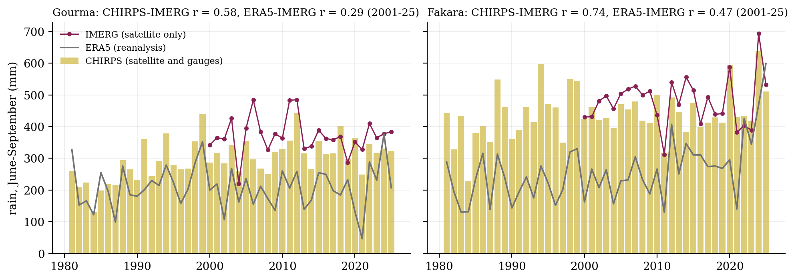
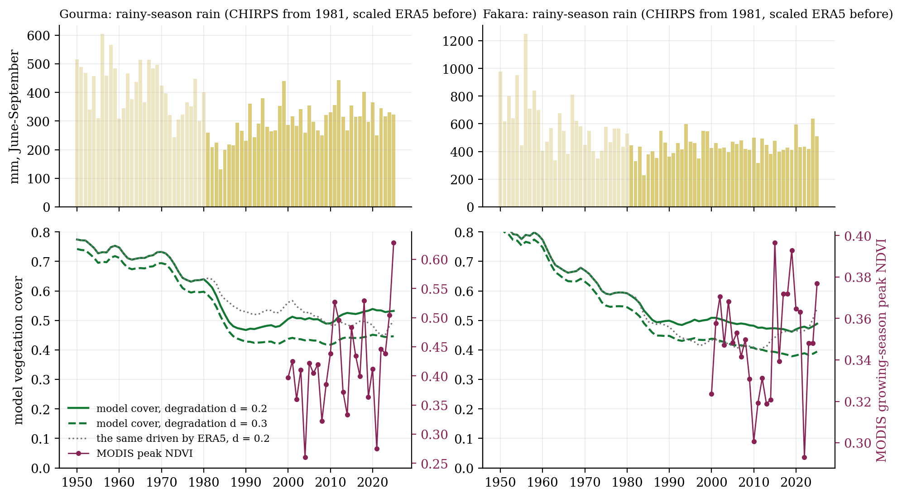
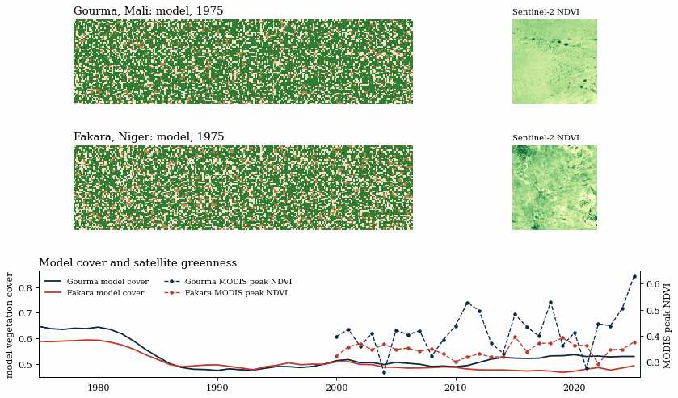

# Sahel desertification as a lattice model

## Why I asked this

The Sahel has been a fixation of mine since I first learned about it as a child, when I did a school science project on it with a chicken incubator and root fungi. This project is also a spin-off of the coral reef model (001). Looked at from above, a dryland is another lattice: patches of shrub and bare ground, each affected by what is growing next to it.

In the droughts of the 1970s and 80s the Sahel lost much of its vegetation. Rain partly came back from the 1990s, and so did the green, but not everywhere. The main aims of this project were to:

1. rebuild the Kéfi et al. (2007) facilitation model and find out whether it tips, and stays tipped, as rainfall falls and then recovers,
2. compare the lattice with the simpler theories that ignore space,
3. drive it with real rainfall at two Sahel sites with opposite histories, and compare it with what satellites saw.

## The model

In a dry place a seed next to a shrub does better than one on bare ground. The shrub shades the soil, slows run-off and builds organic matter. Ecologists call this facilitation. Kéfi et al. wrote it into a lattice where each cell is vegetated (+), empty but fertile (0) or degraded (−). In our lattice each cell changes state at the following rates, where $q_{+|i}$ is the share of its four neighbours that are vegetated and $\rho_+$ the share of the whole lattice:

$$0 \to +:\ \big[\delta\rho_+ + (1-\delta)\,q_{+|i}\big]\,(b - c\,\rho_+), \qquad + \to 0:\ m, \qquad 0 \to -:\ d, \qquad - \to 0:\ r + f\,q_{+|i}.$$

Here $b$ is environmental quality (in our case, rainfall), $\delta$ the share of seeds that travel far, $c$ the competition between plants, $m$ the death rate, $d$ the rate at which bare soil degrades and $r$ the rate at which it recovers on its own. $f$ is the neighbour coupling. This is the same idea as the coupling in the Potts model I used for the reef: being next to plants lowers the barrier for bare soil to recover.

## What the lattice does

To look for a tipping point we sweep $b$ down slowly, then back up again, and watch the vegetation cover. With strong facilitation ($f$ = 0.9), a drying lattice still has 34% cover at $b$ = 0.425 and loses it by 0.325. A re-wetting one has only 8% at the same $b$, and catches up near 0.55. This means the way back is longer than the way down. With $f$ = 0.5 the lag is wider, and with weak facilitation ($f$ = 0.2) degraded soil barely heals: once the vegetation is lost it does not return, even at $b$ = 1.

We can then compare the lattice with two theories. The mean field treats every cell as feeling the whole landscape. The pair approximation tracks neighbouring pairs of cells, so it keeps some of the space. We see that without space, a bare landscape seeded with a few plants never re-greens, at any rainfall. The pair approximation predicts a narrow trap, gone below $b$ = 0.40 and back in full at 0.425. Our lattice sits between the two. This is the same result as the reef: ignoring space overstates how stuck a system gets.

The most interesting result for me was that the vegetation stops being connected long before it disappears. To see this we dry a 200 × 200 lattice slowly. The largest patch then holds 90% of all vegetation at $b$ = 0.58 and only 6% at $b$ = 0.50, while the cover is still near 0.5. The full collapse comes only at $b \approx$ 0.33. This means the percolation threshold (the point where no single patch spans the landscape) is crossed well before the tipping point. A satellite counting patch sizes would see the warning, as Kéfi et al. suggested, but one measuring average greenness would not.

## Two real sites

Gourma (Mali) re-greened after the droughts. Fakara (Niger) did not, under heavy cropping and grazing (Dardel et al. 2014). The two sites had similar rainfall histories. This makes them a natural test for our model: if rain decides the vegetation, the model should follow both.

We drive the lattice with each site's rainy-season rain from 1950 to 2025, scaled so the wet 1950s and 60s sit at $b$ = 0.75, and compare it with MODIS greenness (NDVI) from 2000. Sentinel-2 images of both sites show the patchy structure the lattice produces.

I expected the rainfall to be the weak point, and it was. My first runs used ERA5, which spreads rain over boxes about 30 km across, so the short, sparse storms that fall on a Sahel site are smoothed out. To check this I compared it with two satellite products over the same half-degree box: CHIRPS, which blends satellite with rain gauges (daily from 1981), and IMERG, which is satellite only (monthly from 2000).

We see ERA5 gives about 35% less rain than either satellite product (204 mm a season at Gourma against 321 for CHIRPS and 373 for IMERG), and it follows the satellites poorly from year to year. CHIRPS and IMERG agree with each other (r = 0.58 at Gourma, 0.74 at Fakara), while ERA5 and IMERG barely do (0.29 and 0.47). ERA5 even puts Gourma's driest season in 2021 rather than in the 1980s drought. This means ERA5 was the wrong rain for a site study, so our site runs now use CHIRPS from 1981, with the ERA5 years before then scaled by the ratio of the two products over 1981 to 2025, so $b$ = 0.75 means the same in both runs.

With the better rain, the 1980s take $b$ down to 0.30 at Gourma in 1986, just below where a slowly drying lattice collapses (about 0.33). Our model still does not collapse. Cover falls from about 0.75 to 0.47 and recovers to 0.53 by 2020. The drought was deep enough but too short: smoothed over three years it sits below the edge for only a few model years, and the lattice needs longer than that to fall apart. This means our model cannot reproduce what happened in the Sahel with rain alone, whichever rain we give it.

The better rain also corrects one of my earlier claims. With ERA5, Fakara's rain seemed to rise by 88% between the early 2000s and the early 2020s while its greenness stayed flat. CHIRPS and IMERG show a rise of only 5 to 14%. The contrast between the sites survives the correction. At Gourma each year's peak greenness tracks that year's rain (r = 0.68 with CHIRPS, 0.60 with IMERG) and has risen by a quarter since 2000 while the rain barely changed. At Fakara greenness is flat and hardly tracks the rain at all (r = 0.13 and 0.20). With the same rules and a degradation rate fixed in time, our lattice cannot separate them, and should not be able to. What separates the sites is something rain cannot supply: at Fakara, how the land is used decides the vegetation more than the climate does.

Played year by year, each site is a strip of landscape (60 x 240 cells, a transect rather than a square) driven by its own rain, beside the real site's Sentinel-2 vegetation pattern and MODIS greenness. The model loses about a quarter of its cover through the 1980s at both sites and recovers only slightly afterwards. MODIS greenness at Gourma rises over the same years (a correlation of 0.21 with the model), while at Fakara it doesn't follow the model at all (-0.18): the same rain gives the same lattice, and land use makes the difference.

The limits are worth stating. In our case $b$ is not millimetres of rain, the other rates are Kéfi's defaults rather than fitted values, and grazing and cropping enter only through $d$. A lattice cell also has no fixed size, so patch sizes can be compared in shape but not in metres.

## What I'd do next

A larger study across many Sahel sites, with a degradation rate that rises with cropping and grazing over time. From there I would like to build a risk measure and a stochastic event set of droughts (many simulated rainfall histories, not just the one that happened), run the full lattice through them, and test how feasible different prevention methods are, such as rotating grazing or protecting the largest patches. I would also like to work on the pure mathematics of these models, as well as the applied side.

## Code

`animate_sites.py` (the strip lattice beside the satellite record) · `sahel_ca.py` (Numba lattice, asynchronous updates, periodic edges) · `approximations.py` (mean-field and pair-approximation ODEs, swept by continuation) · `run_hysteresis.py` · `run_theory.py` · `early_warning.py` (patch labelling across the periodic boundary, spanning-cluster test) · `sentinel_patches.py` (Sentinel-2 from Planetary Computer) · `fetch_sites.py` · `run_sites.py` · `make_figures.py` · Python, NumPy, Numba, SciPy, rasterio

## Credits

The model rebuilt here: Kéfi et al. (2007), Nature 449:213, and Kéfi et al. (2007), Theor. Popul. Biol. 71:367. Rietkerk et al. (2004), Science 305:1926. Scanlon et al. (2007), Nature 449:209. Pair approximation: Matsuda et al. (1992), Prog. Theor. Phys. 88:1035. Sahel greening: Herrmann, Anyamba & Tucker (2005), Glob. Environ. Change 15:394. The two sites: Dardel et al. (2014), Remote Sens. Environ. 140:350. Percolation: Stauffer & Aharony (1994). Data: ERA5 via Open-Meteo (Hersbach et al. 2020, QJRMS 146:1999), MODIS MOD13Q1 (Didan 2021) via the ORNL DAAC, Copernicus Sentinel-2 via Microsoft Planetary Computer, CHIRPS (Funk et al. 2015, Sci. Data 2:150066), IMERG V07 (Huffman et al., NASA GES DISC), both via Google Earth Engine.
