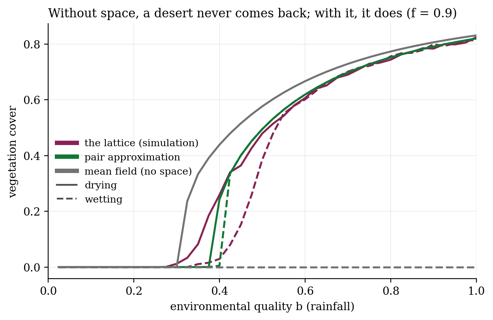
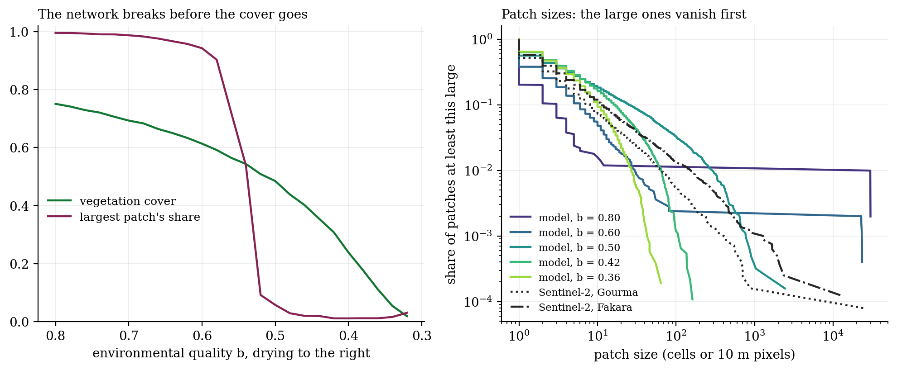
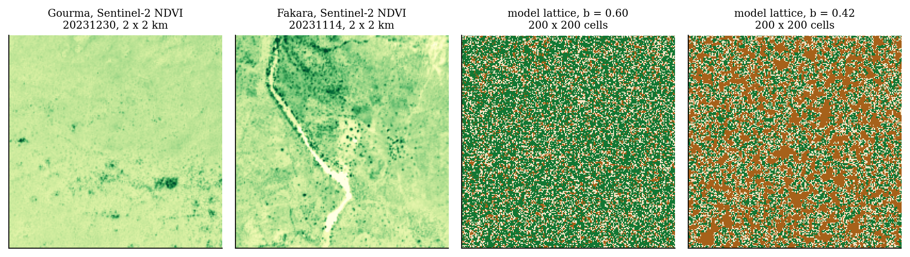

# Desertification in the Sahel: plants that help plants

**In the droughts of the 1970s and 80s the Sahel lost much of its vegetation. Rain partly came back from the 1990s, and so did the green, but not everywhere. If plants make life easier for their neighbours, can a dryland tip into desert and stay there, and can you see it coming from space?**

In a dry place, a seed next to a shrub does better than one on bare ground. The shrub shades the soil, slows run-off and builds organic matter. Ecologists call this **facilitation**. Kéfi et al. (2007) wrote it into a lattice where each cell is vegetated (+), empty but fertile (0) or degraded (−), and $q_{+|i}$ is the share of a cell's four neighbours that are vegetated:

$$0 \to +:\ \big[\delta\rho_+ + (1-\delta)\,q_{+|i}\big]\,(b - c\,\rho_+), \qquad + \to 0:\ m, \qquad 0 \to -:\ d, \qquad - \to 0:\ r + f\,q_{+|i}.$$

$b$ is environmental quality (rainfall). $f$ is the neighbour coupling, the same idea as the coupling in the Ising and Potts models: being next to plants lowers the barrier for bare soil to recover. It is the coral model of project 001 moved onto land.

**What the model says:**
- **Facilitation makes the way back longer than the way down.** With $f = 0.9$, a drying landscape still has 34% cover at $b = 0.425$ and loses it by 0.325. A re-wetting one, at the same $b = 0.425$, has 8%, and catches up only near $b = 0.55$. With $f = 0.5$ the lag is wider: 25% cover at $b = 0.5$ on the way down, 1% at the same $b$ on the way back, and recovery only past 0.65. With weak facilitation ($f = 0.2$) degraded soil barely heals, and once the vegetation is lost it does not return even at $b = 1$.
- **Space matters, and mean-field theory overstates the trap.** Without space (the mean field), a bare landscape seeded with a few plants never re-greens, at any rainfall. The pair approximation, which tracks neighbouring pairs, predicts a narrow trap: gone below $b = 0.40$, back in full at 0.425. The lattice sits between the two, with a recovery slower and more gradual than the pair approximation expects. The coral reef project found the same: ignoring space overstates hysteresis.
- **The vegetation stops connecting long before it disappears.** On a 200 × 200 lattice drying slowly, the largest patch holds 90% of all vegetation at $b = 0.58$ and 6% at $b = 0.50$. Cover is still near 0.5 at that point, and the full collapse comes only at $b \approx 0.33$. The large patches go first (Kéfi's patch-size signal), and the percolation threshold is crossed well before the tipping point. A satellite counting patch sizes would see the warning; one measuring average greenness would not.

| | |
|:-:|:-:|
|  |  |

**Next: real rainfall at two real sites.** Gourma (Mali) re-greened after the droughts; Fakara (Niger), with similar rain, kept losing vegetation under heavy cropping and grazing (Dardel et al. 2014). `run_sites.py` drives the lattice with each site's 1950–2025 rainy-season rain and compares it with MODIS greenness from 2000, at two degradation rates. The question is whether land use alone, through $d$, separates the two fates.

**Built:** a Numba lattice with asynchronous updates and periodic edges; patch labelling across the periodic boundary and a spanning-cluster test; mean-field and pair-approximation ODEs swept by continuation; early-warning statistics; Sentinel-2 NDVI patch maps from Planetary Computer; MODIS NDVI from the ORNL DAAC service; and rainfall-driven runs at two sites.

`sahel_ca.py` · `approximations.py` · `run_hysteresis.py` · `run_theory.py` · `early_warning.py` · `sentinel_patches.py` · `fetch_sites.py` · `run_sites.py` · `make_figures.py` · Python, NumPy, Numba, SciPy, rasterio

**Limits:** the model's $b$ is not millimetres of rain. It is tied to rainfall by one proportional scale, set so the wet 1950s and 60s sit at $b = 0.75$, and the other rates are Kéfi's defaults, not fitted. A lattice cell has no fixed size, so patch sizes can be compared in shape, not in metres. Rainfall is ERA5, which captures the Sahel droughts but is coarser than gauge-based CHIRPS. MODIS greenness starts in 2000, after the collapse. Grazing and cropping enter only through the degradation rate $d$.

*A side project, built for fun. Credits: Kéfi et al. (2007), Nature 449, 213; Kéfi et al. (2007), Theor. Popul. Biol. 71, 367; Rietkerk et al. (2004), Science 305, 1926; Scanlon et al. (2007), Nature 449, 209; Matsuda et al. (1992), Prog. Theor. Phys. 88, 1035; Herrmann, Anyamba & Tucker (2005), Glob. Environ. Change 15, 394; Dardel et al. (2014), Remote Sens. Environ. 140, 350; Stauffer & Aharony (1994), Introduction to Percolation Theory. Data: ERA5 via Open-Meteo (Hersbach et al. 2020, QJRMS 146, 1999); MODIS MOD13Q1 (Didan 2021) via the ORNL DAAC; Copernicus Sentinel-2 via Microsoft Planetary Computer.*
