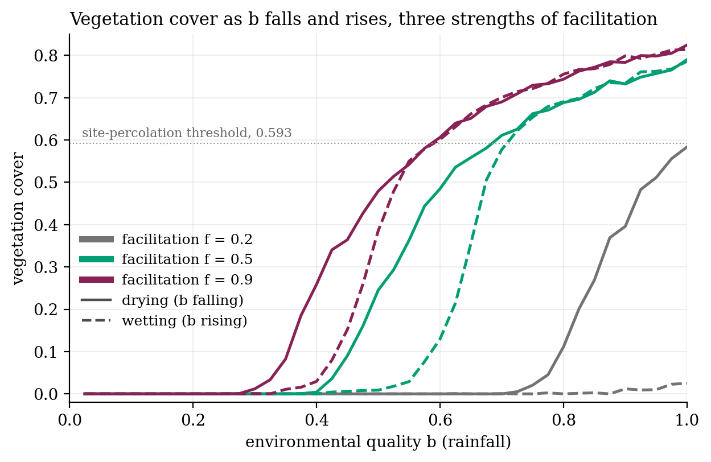
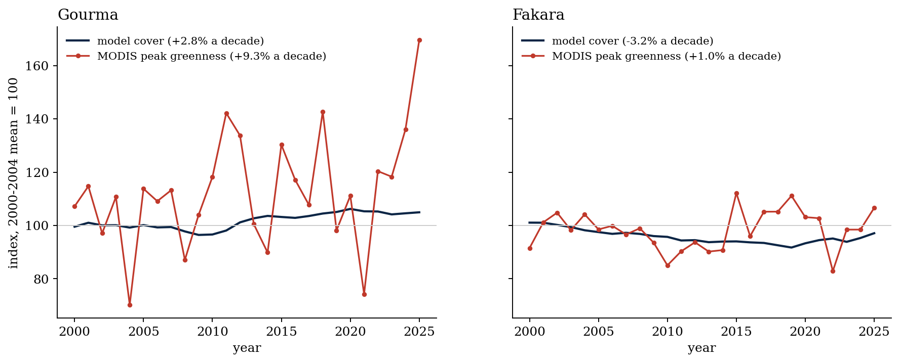
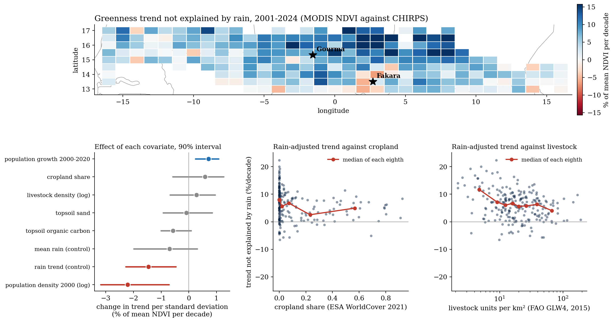
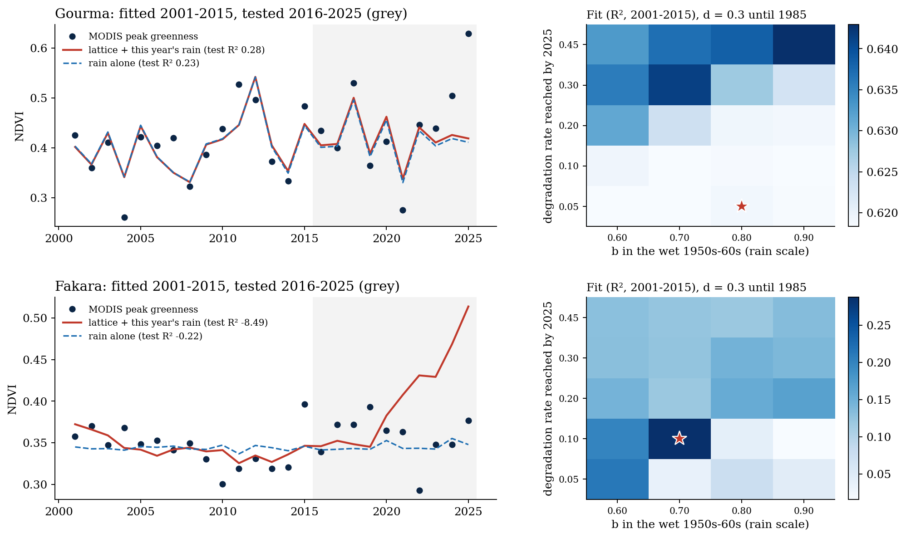
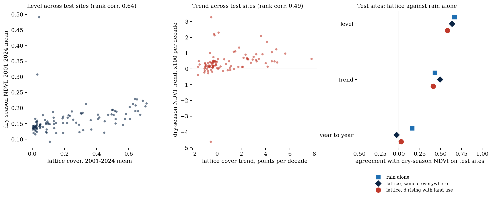
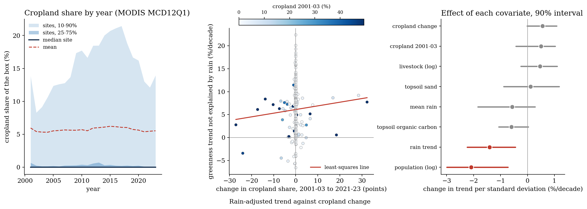

# Sahel desertification as a lattice model

## Why I asked this

The Sahel has been a fixation of mine since I first learned about it as a child, when I did a school science project on it with a chicken incubator and root fungi. This project is also a spin-off of the coral reef model (001). Looked at from above, a dryland is another lattice: patches of shrub and bare ground, each affected by what is growing next to it.

In the droughts of the 1970s and 80s the Sahel lost much of its vegetation. Rain partly came back from the 1990s, and so did the green, but not everywhere. The main aims of this project were to:

1. rebuild the Kéfi et al. (2007) facilitation model and find out whether it tips, and stays tipped, as rainfall falls and then recovers,
2. compare the lattice with the simpler theories that ignore space,
3. drive it with real rainfall at two Sahel sites with opposite histories, and compare it with what satellites saw.

## The model

In a dry place a seed next to a shrub does better than one on bare ground. The shrub shades the soil, slows run-off and builds organic matter. Ecologists call this facilitation. Kéfi et al. wrote it into a lattice where each cell is vegetated (+), empty but fertile (0) or degraded (−). In our lattice each cell changes state at the following rates, where $q_{+|i}$ is the share of its four neighbours that are vegetated and $\rho_+$ the share of the whole lattice:

$$0 \to +:\ \big[\delta\rho_+ + (1-\delta)\,q_{+|i}\big]\,(b - c\,\rho_+), \qquad + \to 0:\ m, \qquad 0 \to -:\ d, \qquad - \to 0:\ r + f\,q_{+|i}.$$

Here $b$ is environmental quality (in our case, rainfall), $\delta$ the share of seeds that travel far, $c$ the competition between plants, $m$ the death rate, $d$ the rate at which bare soil degrades and $r$ the rate at which it recovers on its own. $f$ is the neighbour coupling. This is the same idea as the coupling in the Potts model I used for the reef: being next to plants lowers the barrier for bare soil to recover.

## What the lattice does

To look for a tipping point we sweep $b$ down slowly, then back up again, and watch the vegetation cover. With strong facilitation ($f$ = 0.9), a drying lattice still has 34% cover at $b$ = 0.425 and loses it by 0.325. A re-wetting one has only 8% at the same $b$, and catches up near 0.55. This means the way back is longer than the way down. With $f$ = 0.5 the lag is wider, and with weak facilitation ($f$ = 0.2) degraded soil barely heals: once the vegetation is lost it does not return, even at $b$ = 1.

We can then compare the lattice with two theories. The mean field treats every cell as feeling the whole landscape. The pair approximation tracks neighbouring pairs of cells, so it keeps some of the space. We see that without space, a bare landscape seeded with a few plants never re-greens, at any rainfall. The pair approximation predicts a narrow trap, gone below $b$ = 0.40 and back in full at 0.425. Our lattice sits between the two. This is the same result as the reef: ignoring space overstates how stuck a system gets.

The most interesting result for me was that the vegetation stops being connected long before it disappears. To see this we dry a 200 × 200 lattice slowly. The largest patch then holds 90% of all vegetation at $b$ = 0.58 and only 6% at $b$ = 0.50, while the cover is still near 0.5. The full collapse comes only at $b \approx$ 0.33. This means the percolation threshold (the point where no single patch spans the landscape) is crossed well before the tipping point. A satellite counting patch sizes would see the warning, as Kéfi et al. suggested, but one measuring average greenness would not.

## Two real sites

Gourma (Mali) re-greened after the droughts. Fakara (Niger) did not, under heavy cropping and grazing (Dardel et al. 2014). The two sites had similar rainfall histories. This makes them a natural test for our model: if rain decides the vegetation, the model should follow both.

We drive the lattice with each site's rainy-season rain from 1950 to 2025, scaled so the wet 1950s and 60s sit at $b$ = 0.75, and compare it with MODIS greenness (NDVI) from 2000. Sentinel-2 images of both sites show the patchy structure the lattice produces.

I expected the rainfall to be the weak point, and it was. My first runs used ERA5, which spreads rain over boxes about 30 km across, so the short, sparse storms that fall on a Sahel site are smoothed out. To check this I compared it with two satellite products over the same half-degree box: CHIRPS, which blends satellite with rain gauges (daily from 1981), and IMERG, which is satellite only (monthly from 2000).

We see ERA5 gives about 35% less rain than either satellite product (204 mm a season at Gourma against 321 for CHIRPS and 373 for IMERG), and it follows the satellites poorly from year to year. CHIRPS and IMERG agree with each other (r = 0.58 at Gourma, 0.74 at Fakara), while ERA5 and IMERG barely do (0.29 and 0.47). ERA5 even puts Gourma's driest season in 2021 rather than in the 1980s drought. This means ERA5 was the wrong rain for a site study, so our site runs now use CHIRPS from 1981, with the ERA5 years before then scaled by the ratio of the two products over 1981 to 2025, so $b$ = 0.75 means the same in both runs.

With the better rain, the 1980s take $b$ down to 0.30 at Gourma in 1986, just below where a slowly drying lattice collapses (about 0.33). Our model still does not collapse. Cover falls from about 0.75 to 0.47 and recovers to 0.53 by 2020. The drought was deep enough but too short: smoothed over three years it sits below the edge for only a few model years, and the lattice needs longer than that to fall apart. This means our model cannot reproduce what happened in the Sahel with rain alone, whichever rain we give it.

The better rain also corrects one of my earlier claims. With ERA5, Fakara's rain seemed to rise by 88% between the early 2000s and the early 2020s while its greenness stayed flat. CHIRPS and IMERG show a rise of only 5 to 14%. The contrast between the sites survives the correction. At Gourma each year's peak greenness tracks that year's rain (r = 0.68 with CHIRPS, 0.60 with IMERG) and has risen by a quarter since 2000 while the rain barely changed. At Fakara greenness is flat and hardly tracks the rain at all (r = 0.13 and 0.20). With the same rules and a degradation rate fixed in time, our lattice cannot separate them, and should not be able to. What separates the sites is something rain cannot supply: at Fakara, how the land is used decides the vegetation more than the climate does.

Played year by year, each site is a strip of landscape (60 x 240 cells, a transect rather than a square) driven by its own rain, beside the real site's Sentinel-2 vegetation pattern and MODIS greenness. The model loses about a quarter of its cover through the 1980s at both sites and recovers only slightly afterwards. MODIS greenness at Gourma rises over the same years (a correlation of 0.21 with the model), while at Fakara it doesn't follow the model at all (-0.18): the same rain gives the same lattice, and land use makes the difference.

**Long-term tracking.** Indexed to 2000-2004, the model's cover and MODIS greenness can be compared trend for trend. At Gourma the model gets the direction right but too weakly, +2.8% a decade against +9.3% in MODIS (90% interval 0.6 to 21%). At Fakara the model drifts down, -3.2% a decade, while MODIS is flat to slightly up (+1.0%, an interval spanning zero). Rain alone gives the lattice the right sign where rain matters, and the wrong one where land use does. `long_term.py`

The limits are worth stating. In our case $b$ is not millimetres of rain, the other rates are Kéfi's defaults rather than fitted values, and grazing and cropping enter only through $d$. A lattice cell also has no fixed size, so patch sizes can be compared in shape but not in metres.

## What else goes with land loss and recovery

Rain alone predicted the two sites poorly, so the question moves from two sites to the whole Sahel. A grid of sites every 0.5° of latitude and 1° of longitude, from Senegal to Chad between 13° and 17° N, each a box of about 22 km, gives 297 sites. 223 are vegetated enough to measure, after dropping bare desert and open water. For each site, Earth Engine gives:

- **Greenness:** MODIS NDVI at 250 m, the August-September mean, each year 2001-2024.
- **Rain:** CHIRPS, the June-October total, each year 2001-2024.
- **Cropping:** the share of the box mapped as cropland by ESA WorldCover 2021, at 10 m.
- **Grazing:** livestock in 2015 from FAO's Gridded Livestock of the World (GLW4), as tropical livestock units per km² (cattle 0.7, sheep and goats 0.1).
- **People:** population density in 2000 and its growth to 2020, from GPW v4.11.
- **Soil:** topsoil sand and organic carbon, from OpenLandMap.

**Removing the rain.** At each site greenness is regressed on that year's rain. The residual is the greenness rain doesn't explain, and its trend over the years (a Theil-Sen slope, as % of the site's mean NDVI per decade) is the land gain or loss beyond the weather. This is RESTREND (Evans and Geerken 2004), the usual way to separate land use from climate in the Sahel. The site trends are then regressed on the covariates, each scaled to one standard deviation so the effects compare directly, with mean rain and the rain trend as controls. Neighbouring sites share weather and land use, so the 90% intervals come from a block bootstrap that resamples 4° bands of longitude, and the out-of-sample fit from leaving one band out at a time.

- **The Sahel kept re-greening.** 94% of the sites greened over 2001-2024 (median +8.0% a decade), and 89% greened by more than their rain explains (median +6.3%).
- **The two field sites agree with Dardel et al.** The grid cell nearest Gourma greened +7.6% a decade beyond its rain, the one nearest Fakara +2.8%.
- **More used land greened less.** Taken one at a time, the rain-adjusted trend falls with cropland share (Spearman −0.31), livestock density (−0.28) and population density (−0.41).
- **The pressures can't be told apart.** Cropping, livestock and people rise together (rank correlations 0.6-0.8), and all three rise with rain towards the south. Combined into one land-use index (their first principal component, 74% of their variance), one standard deviation more land use goes with 1.1 points a decade less re-greening (90% interval 0.3 to 1.6). Fitted separately, only population density keeps a clear effect (−2.2, interval −3.2 to −0.7); cropland and livestock intervals span zero once it is in.
- **Population growth points the other way** (+0.7, interval 0.2 to 1.1): sites whose population grew fastest greened slightly more, given their starting density. Farmer-managed tree regeneration in southern Niger is one known reason; this test can't say whether it is the reason here.
- **Soil adds little.** Sand has no effect, and organic carbon a weak negative one whose interval reaches zero.
- **Most of the variation is unexplained.** The covariates explain 31% of the differences between sites, and 19% when each band of longitude is predicted from the others.

The limits are worth stating. The covariates are snapshots (cropland in 2021, livestock in 2015), not changes over the period, and the relations are correlations, not causes. The rain-trend control comes out negative: sites where rain rose most re-greened less than the linear fit expects, a known weakness of RESTREND when greenness saturates in wet years. And MODIS at 250 m mixes trees, grass and crops, so greening in cropland can be the crops themselves. `fetch_covariates.py` · `covariates.py`

**Fitting the lattice to the satellites.** With Kéfi's default rates and a rain scale set by hand, the lattice tracked MODIS poorly, so it was fitted. Two changes: an observation model, since August-September greenness is mostly annual grass that follows that year's rain, on top of the slow shrub and tree cover the lattice represents (greenness = a + g × this year's rain + w × lattice cover, with w required to be positive); and the rates fitted per site by grid search, the scale that turns rain into the lattice's b, and the soil degradation rate d, constant to 1985 and then changing linearly to 2025 as land use changes. Fitted on 2001-2015, tested on 2016-2025, against rain alone. `calibrate_sites.py`

- **At Gourma rain does almost all the work.** The best fit has degradation easing from 0.3 to 0.05, which lets the lattice re-green, but the lattice's weight in the fit is close to zero. On the test years it scores 0.28 against 0.23 for rain alone, too small a difference to mean much, and neither catches the very green 2024 and 2025.
- **At Fakara nothing fits.** Greenness there doesn't follow rain (rain alone explains 1% of it), and any fit that leans on the lattice runs away on the test years.
- **What this says about the approach.** At one 5 km site and 15 fitting years, peak greenness is the grass's response to rain, and the slow cover the lattice models can't be picked out of it.

**One set of rates for the whole Sahel.** So the target changed to dry-season greenness (March-May MODIS NDVI, when the grass has died back and what's left is mostly shrubs and trees), and all 223 vegetated grid sites were run with the same rates: one scale turning each site's 3-year mean CHIRPS rain into the lattice's b (so drier sites get a lower b), and a degradation rate that can rise with the site's land-use index. Each site's lattice (60 × 60, two seeds) runs 1981-2024. The rates were fitted on the sites in half the 4° longitude bands and tested on the other half, against rain alone, on three things: the level of greenness across sites, its 2001-2024 trend across sites, and its year-to-year changes within each site. 48 combinations of rates were tried, in two grids (`results/joint_fit_grid_first.csv` and `results/joint_fit_grid.csv`). `fetch_dry_season.py` · `joint_fit.py`

- **The lattice does about as well as rain, not better.** On the test sites its cover ranks the sites' greenness with a correlation of 0.64 (rain alone 0.67) and their trends at 0.49 (rain alone 0.43). The trend edge is within the noise: neighbouring rate settings range from 0.27 to 0.51.
- **Year to year it does worse** (about 0 against 0.16), because its cover lags the rain by years while shrub greenness answers within a season or two.
- **Land use doesn't help.** Letting the degradation rate rise with cropland, livestock and people lowers the match on every measure (level 0.58, trend 0.41).
- **The dry edge collapses.** At the fitted rates 76 of the 223 sites lose all their lattice cover, while the satellites still see sparse shrubs there. The lattice's all-or-nothing tipping is too sharp for the Sahel's northern fringe, where scattered shrubs persist on very little rain.
- **Where this leaves the model.** Across 223 sites and 24 years, the facilitation and hysteresis that make the lattice interesting don't add predictive skill over smoothed rain. Over 2001-2024 rain was rising and few sites came near a tipping point, so the period may simply not test them. The next step is a model with a persistent shrub layer that can't fully collapse, and a test on a period that includes the 1980s droughts, using the AVHRR greenness record that goes back to 1981.

**Cropland over time.** The covariates above are snapshots, so cropland was also followed year by year, 2001-2023, from the MODIS land-cover product MCD12Q1 (500 m), at the same sites. Two tests were run: across sites, the rain-adjusted trend against the change in cropland share, with the other covariates as controls; and within each site, whether a year with more cropland has greenness above or below what its rain predicts, after removing each site's own level and each year's Sahel-wide anomaly.

The data is too thin to answer this. At 500 m MODIS misses most Sahel fields: the median site shows no cropland at all in any year, its cropland agrees only loosely with ESA WorldCover (rank correlation 0.58), and only 11% of sites gained cropland. The change-on-change effect is small and its interval reaches zero (+0.6 a decade per standard deviation, −0.0 to 1.1). Within sites, a year with one point more cropland is 0.28% greener than its rain predicts (0.22 to 0.35), but that is likely circular: MODIS classifies cropland partly from greenness, and crops are green in August and September. Population density keeps the same clear effect as before (−2.1, −3.0 to −0.7). A real test needs a finer cropland record, such as ESA's CCI land cover (300 m, 1992-2022, from the Copernicus Climate Data Store). `landuse_change.py`

## What I'd do next

Land-use change over time rather than snapshots (ESA CCI land cover runs from 1992), and a lattice whose degradation rate rises with the land-use index fitted above, run at every grid site. From there I would like to build a risk measure and a stochastic event set of droughts (many simulated rainfall histories, not just the one that happened), run the full lattice through them, and test how feasible different prevention methods are, such as rotating grazing or protecting the largest patches. I would also like to work on the pure mathematics of these models, as well as the applied side.

## Code

`animate_sites.py` (the strip lattice beside the satellite record) · `sahel_ca.py` (Numba lattice, asynchronous updates, periodic edges) · `approximations.py` (mean-field and pair-approximation ODEs, swept by continuation) · `run_hysteresis.py` · `run_theory.py` · `early_warning.py` (patch labelling across the periodic boundary, spanning-cluster test) · `sentinel_patches.py` (Sentinel-2 from Planetary Computer) · `fetch_sites.py` · `run_sites.py` · `fetch_covariates.py` (Earth Engine and FAO GLW4) · `covariates.py` (RESTREND and the covariate fit) · `landuse_change.py` (MODIS cropland year by year) · `calibrate_sites.py` (fitting the lattice to MODIS) · `fetch_dry_season.py` · `joint_fit.py` (one set of rates across 223 sites) · `make_figures.py` · Python, NumPy, Numba, SciPy, rasterio

## Credits

The model rebuilt here: Kéfi et al. (2007), Nature 449:213, and Kéfi et al. (2007), Theor. Popul. Biol. 71:367. Rietkerk et al. (2004), Science 305:1926. Scanlon et al. (2007), Nature 449:209. Pair approximation: Matsuda et al. (1992), Prog. Theor. Phys. 88:1035. Sahel greening: Herrmann, Anyamba & Tucker (2005), Glob. Environ. Change 15:394. The two sites: Dardel et al. (2014), Remote Sens. Environ. 140:350. Percolation: Stauffer & Aharony (1994). Data: ERA5 via Open-Meteo (Hersbach et al. 2020, QJRMS 146:1999), MODIS MOD13Q1 (Didan 2021) via the ORNL DAAC, Copernicus Sentinel-2 via Microsoft Planetary Computer, CHIRPS (Funk et al. 2015, Sci. Data 2:150066), IMERG V07 (Huffman et al., NASA GES DISC), both via Google Earth Engine.
