# Kevin Grainger: projects

Thirteen side projects across earth systems, signal processing, commodity and energy markets and network risk, plus three from my undergraduate physics degree. Most start from a published model and try to add one honest result. They're built for fun; the write-ups are short, and the graphics do most of the talking.

| | Project | In one line |
|:-:|---|---|
| 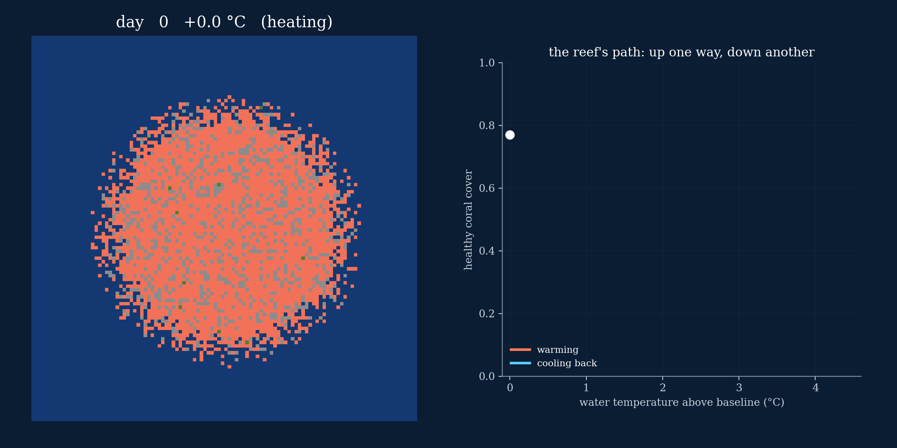 | **[001 · Coral reef tipping points](001-coral-reef-tipping-points)** | A reef modelled like a magnet gets stuck after a heatwave, and the classic mean-field models make it look worse than it is. |
| 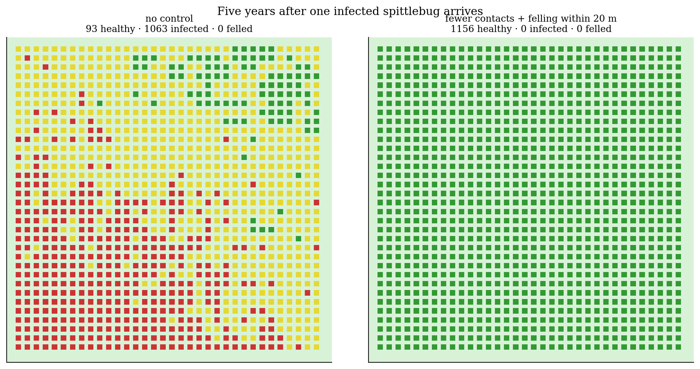 | **[002 · Olive grove *Xylella*](002-olive-grove-xylella)** | The outbreak sits on a knife-edge, and felling trees doesn't push it off. |
| 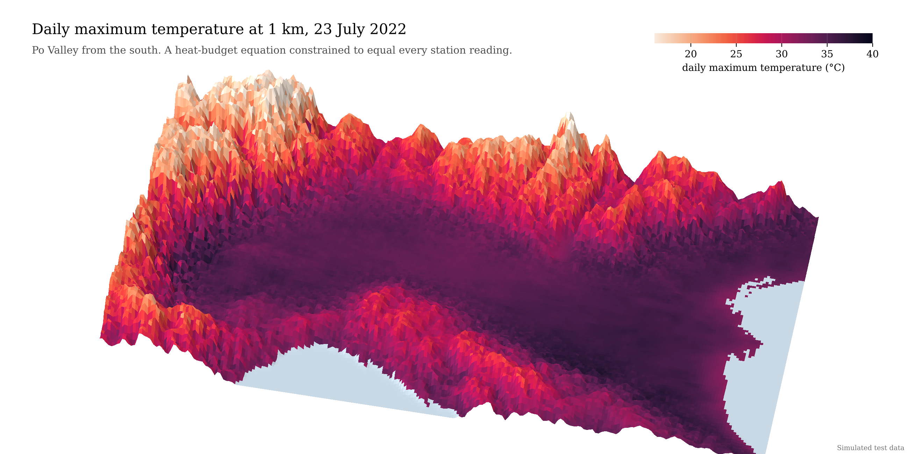 | **[003 · Po Valley temperature at 1 km](003-po-valley-downscaling)** | What is the temperature between the weather stations? A heat-budget equation made to equal every station reading, with XGBoost supplying the physics it lacks. |
| 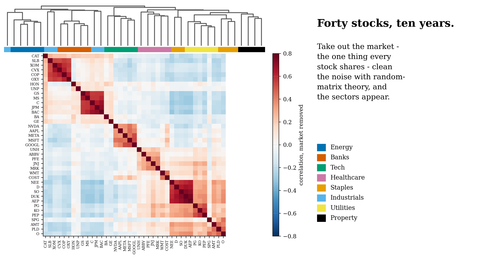 | **[004 · corrlib](004-corrlib-correlation-toolbox)** | A tested library for measuring and cleaning correlation matrices. |
| 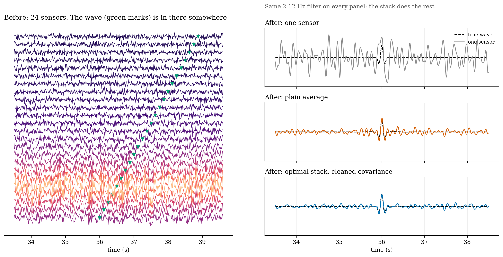 | **[005 · Seismic denoiser](005-seismic-denoiser)** | Geophysics against finance on small earthquakes under a noisy city, with one impressive result exposed as a trick. |
| 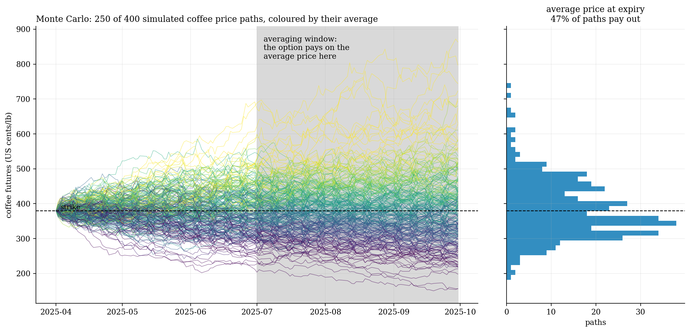 | **[006 · Option pricer](006-option-pricer)** | European, American and Asian options, from the S&P 500 to cocoa and Bangkok, and a hedge that surprises. |
| 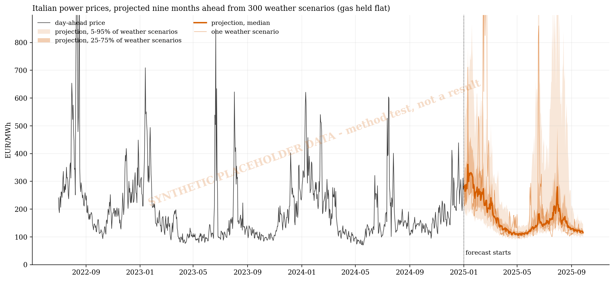 | **[007 · Italian power volatility](007-italian-power-volatility)** | Can a weather forecast see a power-price storm coming? On real 2018–2026 data, extreme months are calmer, and a perfect forecast is worth 0.7%. |
| 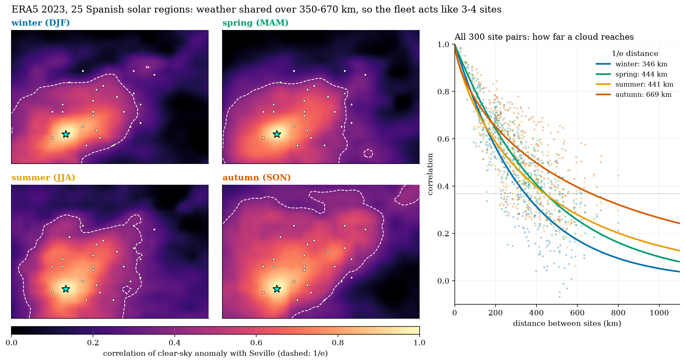 | **[008 · Spanish solar portfolio](008-spanish-solar-portfolio)** | How far does a cloud reach, from an ML-ready ERA5 dataset built with ECMWF's Anemoi? |
| 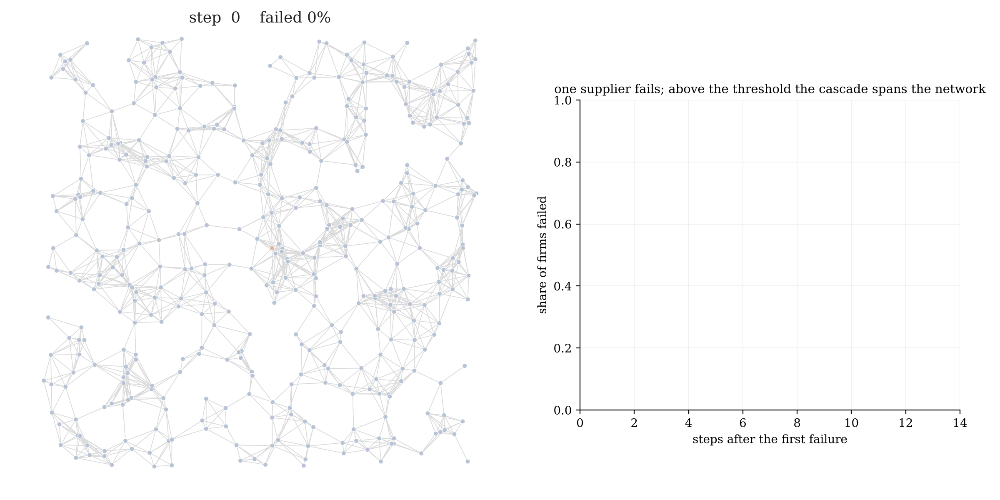 | **[012 · Ecology for bankers, revisited](012-percolation-tranche-loss)** | May's stability bound and percolation thresholds, turned on the Rhine low water and on structured credit. A maths note. |
| 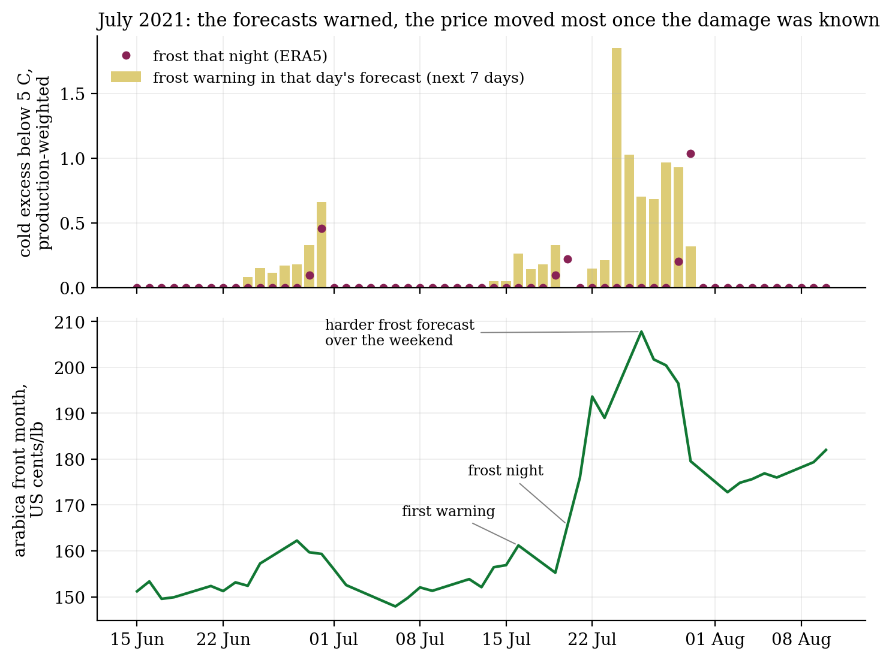 | **[013 · Coffee, frost and the forward curve](013-coffee-forward-curves)** | Does coffee move with the frost forecast or with the frost? Archived ECMWF and GFS forecasts against arabica futures and a Schwartz two-factor curve. |
| 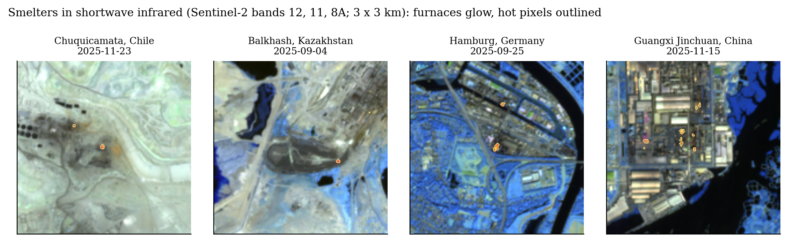 | **[014 · Copper seen from space](014-copper-satellite-signals)** | Ships at copper ports and furnaces in shortwave infrared: the supply is visible, and already in the price. |
| 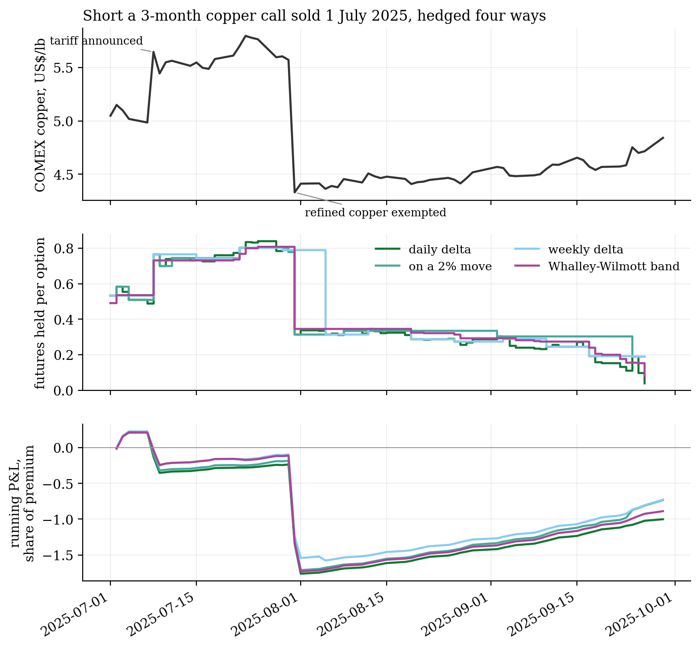 | **[015 · Hedging commodity options through a shock](015-commodity-option-hedging)** | Eight hedges on six commodities: in a shock, how you hedge barely matters; the volatility you sold at does. |
| 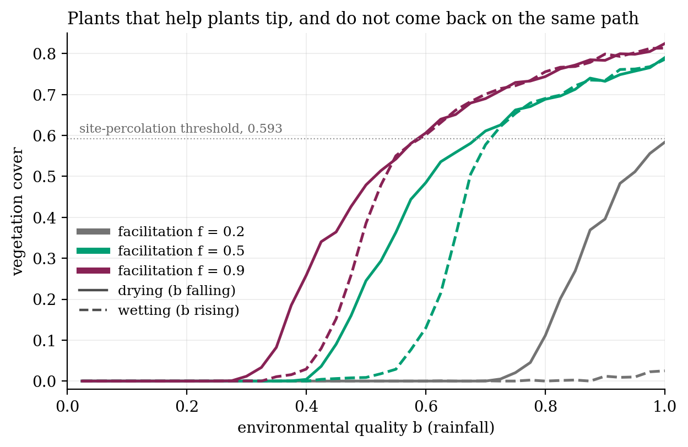 | **[016 · Desertification in the Sahel](016-sahel-desertification)** | Plants that help plants: a lattice that tips, warns from space first, and shows rain alone cannot explain which Sahel sites re-greened. |
| 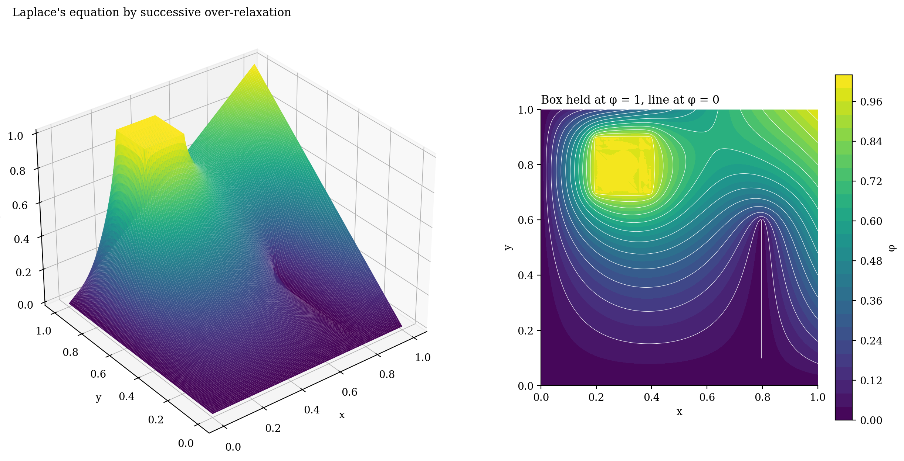 | **[009 · PDEs by over-relaxation](earlier-work/pde-solvers-cpp)** | Laplace's equation in C++ and a cost surface for SOR, then the same solver pricing American options. *Undergraduate.* |
| 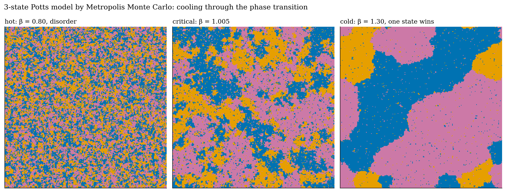 | **[010 · The Potts model](earlier-work/potts-monte-carlo-cpp)** | Monte Carlo through a phase transition, and the seed of the coral reef model. *Undergraduate.* |
| 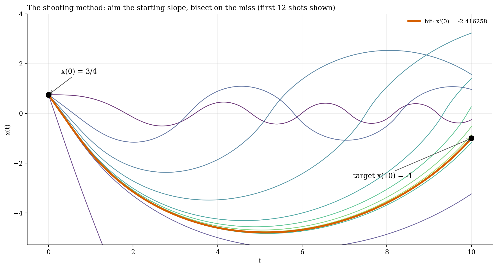 | **[011 · Higher-order ODEs](earlier-work/higher-order-odes-cpp)** | Runge–Kutta by hand, fourth-order convergence, and the shooting method. *Undergraduate.* |

**Running it.** Each folder has its notebooks with outputs saved; `pip install -r requirements.txt` covers projects 001–007 and 013–016 (014's smelter time series also needs `earthengine-api`). Project 008's dataset pipeline has its own environment (`008-spanish-solar-portfolio/iberia_datasets/requirements.txt`) and runs in Docker. CI runs the `corrlib` tests, the Po Valley solver tests and the dataset-pipeline tests on every push.

**Figures** live in each project's `figures/` folder: a `cover` image (made by `make_covers.py`, about 2,600 px wide) plus numbered figures in PNG and PDF, all in one shared style (`figstyle.py`). Figures made from simulated data carry a small footnote saying so.

**Data:** small open datasets are committed next to the code; market prices that can't be redistributed are re-downloaded by each project's scripts, and the large ERA5 dataset for 008 is attached to a GitHub Release. [`DATA.md`](DATA.md) lists every dataset, where it lives and how to get it. Open work is listed in [`NEXT_STEPS.md`](NEXT_STEPS.md).
