# Kevin Grainger: projects

I'm a quantitative analyst in London, working on climate physical risk. These are my side projects, in earth systems, signal processing and energy and commodity markets. Some grew out of my current role, and many began as numerical simulations in my theoretical physics degree. Most take a published model and change it, or apply it to a particular case.

| | Project | In one line |
|:-:|---|---|
| 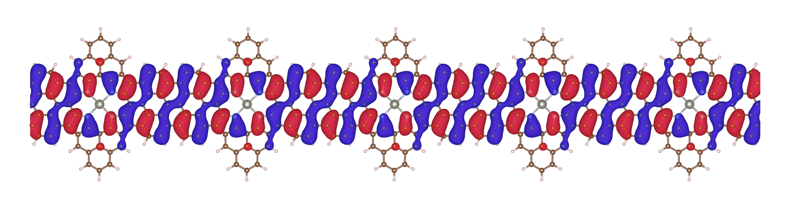 | **[001 · DFT simulations of metal-porphyrin 2D nano-networks](earlier-work/dft-porphyrin-networks)** | My capstone: how the bridge, the metal, the arms and one oxygen set the spin and gap of porphyrin networks, in FHI-aims. |
| 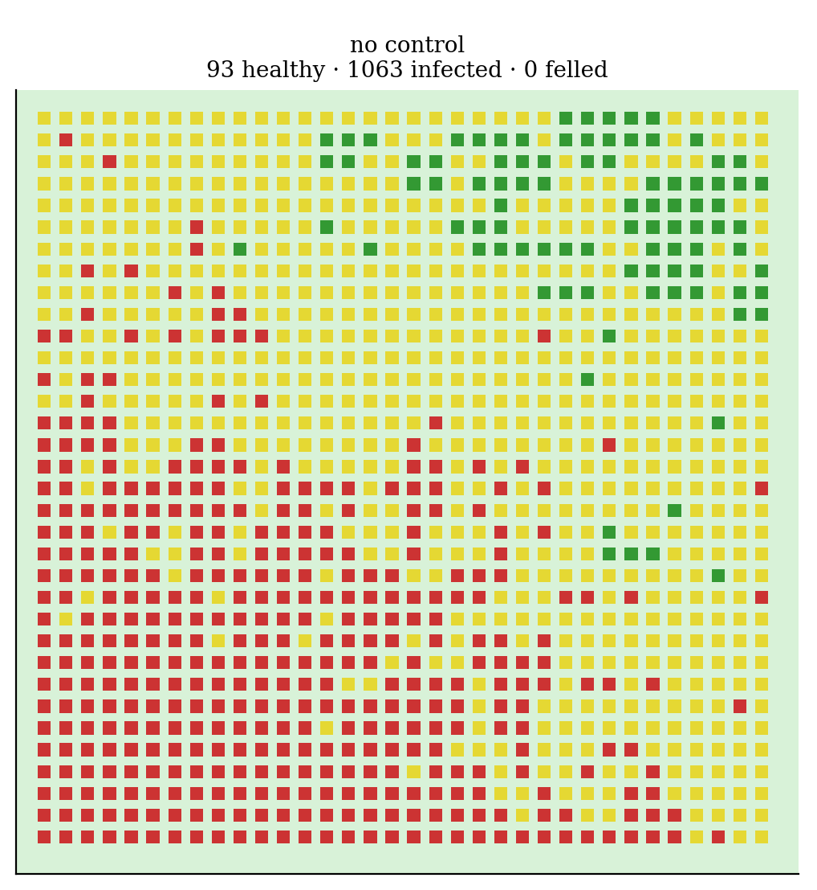 | **[002 · Olive grove Xylella, stochastic SIR](002-olive-grove-xylella)** | A lighter rebuild of an agent-based Xylella model: outbreaks usually take the whole grove, felling doesn't stop them, and a real grove near Gallipoli is the next test. |
| 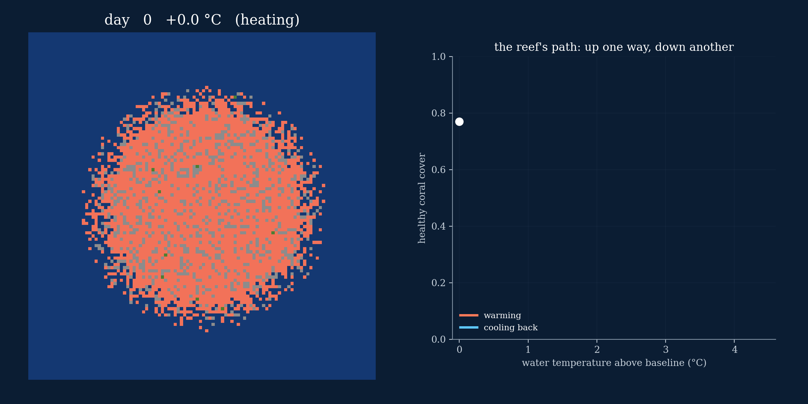 | **[003 · Coral reef tipping points](001-coral-reef-tipping-points)** | A reef modelled on a Potts lattice, which stays stuck after a heatwave, fitted to real Scott Reef surveys by simulation-based inference. |
| 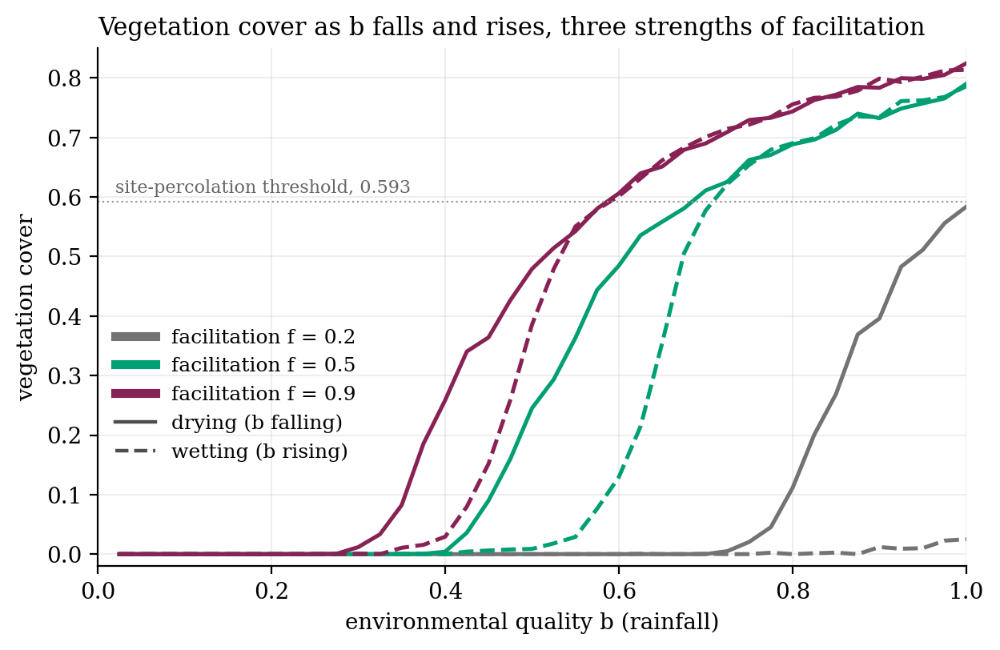 | **[004 · Sahel desertification as a lattice model](016-sahel-desertification)** | The Kéfi model: hysteresis, patch sizes as an early warning, and two real sites where rain alone can't explain the vegetation. |
| 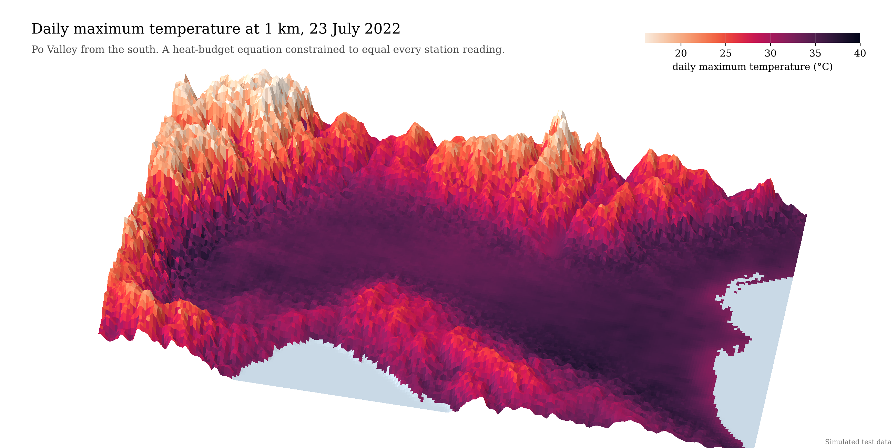 | **[005 · Po Valley mesoclimate, physics-informed machine learning](003-po-valley-downscaling)** | A heat-budget equation anchored to every station, against kriging, a U-Net and a physics-informed network, on real data. |
| 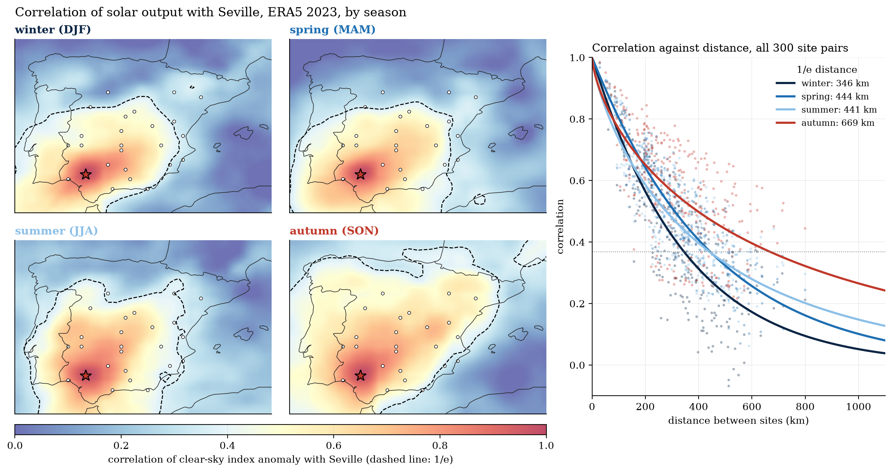 | **[006 · Correlated risk structures in a Spanish solar portfolio](008-spanish-solar-portfolio)** | How correlated 25 solar regions are, and why each site's P95 on its own underprices the fleet. |
| 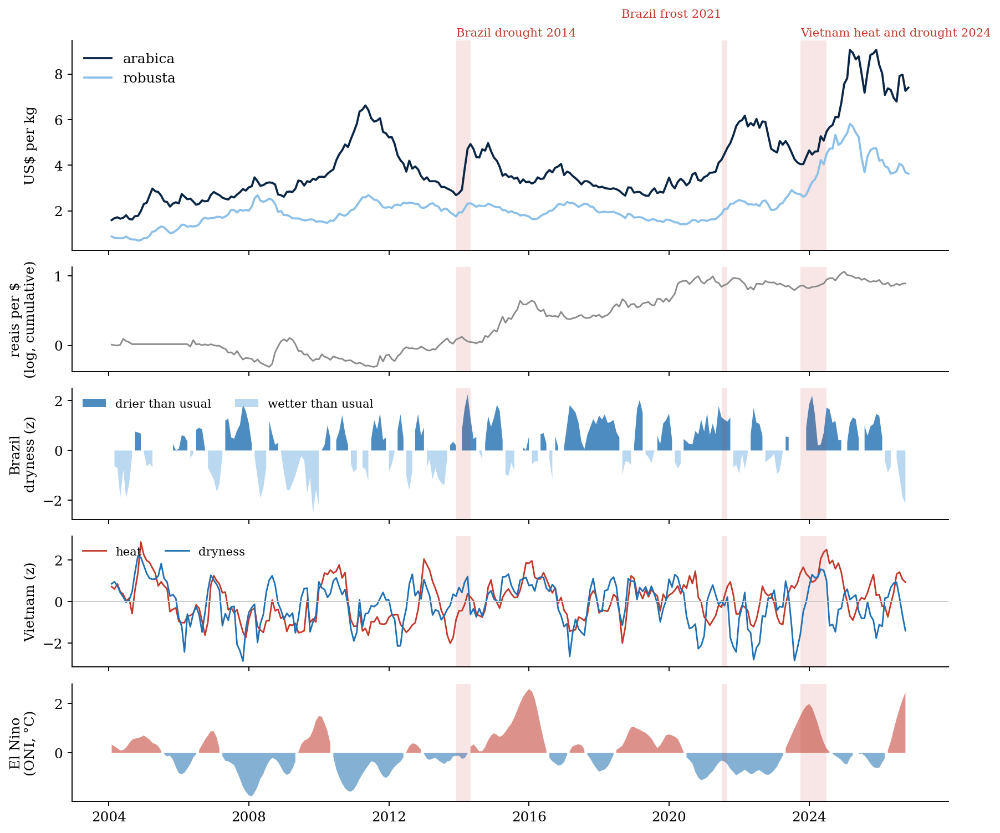 | **[007 · Weather and coffee price correlation](013-coffee-forward-curves)** | Weather in Brazil and Vietnam against arabica and robusta: copulas, compound events, a weather-informed forward curve and a seasonal forecast test. |
| 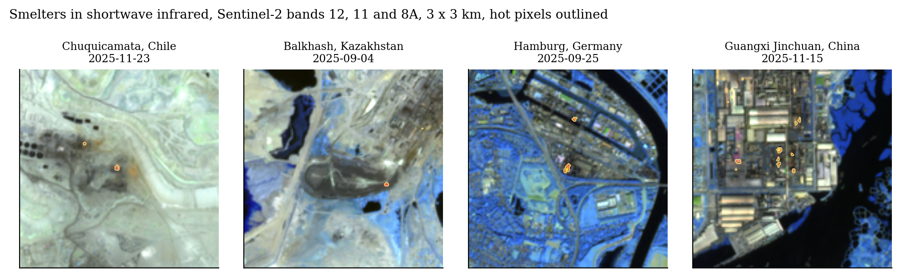 | **[008 · EO proxies for copper production intensity](014-copper-satellite-signals)** | Ships at the ports and heat at the smelters, against official exports, the price and the July 2026 Chile storm. |
| 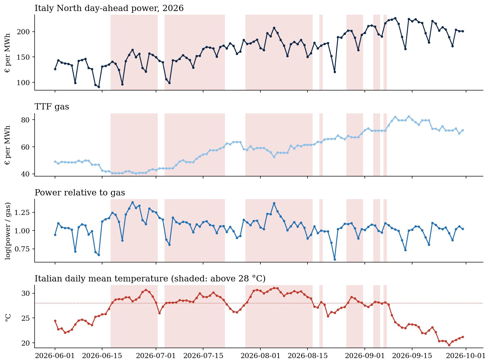 | **[009 · Weather and the Italian power price](007-italian-power-volatility)** | Gas taken out first, then the weather: heat lifts power above gas day by day, and what a seasonal forecast adds. |
| 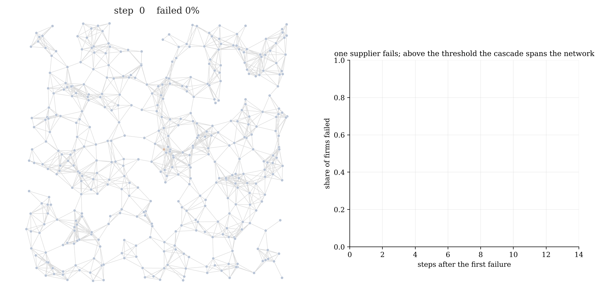 | **[010 · Supply chain risk as network percolation](012-percolation-tranche-loss)** | May's stability bound and percolation thresholds, then low Rhine water modelled three ways. A maths note. |
| 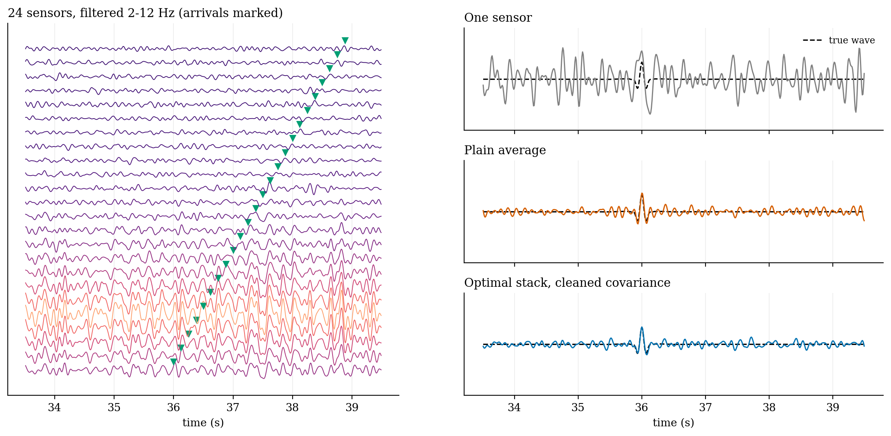 | **[011 · Seismic denoiser](005-seismic-denoiser)** | Which denoising methods keep a P-wave's arrival time and first motion on 3,000 noisy recordings. |
| 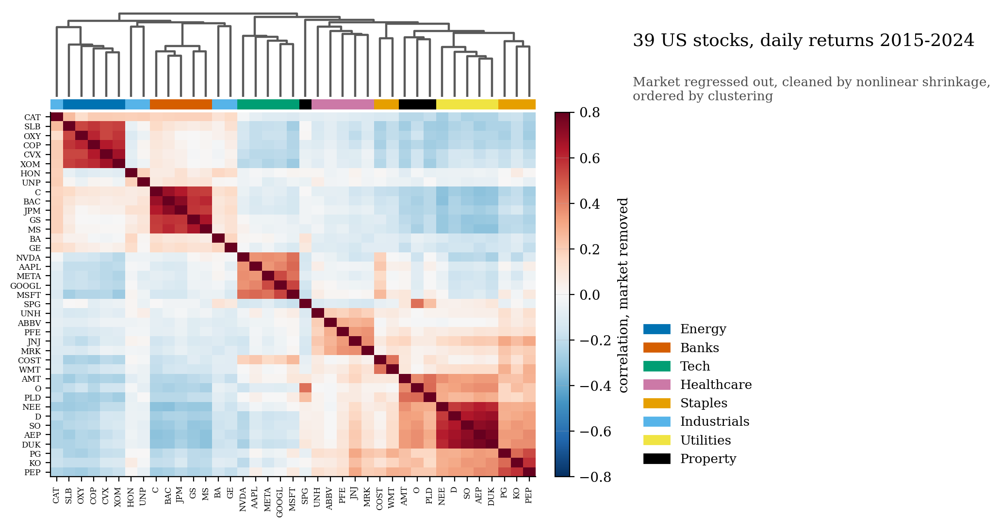 | **[012 · corrlib, a correlation library](004-corrlib-correlation-toolbox)** | A small, tested library for correlation, cleaning and array stacking, used across these projects. |
| 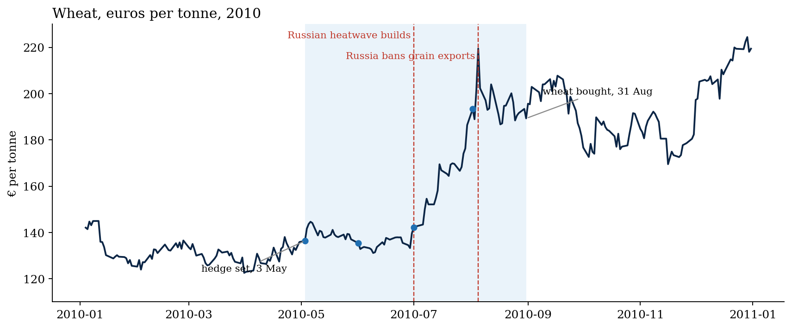 | **[013 · Hedging Italian wheat through Russia's 2010 export ban](015-commodity-option-hedging)** | Eight standard hedges for a producer and a miller through one real shock, in euros per tonne. |
| 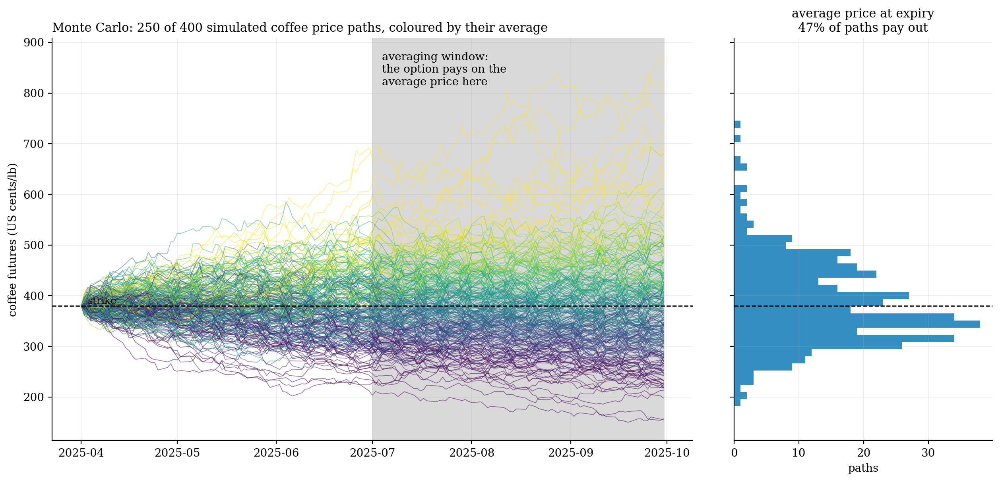 | **[014 · Asian option pricer](006-option-pricer)** | A learning project: Asian options on softs, priced three ways that check each other. |
| 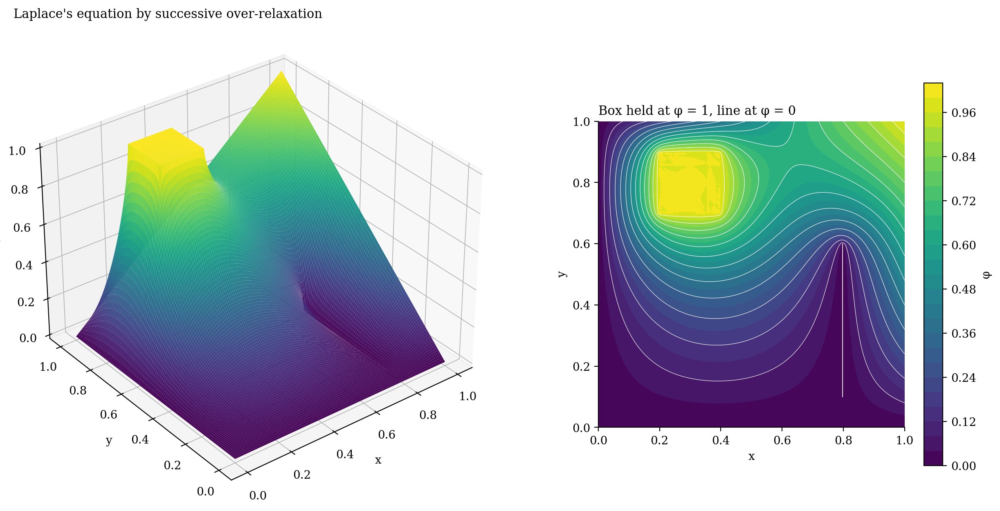 | **[015 · PDE systems by successive over-relaxation](earlier-work/pde-solvers-cpp)** | Laplace's equation in C++, the cost of SOR against its relaxation factor, and Black-Scholes. *Undergraduate.* |
| 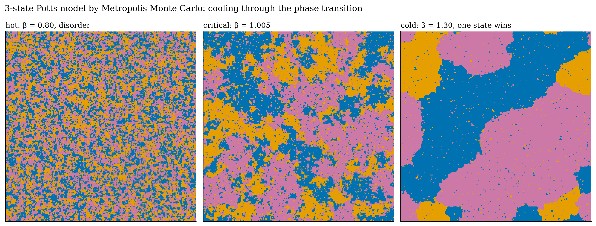 | **[016 · The Potts model by Monte Carlo](earlier-work/potts-monte-carlo-cpp)** | Continuous and first-order phase transitions, and the seed of the coral reef model. *Undergraduate.* |
| 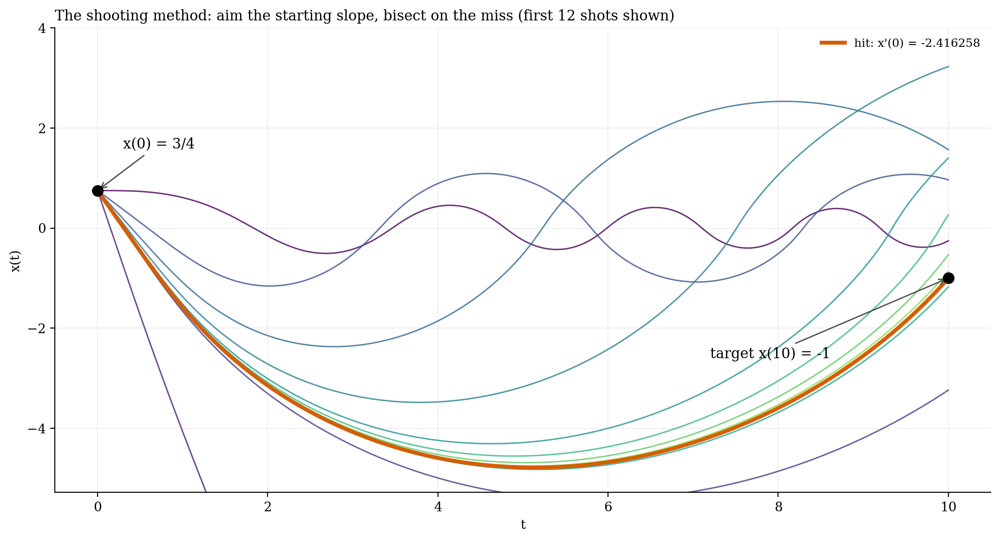 | **[017 · Higher-order ODEs](earlier-work/higher-order-odes-cpp)** | Runge-Kutta by hand, fourth-order convergence, and the shooting method. *Undergraduate.* |

The numbers follow the order on the website. The folder names keep the numbers each project was started under.

**Running it.** Each folder has its notebooks with outputs saved. `pip install -r requirements.txt` covers every project except two: the copper project's smelter time series also needs `earthengine-api`, and the Spanish solar dataset pipeline has its own environment (`008-spanish-solar-portfolio/iberia_datasets/requirements.txt`) and runs in Docker. CI runs the `corrlib` tests, the Po Valley solver tests and the dataset-pipeline tests on every push.

**Figures** live in each project's `figures/` folder: a `cover` image (made by `make_covers.py`, about 2,600 px wide) plus numbered figures in PNG and PDF, all in one shared style (`figstyle.py`). Figures made from simulated data carry a small footnote saying so.

**Data:** small open datasets are committed next to the code. Market prices that can't be redistributed are re-downloaded by each project's scripts, and the large ERA5 dataset for the Spanish solar project is attached to a GitHub Release. [`DATA.md`](DATA.md) lists every dataset, where it lives and how to get it. Open work is listed in [`NEXT_STEPS.md`](NEXT_STEPS.md).
