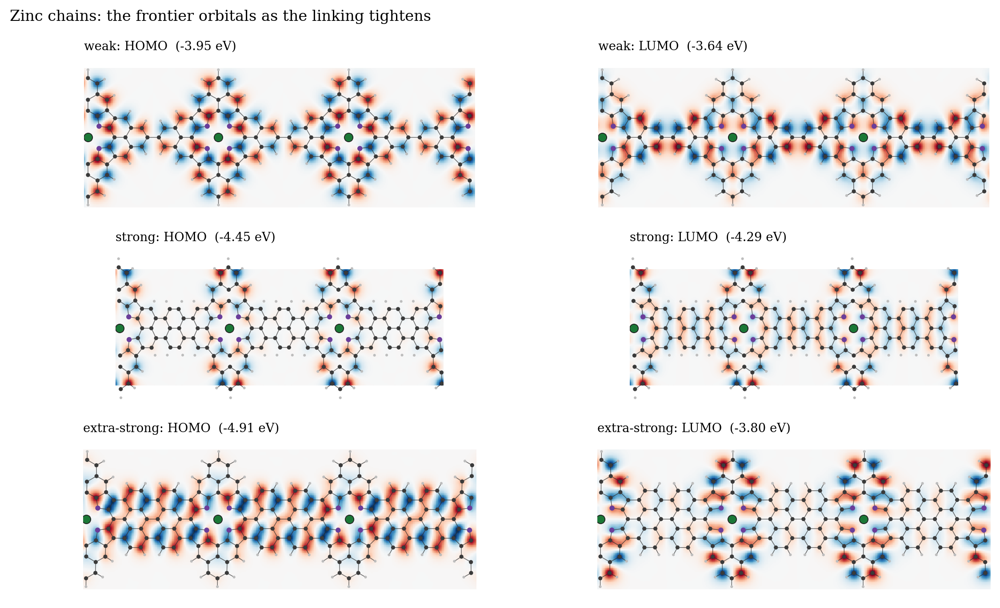
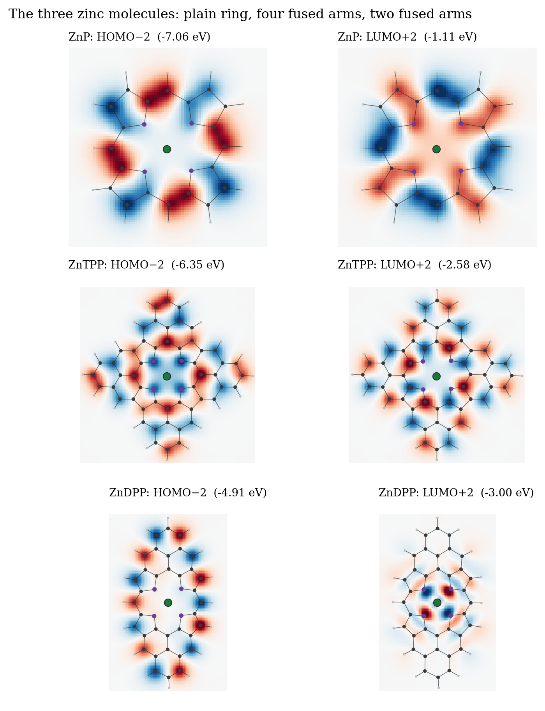
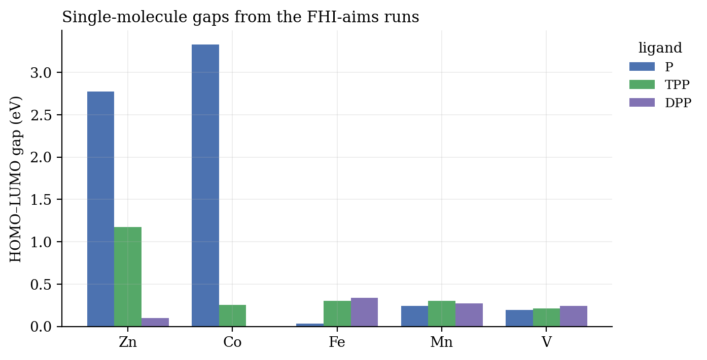
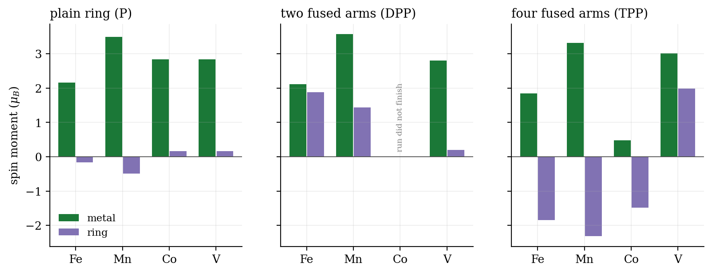
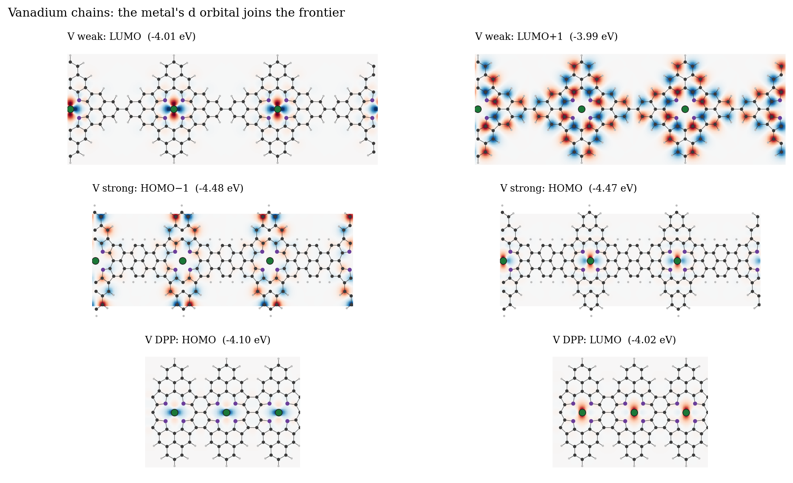
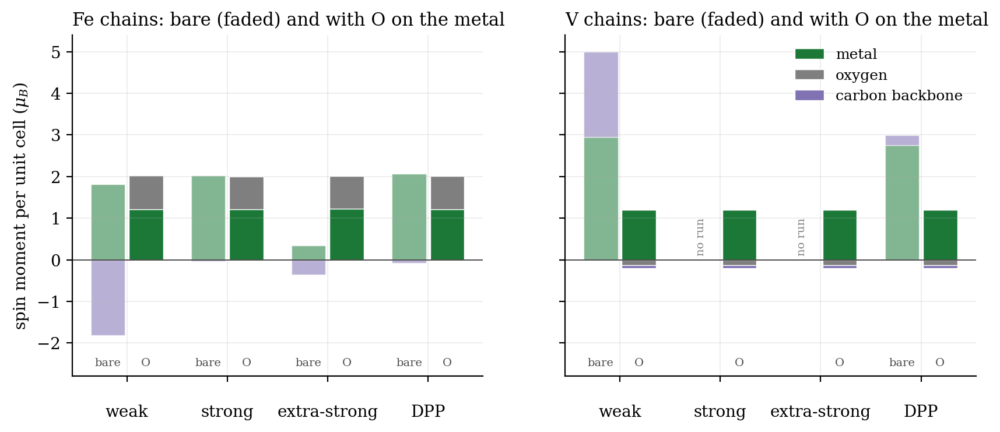
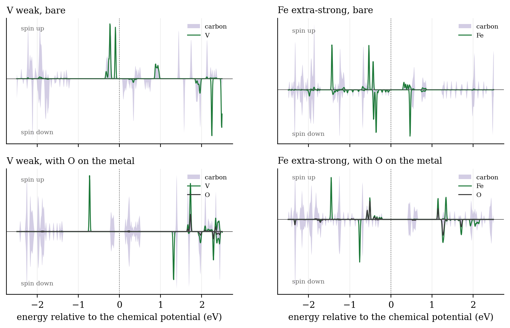
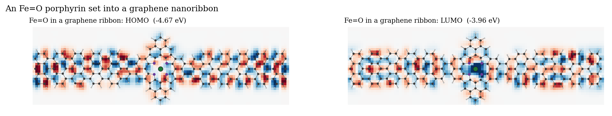

# Metal-porphyrin chains by density functional theory

*Undergraduate capstone, B.A. (Mod.) Theoretical Physics, Trinity College Dublin, 2025. Supervised by Prof. Cormac McGuinness. Calculations run in FHI-aims on Trinity's high-performance computing cluster.*


## Why I took this on

My capstone was a small part of a larger project in Cormac McGuinness's group, which studies metal-porphyrin networks grown on surfaces and measured with X-ray spectroscopy. I came into the project woefully ignorant of all things physical-chemistry. Given the whole study ran through a density functional theory code, I wanted to derive the mathematics behind it rather than treat it as a magical 'black box', and the thesis spends its first chapter on that derivation. This page is about what the calculations found, including a set of runs I never got into the thesis.

## The question

On-surface synthesis can now fuse porphyrins (flat rings of four pyrroles with a metal atom at the centre) into chains and ribbons, and the way neighbouring units are joined can be chosen. The question I set out to answer was this. When metal porphyrins are fused into a chain, does the way they are joined decide whether the chain carries a spin, and can a single molecule bound to the metal switch that spin?

The second half of the question came from my own conclusion in the thesis, that these chains could be used for chemical sensing "if a spin could be imposed via an on-metal ligand". I had run that test, with an oxygen atom bound to iron and to vanadium, but ran out of time to write it up. It is in the last results section here.

## The idea, from one molecule

Our building block is a porphyrin with fused aryl arms. In the thesis I called them "phenol" arms, but they are phenyl rings with no oxygen. With all four arms fused it is TPP, and with two fused it is DPP. The same two molecules were made on gold by Sun et al. (2020), who call them PorA₄ and PorA₂. They found something worth knowing in advance. PorA₄ is closed-shell, with every electron paired, while PorA₂ is open-shell, with two unpaired electrons and a triplet ground state.

To link our units into a chain we have three bridges to choose from: a *weak* bridge is one carbon–carbon bond between arms, a *strong* bridge is three bonds after adding two carbons, and in an *extra-strong* chain the arms are fully fused, so our backbone becomes a graphene-like ribbon. These were the bridges partly or fully made by on-surface synthesis at the time. The metal was zinc, iron, vanadium, cobalt or manganese, chosen to span the d-shell from three electrons (vanadium) to a full ten (zinc).

### How the calculation works

Density functional theory replaces the many-electron wavefunction with the electron density n(**r**), which has 3 variables instead of 3N. Hohenberg and Kohn showed the ground-state density fixes everything else, and that the true density minimises an energy functional. Kohn and Sham then wrote that functional for a stand-in system of non-interacting electrons with the same density. This turns our problem into one-electron equations, which can be written as such:

$$\Big[-\tfrac{1}{2}\nabla^2 + v_{\text{ext}}(\mathbf r) + \int \frac{n(\mathbf r')}{|\mathbf r-\mathbf r'|}\,d\mathbf r' + v_{xc}[n](\mathbf r)\Big]\psi_i(\mathbf r) = \epsilon_i\,\psi_i(\mathbf r), \qquad n(\mathbf r)=\sum_i^{\text{occ}}|\psi_i(\mathbf r)|^2$$

Where v_ext is the pull of the nuclei, the integral is the repulsion of the electron cloud with itself, and v_xc (exchange–correlation) holds everything quantum the other terms leave out. The potential depends on n, which depends on the orbitals ψᵢ. We guess a density, solve, rebuild the density and repeat until it stops changing, which is the self-consistent field cycle. For spin we solve two sets of these equations, one per spin channel, with v_xc depending on both densities. In our case v_xc is the PBE functional, our orbitals are expanded in FHI-aims' numeric atom-centred basis, and each chain is one unit cell repeated along x and sampled with 30 k-points.

## What I expected, and what happened

I expected the metal to set the electronics and the bridge to matter less, but the zinc chains show the bridge matters a great deal. This is easiest to see with zinc because its full d shell stays out of the way, so we see our carbon backbone on its own.



We see that with a weak bridge the highest occupied orbital (HOMO) sits on each porphyrin separately, and only the lowest empty one (LUMO) reaches across the bridge. With an extra-strong bridge the HOMO runs the whole length of the chain without a break. This is what a conducting backbone looks like. This does not mean the gap simply shrinks, though, and the three gaps are as such: 0.31 eV for weak, 0.05 eV for strong and 0.78 eV for extra-strong. A fully fused chain is a narrow graphene ribbon, and narrow ribbons are known to open a gap again, so the rule I started with (more fusion, smaller gap) only holds up to a point.



The single molecules gave the clue I missed at the time. In a calculation without spin, ZnTPP has a clean 1.17 eV gap while ZnDPP's collapses to 0.10 eV. My abstract read this as the ligands widening the gaps, which these numbers do not support. A near-zero gap in a run where every orbital must hold two electrons is the sign of two half-filled orbitals, ie. the open-shell PorA₂ that Sun et al. measured. This means my DPP runs were seeing the triplet before I knew to look for it.



### Every magnetic metal follows the arms

Zinc only shows the backbone. To see what the arms do to a spin we need a metal that has one, and I ran the three molecules with spin switched on for iron, manganese, cobalt and vanadium. Summing the Mulliken spin over the metal and over the ring (carbon, nitrogen and hydrogen) splits each molecule's moment in two.



We see the same pattern for every metal. On the plain ring the spin sits on the metal and the ring carries almost none. With two fused arms (DPP) the ring picks up its own spin, about 1.9 μB for iron and 1.4 μB for manganese, pointing the same way as the metal's. This is the triplet of PorA₂ again, now coupled to the metal, and for iron it gives 4 μB in total. Sun et al. (2022) measured iron in PorA₂ on gold at about 3.7 μB with the ring and the metal coupled ferromagnetically, so our FePorA₂ agrees with the experiment on both the size and the direction. Vanadium is the weak case here, with only 0.2 μB on the ring.

With four fused arms (TPP) the ring again carries about 2 μB, but now pointing against the metal for iron, manganese and cobalt, so the iron molecule cancels to zero overall. PorA₄ is closed-shell on its own, so in our case it is the metal that draws the spin out of the ring. Vanadium goes the other way, with its ring spin parallel. I would treat the TPP result more carefully than the DPP one, since it has not been measured and PBE is known to overstate this kind of spin polarisation. Nickel, like zinc, has no unpaired electron, and its gaps (3.37 eV for NiP, 1.16 eV for NiTPP) sit almost on top of zinc's (2.77 and 1.17 eV). This is a useful check that the closed-shell metals leave the backbone alone. Copper does have an unpaired electron, but I only ran it without spin, so I have left it out.

We can now add a metal with an open d shell. Vanadium and iron bring their d orbitals to the frontier (the states nearest the gap), and in our vanadium chains the HOMO and LUMO are almost entirely the metal's d orbital, and the backbone is barely involved.



## The runs I never wrote up: one oxygen on the metal

For iron and vanadium every chain was run twice with spin switched on: once bare, and once with a single oxygen bound to the metal 1.6 Å below the ring, which gives iron–oxo (Fe=O) and vanadyl (V=O) chains. To see where the spin goes we can sum FHI-aims' Mulliken spin over each element, which splits our total moment into the part on the metal, the part on the oxygen and the part on the carbon backbone.



We see first that the bare chains do not agree with each other. In the strong and DPP iron chains the 2 μB sits on the iron. In the weak and extra-strong iron chains the iron's spin is matched by an opposite spin on the carbon backbone and the two cancel. In the weak vanadium chain the backbone carries 2 μB of its own, parallel to the vanadium's 3, for 5 μB in total. Only the metal was given a starting moment, so the backbone spin appeared by itself. This means the bridge decides whether our backbone is magnetic. This is the open-shell physics of PorA₂ again, now in a chain: a weak bridge leaves each unit's unpaired electrons free, while a strong bridge lets them pair up across the join.

We find that with the oxygen bound, every chain lands in the same state whatever the bridge. Fe=O carries 2 μB shared between iron (1.2) and oxygen (0.8), which is the known S = 1 of an iron(IV)–oxo porphyrin. V=O carries exactly 1 μB on the vanadium, the S = ½ of a vanadyl porphyrin. The backbone spin goes to zero in all of them.



The density of states shows why. In the bare chains the metal's states sit right at the chemical potential, mixed in with the carbon states. With the oxygen bound they are pushed away from it, and we see the one vanadium electron become a single sharp spin-up state 0.75 eV below the chemical potential with nothing from the backbone mixed in. This means the spin and the conduction now live in different places: the spin on the V=O unit, the conduction in our carbon bands. The gap of each chain changes too, from 0.18 to 0.27 eV for vanadium weak and from 0.34 to 0.64 eV for iron extra-strong.

So, to answer the question: the bridge decides whether a bare chain is magnetic, and one oxygen on the metal overrides that, leaving a single local spin and a backbone gap that the bridge still sets. This is the sensing mechanism my conclusion hoped for. It is also what the work on vanadyl qubits is after, a spin-½ that stays put on a conjugated bridge we can tune.

I also set an Fe=O porphyrin into a graphene nanoribbon (260 atoms). There the frontier orbitals run along the ribbon and the spin sits on the ribbon's carbons, not the iron.



## How I checked it

We can start with the molecules, since those have been measured. Our ZnTPP and ZnDPP contrast matches Sun et al. (2020), closed-shell PorA₄ and open-shell PorA₂. For iron in PorA₂, Sun et al. (2022) measured about 3.7 μB with the ring and metal spins aligned, and our molecule gives 4 μB with the ring and metal spins aligned. Next, the oxo chains land on the textbook spin of each unit, S = 1 for Fe=O and S = ½ for V=O, and a setup error would be unlikely to give both. Finally, every run used here converged to 10⁻⁵ in the density and 10⁻⁵ eV in the energy. Many runs were repeated as the geometries were corrected, and the copies agree to within a few meV.

## What went wrong, and what I learned

The cobalt chains never settled properly, and even their carbon states did not line up with the other metals. Of 45 cobalt runs only six finished, the cobalt DPP molecule among the failures, and none of the seven manganese chains finished at all. Sun et al. later found cobalt in PorA₂ dominated by a Kondo effect on gold, so cobalt was always going to be the hardest case. I ran out of time before running the spin-polarised bare vanadium strong and extra-strong chains, so those two have only the oxo half of the comparison. The pictures of the single molecules show one state below and one above the frontier, because those were the states I saved.

The biggest lesson was about reading my own numbers. The open-shell result was in my table from the start, and I described it as a gap widening because I did not yet know what an open-shell molecule looks like in a closed-shell calculation.

The limits are real, and there are three of them. PBE is known to be unreliable for spin states in iron porphyrins, so a +U correction or a hybrid functional would be the next check. The bare iron chains may depend on where each calculation started, since the spin settled differently from chain to chain. With one metal per unit cell our calculation forces every metal to point the same way, which means it cannot give the coupling between neighbouring spins.

## What I'd do next

I'd like to double the unit cell so neighbouring spins can point opposite ways, and compute the exchange coupling J between them for each bridge. For the V=O chains this is the coupling between two qubits through the bridge. I would also repeat the iron chains with DFT+U and several starting moments, to see which bare states survive. Then I'd compute how strongly O, NO and CO bind to each metal, to turn the sensing idea into a number. Last, the chain belongs on Au(111), since charge transfer to gold is what makes PorA₄ open-shell in the experiments.

## Reproducing the figures

The raw FHI-aims runs (about 35 GB, in a folder I prepared for Cormac) are not in this repository. The extracted tables are in `data/`. With the runs available:

```
THESIS_DATA=~/Documents python make_figures.py
CORMAC=~/OneDrive/Desktop/"For Cormac" python make_orbitals.py
CORMAC=~/OneDrive/Desktop/"For Cormac" python make_spin_figures.py
```

## Credits

- Sun, Mateo, Robles, Ruffieux, Lorente, Bottari, Torres & Fasel (2020), *Inducing open-shell character in porphyrins through surface-assisted phenalenyl π-extension*, J. Am. Chem. Soc. 142, 18109. The molecules this project is built on.
- Sun et al. (2022), *Magnetic interplay between π-electrons of open-shell porphyrins and d-electrons of their central transition metal ions*, Adv. Sci. 9, 2105906.
- Gao, Menchón, Garcia-Lekue & Brandbyge (2023), *Tunable spin and conductance in porphyrin–graphene nanoribbon hybrids*, Commun. Phys. 6.
- Wäckerlin et al. (2010), *Controlling spins in adsorbed molecules by a chemical switch*, Nat. Commun. 1, 61.
- Blum et al. (2009), *Ab initio molecular simulations with numeric atom-centered orbitals*, Comput. Phys. Commun. 180 (FHI-aims). Makino & Aihara (2012) for the earlier oligoporphyrin study.

Python · FHI-aims · density functional theory · spin-polarised DFT · Mulliken analysis · matplotlib
