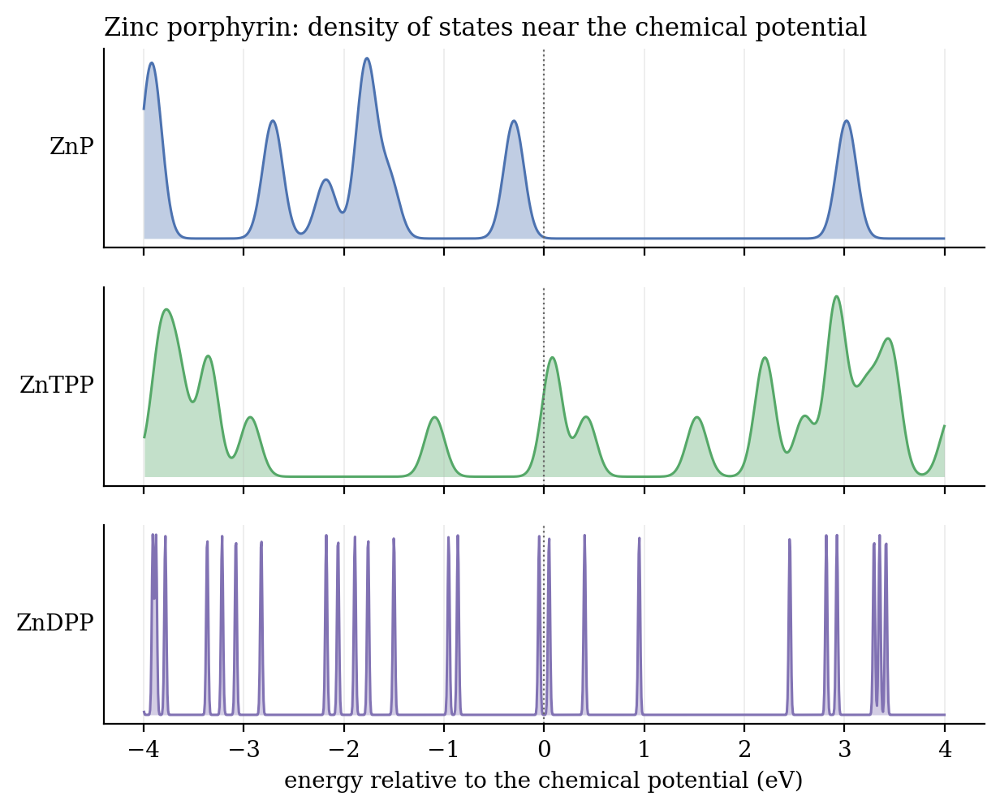

# Metal-porphyrin networks by density functional theory

*Undergraduate capstone, B.A. (Mod.) Theoretical Physics, Trinity College Dublin, 2025. Supervised by Prof. Cormac McGuinness. Calculations run on Trinity's high-performance computing cluster.*

> **DRAFT for Kevin.** Sections marked ✎ need your own words; Claude must not invent motives or memories. Delete this box when done.

## Why I took this on

✎ *What drew you to the project, and what you knew (or didn't) going in. Your acknowledgements already have the honest line about starting "woefully ignorant of all things physical-chemistry"; build from that.*

## What I set out to do

Recent on-surface synthesis can join metal porphyrins (flat ring molecules with a metal atom at the centre) into chains, ribbons and sheets. My project was to calculate what that does to their electronic structure: whether the joined networks conduct, and how that depends on the central metal (Zn, Co, Fe, Mn, V) and on electron spin.

## How I calculated it

✎ *The derivation section: the energy functional, why DFT trades the many-electron wavefunction for the density, the Hohenberg–Kohn theorems (your appendix proves them), and how FHI-aims solves the Kohn–Sham equations self-consistently. A scanned hand-written page fits here.*

I worked up in size: the single molecule first (plain porphyrin P, then with four phenyl arms, TPP, then with two dehydrogenated arms, DPP), then the repeating unit of a network, then the full periodic network.

## What the single molecules show


The first thing I compared was the HOMO–LUMO gap (highest filled to lowest empty state) of each molecule on its own, for the bare ring (P), with four phenyl arms (TPP) and with two dehydrogenated arms (DPP).



For zinc, adding the phenyl arms closes the gap a long way: from 2.77 eV for plain porphyrin to 1.17 eV for ZnTPP and 0.10 eV for ZnDPP, as new states appear close to the chemical potential. Cobalt behaves the same way. For iron, manganese and vanadium the gap is already small for the bare molecule, and the arms widen it slightly.

> **Check against the thesis.** The abstract says the dehydrogenated phenol ligands *widened* the gaps. In these outputs that holds for Fe, Mn and V, but Zn and Co go the other way. ✎ *Which runs did the thesis compare? This is worth a sentence either way: it is exactly the kind of check a panel likes to see.*

## Networks and spin

✎ *Next figures to redraw from `Final Bands/`: band structures for the weak, strong and extra-strong linked chains, and the spin-up / spin-down channels for Co, Fe and V.*

## What I'd do next

✎ *Your conclusions: spin-tunable conductance, chemical sensing if a spin can be fixed with an on-metal ligand, exciton dynamics.*

## Reproducing the figures

The raw FHI-aims runs (several GB) are not in this repository. The extracted gaps are in `data/molecule_gaps.csv`. With the runs available:

```
THESIS_DATA=/path/to/folder/with/Zinc/and/Molecules\ Analysis python make_figures.py
```

## Credits

FHI-aims (Blum et al. 2009). ✎ *Add the on-surface synthesis paper the thesis builds on (thesis ref. [1]) and the earlier porphyrin-network study (ref. [2]).*
