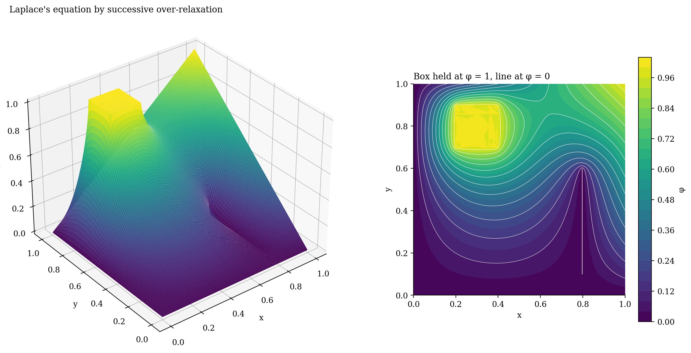
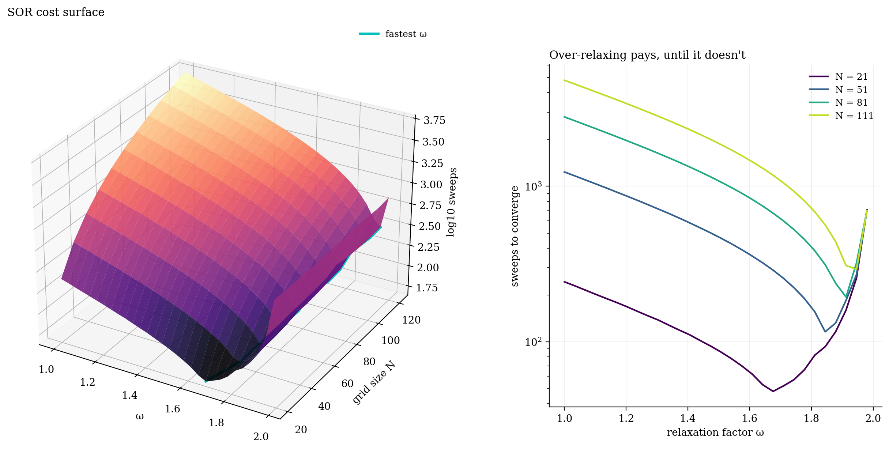
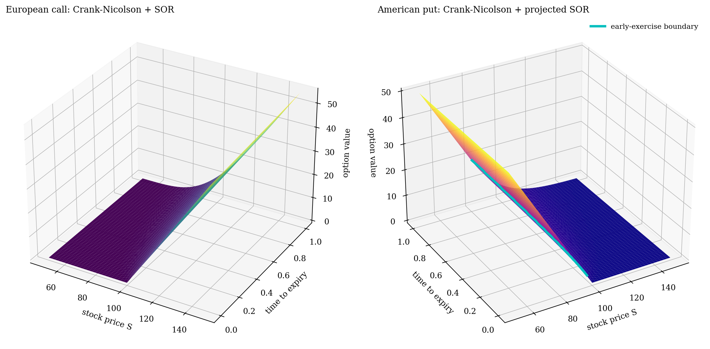
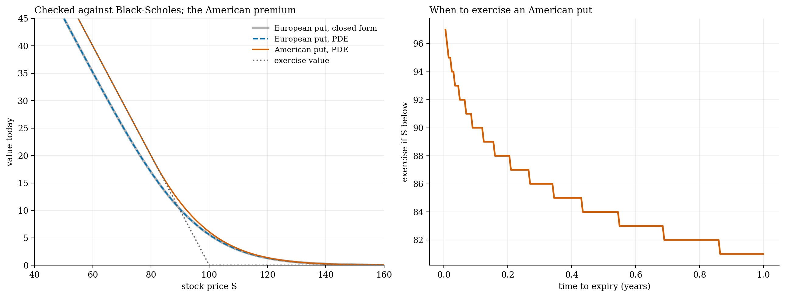
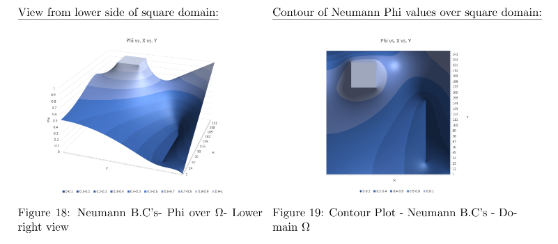

# PDE systems by successive over-relaxation

**Undergraduate work in C++, re-plotted with a Numba port, with the same SOR machinery applied to Black–Scholes.**

This was a lab project at Trinity: solving an elliptic PDE system (Laplace's equation on a square grid, with fixed potentials inside it and both Dirichlet and Neumann boundaries) by successive over-relaxation. SOR sweeps the grid, replaces each point with the average of its neighbours, and then pushes past that average by a relaxation factor ω so as to converge faster. In our case ω decides almost everything about the cost: too low and the sweeps crawl, too close to 2 and they oscillate.

I ported the C++ to Python with Numba in order to study that cost properly, mapping the number of sweeps over ω and grid size (the "parameter surface"). The port matches the C++, giving the same derivative at (2/5, 1/2), 1.732. At the optimal ω it converges in 760 sweeps (1.1 s), against 4,047 at ω = 1.8. We see the best ω climb towards 2 as the grid refines, close to the theoretical 2 / (1 + sin(π/(N−1))).

The same SOR machinery then solves the Black–Scholes equation, stepping back in time from expiry and solving each time step by SOR. Our solver agrees with the closed-form price to within 0.003.

| | |
|:-:|:-:|
|  |  |
|  |  |

Also here: a numerical study of the Schrödinger equation ([report](report_schrodinger.pdf)).

`*.cpp` · `pde_numba.py` · `../make_figures.py` · [report](report_pde_solvers.pdf) · C++, Python, Numba
