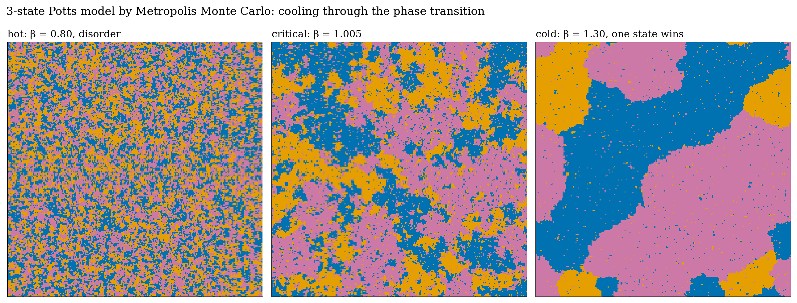

# The Potts model by Monte Carlo

**Undergraduate work: Metropolis Monte Carlo for the 3-state Potts model, cooled through its phase transition.**

Every site on our grid holds one of three states and prefers to match its neighbours. At high temperature the grid is disordered, and at low temperature one state takes over. In between, at the critical temperature, domains of every size appear at once. The Metropolis algorithm samples this by proposing single-site changes and accepting them with Boltzmann probability.

We see the magnetisation jump from about 0.1 to 0.9 over a narrow range of inverse temperature β. Fluctuations peak at β ≈ 1.04, close to the exact β_c = ln(1 + √3) ≈ 1.005, and the shift is expected on a 24 × 24 lattice. The report's run put the transition at β ≈ 1.06. It discarded the first 4,000 of 10,000 steps for thermalisation, and the code kept here discards 5,000. In the report, the q = 5 run gives a first-order transition, much sharper, near β ≈ 1.23, as theory expects for q above 4. The snapshots come from a 256 × 256 Python + Numba port of the C++ code. The same model, scaled up, became the [coral reef project](../../001-coral-reef-tipping-points).

`MC.cpp` · `mc_results.csv` · `../make_figures.py` · [report](report_potts.pdf) · C++, Python, Numba

*Undergraduate coursework, 2024. Exact critical point from Baxter (1973).*
